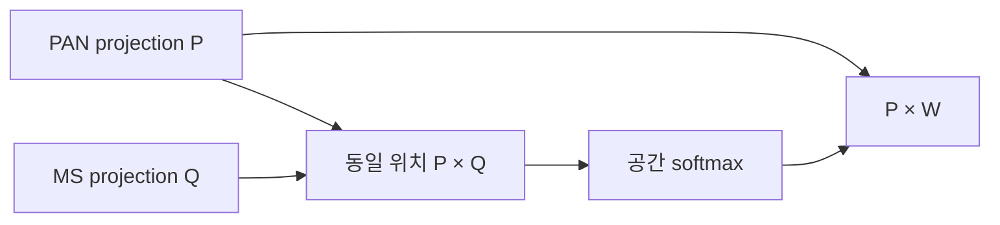
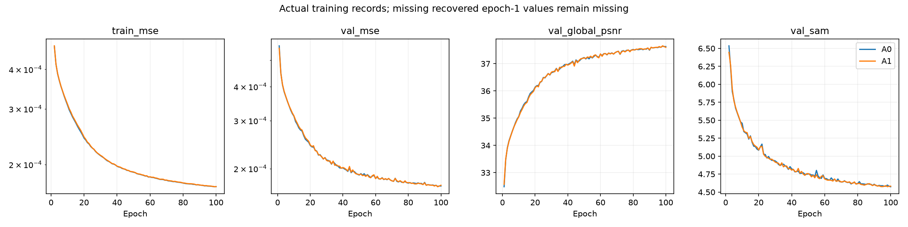
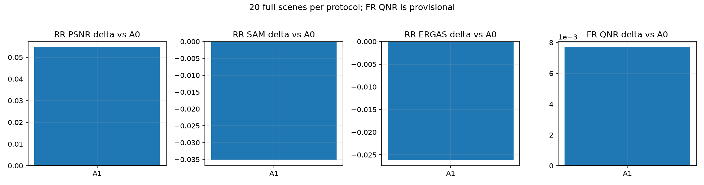
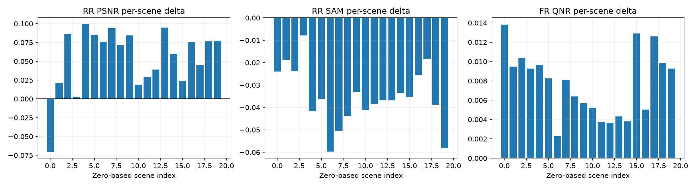
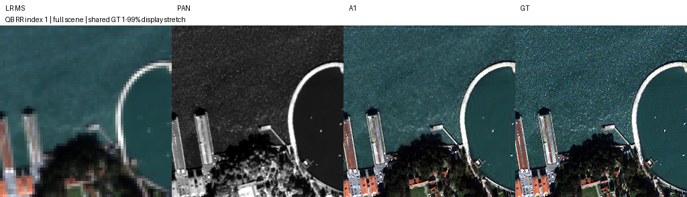
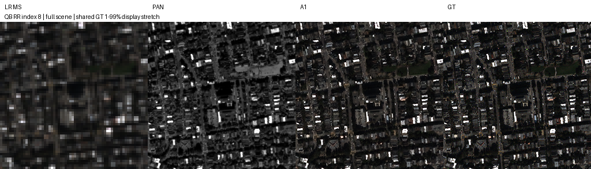
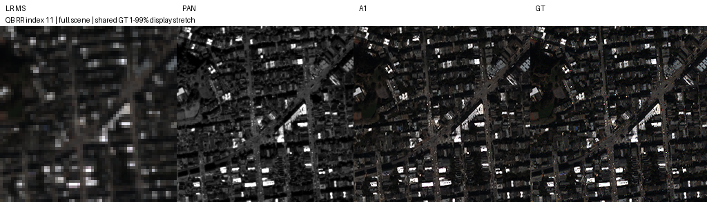
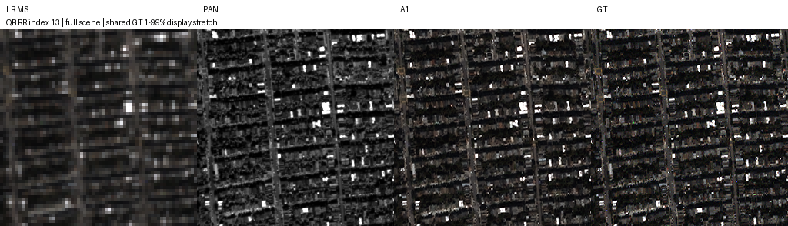
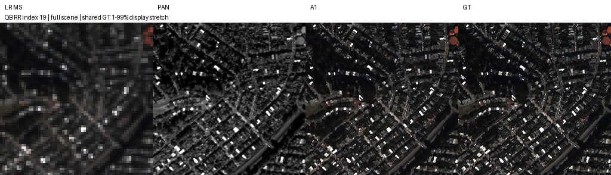

# SSAI 1 · SSAI 공간 좌표 정렬

**연구 분야:** SSAI 개선 (`ssai`)<br>
**실험자:** 이병현<br>
**변경 내용:** 원본의 두 공간 전치를 제거해 같은 위치의 PAN·MS 특징을 결합했습니다.

| 확인된 결과 | 상태 | 개선 여부 |
|---|---|:---:|
| 원본 대비 RR PSNR +0.054514dB, SAM -0.035102°, 잠정 FR QNR +0.007682입니다. | 평가 완료 | 개선 |

[전체 SSAI 표](../../../README.md#ssai-experiments) · [연구 분석](../../../research/ssai/README.md) · [실행 설정](config.json)

## 1. 목적과 상태

정렬된 PAN·MS 입력의 대응을 SSAI 내부에서도 유지하면 복원에 도움이 되는지 비교했습니다.

2026-10-14에 학습 완료 원본과 validation-selected best를 확인하고 RR·FR 각20개 전체 장면 평가를 마쳤습니다. A0와 후보를 각100에폭 학습했습니다. best는100에폭 중 validation MSE가 가장 낮은98에폭이고 latest는100에폭입니다. 학습 완료와 전체 평가 완료를 실제 checkpoint·complete·장면별 JSON으로 각각 확인했습니다.

## 2. 변경한 구조와 비교 조건

대조군 A0는 **원본 SSA-MRN·K=4·기본 MSE·단일 복원·공간 확대4배**입니다. 최신 반복 복원이나 backbone 개선 후보로 대체하지 않았습니다.

각 SSAI 블록은 PAN `N×1×H×W`와 현재 C채널 MS 특징에 대상 밴드 하나를 붙인 `N×(C+1)×H×W`를 입력받습니다. PAN은3×3 conv·ReLU·3×3 conv, MS 입력은3×3 conv로 K채널 특징 P·Q가 됩니다. SSAI 출력은 `N×K×H×W`이며 C개 밴드를 연결한 후 원본3×3 conv·PReLU로 C채널에 융합합니다. 전체·절반·1/4 크기에 적용하고 작은 크기부터 두 번2배 확대해 복원합니다.

원본 정사각 logit은 `Pᵀ⊙Q`입니다. A1은 `Z=P⊙Q`, `W=softmax_HW(Z)`, `Y=P⊙W`로 계산합니다. projection·공간 softmax·PAN Value·후속 밴드 융합은 그대로 유지했습니다.



| 조건 | 실제 설정 |
|---|---|
| 데이터·분할 | QB 기존 H5 train17,139·validation1,905 패치, 원본 분할·2047 정규화를 유지했습니다. |
| 형상 | train PAN/LMS64×64·MS16×16, RR PAN/LMS256×256·MS64×64, FR PAN/LMS512×512·MS128×128입니다. |
| 학습 | seed42, Adam lr1e-4·betas0.9/0.999·eps1e-8·weight decay0, MSE, 일정LR,100에폭입니다. |
| 배치·정밀도 | 유효 배치32, CUDA FP32·AMP 없음·TF32 off·결정론·cuDNN benchmark off입니다. |
| 실제 경로 차이 | A0·A1의1-3에폭은 micro4,4-100에폭은 micro32입니다. A2는1-100에폭 모두 micro32입니다. 변경 전 원본 소스·설정·초기 가중치를 보존했습니다. |
| 초기값·순서 | 공통 초기 state와 시드별 DataLoader 순서를 유지했고, GPU cache의 샘플 순서·generator 상태 대응을 검증했습니다. 마지막 부분 배치도 포함했습니다. |
| 환경 | Ryzen5600X·RAM16GB·RTX3060Ti8GB, Python3.10.6·PyTorch2.7.1+cu128·CUDA12.8입니다. |
| 병렬·데이터 공급 | 동시2개·micro32·GPU 학습 데이터 cache입니다. 평가와 inference 비용은 단독 실행했습니다. |
| 선택 | 최소validation MSE, 정확한 동률은 최초epoch를 유지했습니다. test로checkpoint·계수·예시를 선택하지 않았습니다. |

SSAI 외 backbone·복원 구조·연결부·손실·보간(`bilinear`, `align_corners=True`)·데이터 처리는 바꾸지 않았습니다. 내부 특징 차원K=4와 공간 확대4배는 서로 다른 설정입니다.

## 3. 정량 결과

RR·FR은 각각 원본 H5의20개 전체 장면 평균입니다. 예측을 자르거나 clipping하지 않았습니다. validation PSNR은 정규화global MSE 기반이며, 아래 test PSNR은 공통 코드의 밴드별 평균·peak2047입니다. 두 정의를 혼용하지 않습니다. FR에는GT가 없으며 QNR·Q2n·SCC의 MATLAB parity는 미검증입니다.

| 모델 | best epoch | validation MSE ↓ | RR PSNR ↑ | SAM ↓ | ERGAS ↓ | SCC ↑ | Q2n ↑ | FR Dλ ↓ | Ds ↓ | 잠정 QNR ↑ |
|---|---:|---:|---:|---:|---:|---:|---:|---:|---:|---:|
| A0 | 98 | 0.000172125583 | 37.417961 | 4.964835 | 4.129406 | 0.976691 | 0.921426 | 0.046719 | 0.042283 | 0.913482 |
| A1 | 98 | 0.000171569884 | 37.472475 | 4.929733 | 4.103310 | 0.976980 | 0.921924 | 0.042774 | 0.038139 | 0.921165 |

후보−A0 차이는 PSNR +0.054514dB, SAM -0.035102°, ERGAS -0.026097, 잠정 QNR +0.007682입니다. validation MSE 차이는 -0.3228%입니다. A1는20장 중 PSNR 19장, SAM 20장, 잠정 QNR 20장에서 개선했습니다. [장면별 원본과 공유 평균](results/evaluation/summary.json)을 보존했습니다.

전체 등록 파라미터는 두 모델 모두426,654개입니다. 사용하지 않는 원본 계층도 포함한 수이며 Conv MACs는 실제 forward에서 실행한 연산만 셌습니다.

| 입력 크기 | Conv GMACs | A0 median ms | 후보 median ms | peak allocated MiB A0 / 후보 |
|---|---:|---:|---:|---:|
| 64×64 | 1.244 | 15.249 | 14.228 | 6.90 / 6.90 |
| 256×256 | 19.904 | 16.863 | 15.549 | 85.01 / 85.01 |
| 512×512 | 79.614 | 29.158 | 28.024 | 334.95 / 334.95 |

비용은 단독 CUDA FP32에서 같은 합성 입력·3회 워밍업·10회 동기화 측정의 median입니다. p95와 예약메모리는 [profile 원본](results/evaluation/A1/profile.json)에 있습니다. Conv MACs는 보간·softmax/sigmoid·메모리 이동을 포함한 전체FLOPs가 아니며 짧은 합성 측정값을 실제 서비스 속도로 확대 해석하지 않습니다.

## 4. 기준선 대비 차이와 해석

A0·A1은 같은 시드·초기값·샘플 순서와 같은 micro batch 변경 시점을 유지했습니다. 같은 조건에서 RR PSNR·SAM·ERGAS·SCC·Q2n과 잠정 FR QNR·Dλ·Ds가 함께 개선했습니다. 단일 QB seed42 결과이며 반복 시드·센서 확장과 독립 holdout은 아직 없습니다. 이 판정은 현재 비교의 관측 개선이며 기준 모델의 최종 채택을 뜻하지 않습니다.

실험들을 서로 합치거나 학습 조건이 다른 과거K6·AMP 결과와 절댓값 순위를 매기지 않았습니다. 기존 test는 선행 탐색에 사용됐으므로 독립 최종 holdout으로 주장하지 않습니다. 작은 단일 시드 차이에 통계적 유의성을 부여하지 않습니다.

## 5. 학습·평가 그래프



대조군과 후보의 실제 100에폭 compact 기록입니다. 복구된 A0·A1의1에폭 train MSE·SAM·시간은 당시 미저장되어 빈값으로 유지했습니다. validation MSE는 실제checkpoint에서 복구했습니다. 누락값을 추정·보간하지 않았습니다.





## 6. 결과 이미지

사전 고정한 RR zero-based index1·8·11·13·19를 전체 장면·오름차순으로 표시합니다. 패널은 **LR MS·PAN·예측·GT** 순서입니다. QB RGB 표시밴드는 `[2,1,0]` 가정이며 LR MS는 nearest 확대, MS·예측·GT는 해당 GT의1-99% 대비를 공유하고 PAN은 별도 대비를 사용했습니다. 이는 표시용이며 수치평가에는 적용하지 않았습니다. FR에는GT를 만들지 않았습니다.











## 7. 재현 자료

[원본 best/latest](checkpoints) · [compact 학습 기록](results/training) · [전체 RR·FR 원본](results/evaluation) · [모델](model.py) · [설정](config.json) · [학습 당시 소스](provenance/training_source.zip) · [실제 실행 plan](provenance/plan.json) · [평가 당시 소스](provenance/evaluator.py) · [파일 해시](manifest.json)

공유 A0도 실험 안에 원본 best/latest로 함께 보관했습니다. SSAI 1에는 최적화 이전 초기 A0·A1 best/latest와 해당 소스도 보존합니다. 학습 당시 source와 checkpoint 내부의 역사적 이름·경로·plan을 변경하지 않았습니다. 현재 모델의 경로는 strict load·CPU 추론으로 확인합니다. 파일 해시 검증과 실제 성능 평가는 별개입니다.

```bash
python SSA-MRN/common/verify.py --research-track ssai --experiment 1
python SSA-MRN/common/checkpoint.py --research-track ssai --experiment 1 --checkpoint checkpoints/A1_QB_s42/best.pt
```

두 번째 명령은 데이터 없이 strict load·CPU 추론만 수행합니다. 전체 성능 재평가는 [공유 평가 도구](../../../common/ssai_evaluate.py)에 원본 H5와 보존한 validation-selected checkpoint를 지정하고 새 출력 경로를 사용합니다.

```bash
python SSA-MRN/common/ssai_evaluate.py --source-root SSA-MRN --runtime SSA-MRN/experiments/ssai/1_spatial_alignment --data /path/to/test_h5 --output /tmp/ssai_1_evaluation --arms A0 A1
```

기본 재평가는 CUDA FP32이며 `--device cpu`를 지정할 수 있습니다. 평가 당시 원본 코드는 provenance에 그대로 보존했습니다.

## 8. 개선 여부와 다음 단계

**판정: 개선.** A0·A1은 같은 시드·초기값·샘플 순서와 같은 micro batch 변경 시점을 유지했습니다. 같은 조건에서 RR PSNR·SAM·ERGAS·SCC·Q2n과 잠정 FR QNR·Dλ·Ds가 함께 개선했습니다. 단일 QB seed42 결과이며 반복 시드·센서 확장과 독립 holdout은 아직 없습니다. 이 판정은 현재 비교의 관측 개선이며 기준 모델의 최종 채택을 뜻하지 않습니다.

다음 단계는 가설을 고정한 동일 조건의 QB 반복 seed43·44와 필요시 GF2·WV3 확장입니다. 이 보고서의 후속 학습은 실행하지 않았습니다. 기준 모델은 원본 K4·MSE로 유지합니다.
