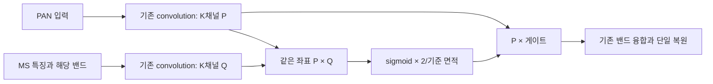
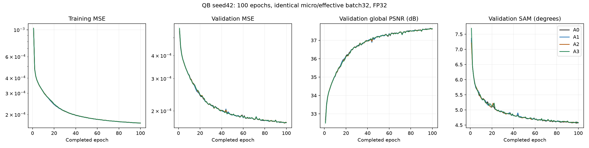
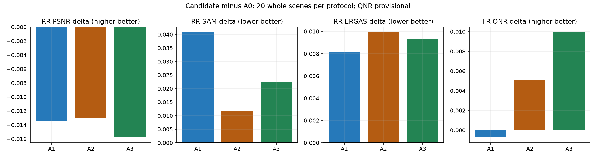
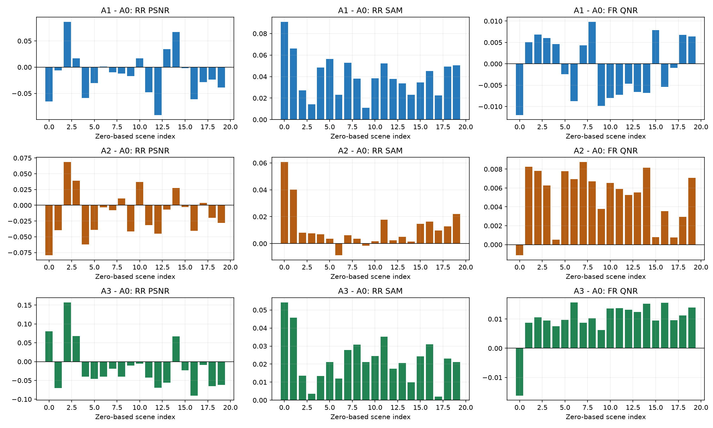
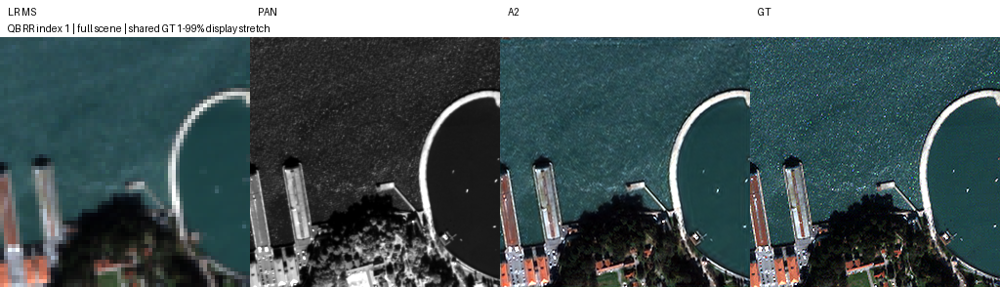
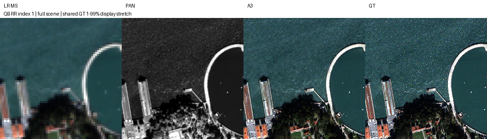
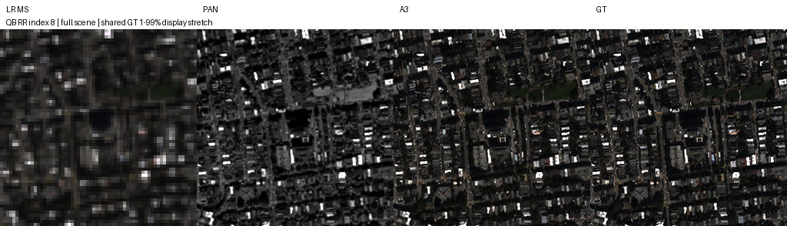
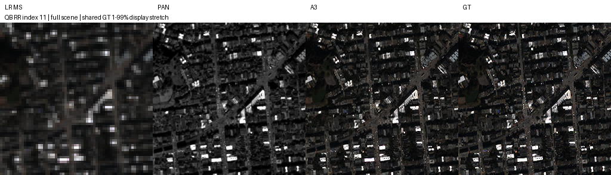
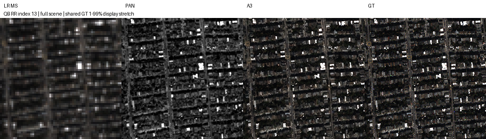
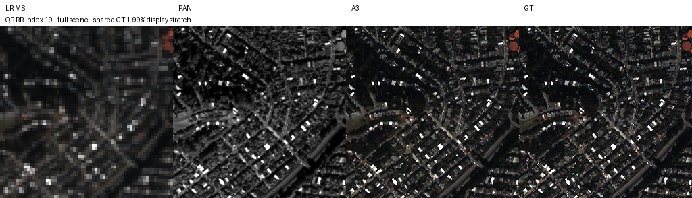

# 4. 공간 좌표 정렬과 sigmoid 게이트 결합

**연구 분야:** SSAI 개선 (`ssai`) **실험자:** 이병현 **변경 내용:** 같은 위치의 PAN·MS 특징을 곱하고 기준 크기 sigmoid 게이트로 융합합니다.

| 확인된 결과 | 상태 | 개선 여부 |
|---|:---:|:---:|
| A3의 RR PSNR -0.015761dB·SAM +0.022620°, 잠정 FR QNR +0.009932입니다. | 평가 완료 | 부분 개선 |

[실행 설정](config.json) · [원본 숫자](results/evaluation/summary.json) · [보존 manifest](manifest.json)

## 1. 목적과 상태

공간 좌표 정렬과 sigmoid 게이트의 결합 효과를 검증했습니다. 네 후보를 각 100에폭 학습했고, validation으로 선택한 98에폭 best에서 RR·FR 각 20개 전체 장면을 평가했습니다. 총 160개 예측의 장면별 지표와 후보별 고정 RR 예시 5장을 보존했습니다. 실제 best/latest 8개와 학습 당시 소스·설정을 함께 보관했습니다.

A3는 FR 지표가 좋아졌지만 RR 주요 지표와 validation MSE는 악화해 부분 개선입니다. 기준 모델은 원본 SSA-MRN으로 유지합니다.

## 2. 변경한 구조와 비교 조건

대조군은 원본 SSA-MRN·K=4·MSE·단일 복원·공간 확대 4배입니다. backbone·복원·연결부·손실·보간·데이터 처리·분할은 바꾸지 않았습니다. 내부 특징 차원 K=4와 공간 확대 4배는 서로 다른 값입니다.

각 밴드 SSAI는 PAN `N×1×H×W`와 현재 C채널 MS 특징에 해당 밴드를 붙인 `N×(C+1)×H×W`를 입력받습니다. 기존 PAN convolution·ReLU·convolution과 MS convolution이 각각 K채널 특징 P·Q를 만듭니다. 출력은 `N×K×H×W`이며, 기존 밴드 연결·융합·작은 크기부터 복원하는 구조로 전달합니다. 새 파라미터는 없습니다.

| 후보 | 좌표 연산 | 가중치 연산 |
|---|---|---|
| A0 | 원본 전치·reshape | 공간 softmax |
| A1 | 같은 좌표의 P×Q | 공간 softmax |
| A2 | 원본 전치·reshape | `(2/A_ref) × sigmoid(Z)` |
| A3 | 같은 좌표의 P×Q | `(2/A_ref) × sigmoid(P×Q)` |

원본 정사각 입력의 logit은 `Pᵀ⊙Q`이며 직사각 입력에는 reshape 재배열이 포함됩니다. A3의 출력은 `P × [(2/A_ref) × sigmoid(P×Q)]`입니다. 전체·절반·1/4 크기의 기준 면적은 각각 4096·1024·256이며 학습 형상에서 고정했습니다. test로 계수를 조절하지 않았습니다.

| 비교 조건 | 실제 공통 설정 |
|---|---|
| 데이터 | QB 원본 H5 train 17,139·validation 1,905 패치, 정규화 2047, 추가 augmentation 없음 |
| 입력 형상 | 학습 PAN/LMS 64×64·MS 16×16, RR 256×256·MS 64×64, FR 512×512·MS 128×128 |
| 초기값·순서 | seed42, 같은 초기 파라미터·샘플 순서, 이전 실험 가중치에서 시작하지 않았습니다. |
| 학습 | Adam lr1e-4·betas0.9/0.999·eps1e-8·weight decay0, MSE, 일정 LR, 100에폭 |
| 배치·정밀도 | 첫 에폭부터 유효 배치32·micro32·FP32, AMP 없음·TF32 off·결정론 |
| 실행 | RTX3060Ti8GB·Ryzen5600X·RAM16GB, PyTorch2.7.1+cu128, 독립 캐시·최대 두 학습 병렬 |
| 선택 | 최소 validation MSE, 정확한 동률은 최초 에폭을 선택했습니다. test로 선택하지 않았습니다. |

GPU 응답 정지 후 A0 72에폭·A1 73에폭 latest에서 원본 optimizer·난수 상태를 복원하고 미완료 에폭을 다시 계산했습니다. 소스·설정·배치·정밀도는 유지했습니다. 장애의 근본 원인은 미확정입니다. 실제 기록은 [복구 검증](provenance/recovery_20261014/checkpoint_check.json)과 [재개 검증](results/resumed_check.json)에 보존했습니다.

## 3. 정량 결과

모든 행은 같은 조건의 새 대조군과 비교합니다. RR·FR 각각 20장면의 평균이며 전체 장면 추론에 clipping을 적용하지 않았습니다. validation PSNR은 정규화 global MSE 기반이고 RR test PSNR은 밴드별 평균·peak2047이므로 정의를 구분합니다. FR에는 정답이 없으며 QNR·Q2n·SCC의 MATLAB 일치 검증은 미완료입니다.

| 후보 | best epoch | validation MSE ↓ | RR PSNR ↑ | SAM ↓ | ERGAS ↓ | SCC ↑ | Q2n ↑ | FR Dλ ↓ | Ds ↓ | 잠정 QNR ↑ |
|---|---:|---:|---:|---:|---:|---:|---:|---:|---:|---:|
| A0 | 98 | 0.000171550928 | 37.453589 | 4.928274 | 4.110100 | 0.976948 | 0.923239 | 0.045167 | 0.039614 | 0.917411 |
| A1 | 98 | 0.000172080500 | 37.440087 | 4.968995 | 4.118260 | 0.976872 | 0.922021 | 0.042811 | 0.042720 | 0.916668 |
| A2 | 98 | 0.000171701993 | 37.440578 | 4.939821 | 4.120005 | 0.976758 | 0.922445 | 0.039728 | 0.039773 | 0.922514 |
| A3 | 98 | 0.000172315303 | 37.437828 | 4.950894 | 4.119439 | 0.976914 | 0.923042 | 0.037648 | 0.036947 | 0.927342 |

| 후보 | validation MSE 차이 | PSNR 차이 | SAM 차이 | ERGAS 차이 | 잠정 QNR 차이 | 판정 |
|---|---:|---:|---:|---:|---:|:---:|
| A1 | +0.3087% | -0.013502 | +0.040720 | +0.008160 | -0.000742 | 개선 없음 |
| A2 | +0.0881% | -0.013011 | +0.011547 | +0.009905 | +0.005104 | 부분 개선 |
| A3 | +0.4456% | -0.015761 | +0.022620 | +0.009338 | +0.009932 | 부분 개선 |

파라미터는 모두 426,654개이고 실행된 convolution MACs도 같습니다. 아래는 단독 CUDA 추론의 3회 warmup·10회 반복 중앙값입니다. 합성 입력을 사용했고 이 작은 시간 차이를 안정적인 속도 개선으로 확정하지 않습니다. convolution MACs에는 softmax·sigmoid·원소 곱·메모리 이동 비용이 포함되지 않습니다.

| PAN/LMS 크기 | Conv GMAC | A0 ms | A1 ms | A2 ms | A3 ms | 최대 allocated MiB, 공통 |
|---|---:|---:|---:|---:|---:|---:|
| 64×64 | 1.244 | 15.425 | 14.227 | 15.425 | 14.438 | 6.90 |
| 256×256 | 19.904 | 15.539 | 16.311 | 17.339 | 15.331 | 85.01 |
| 512×512 | 79.614 | 28.335 | 27.750 | 28.024 | 27.407 | 334.95 |

GPU 학습 데이터 캐시를 포함한 병렬 학습의 reserved memory와 위 단독 추론 allocated memory는 서로 다른 측정입니다. [후보별 원본 profile](results/evaluation/summary.json)에는 p95·reserved memory도 보존했습니다.

## 4. 기준선 대비 차이와 해석

A3는 원본보다 RR PSNR·SAM·ERGAS·SCC·Q2n이 악화하고 FR Dλ·Ds·QNR이 개선했습니다. A2보다 잠정 QNR은 +0.004828이지만 RR PSNR은 -0.002749dB·SAM은 +0.011073°로 나빠졌습니다. 두 변경을 결합하면 모든 지표가 함께 좋아진다는 가설은 지지되지 않았습니다.

A1은 주요 RR 지표와 잠정 QNR 모두 악화했습니다. A2는 RR 지표가 악화하고 FR QNR이 개선했지만 Ds는 악화했습니다. 기존 1번의 관측 개선은 처음 3에폭 micro4 경로를 포함하므로 이번의 처음부터 micro32 결과와 조건이 다릅니다. 이전 가중치·결과를 바꾸거나 같은 결과로 합치지 않았습니다.

| 후보 | PSNR 개선 장면 | SAM 개선 장면 | 잠정 QNR 개선 장면 |
|---|---:|---:|---:|
| A1 | 6/20 | 0/20 | 9/20 |
| A2 | 6/20 | 2/20 | 19/20 |
| A3 | 4/20 | 0/20 | 19/20 |

장면별 차이를 모두 보존했고 유리한 장면만 선택하지 않았습니다. [상호작용 숫자](results/interaction.json)의 `A3−A1−A2+A0`는 단일 시드의 기술적 비교이며 유의성 검정이 아닙니다. 기존 QB test는 이미 탐색에 사용한 자료로 독립 최종 holdout이 아닙니다. 반복 시드·센서 확장은 아직 하지 않았습니다.

## 5. 학습·평가 그래프

각 후보의 완료된 1-100에폭 실제 MSE·validation MSE·PSNR·SAM 기록입니다. 중단된 미완료 에폭은 완료 에폭으로 추가하지 않았습니다.

아래는 후보−A0 평균 차이입니다. PSNR·QNR은 양수가 개선이고 SAM·ERGAS는 음수가 개선입니다.

## 6. 결과 이미지

사전 고정한 zero-based 장면 인덱스 1·8·11·13·19, seed42, 전체 장면·오름차순을 유지했습니다. 각 이미지는 LR MS·PAN·예측·정답 순서의 4패널입니다. MS는 nearest 표시 확대, RGB는 가정한 밴드 [2,1,0], MS·예측·정답은 같은 장면 GT의 1-99% 대비를 공유하며 PAN은 별도 대비입니다. 예시는 결과를 보고 바꾸지 않았습니다. FR 정답은 만들지 않았습니다.

같은 장면 1에서 원본·두 단일 변경과 아래 A3를 비교할 수 있습니다.

**A0 · 원본 대조군 · 장면 1**

**A1 · 공간 좌표 정렬 · 장면 1**

**A2 · 기준 크기 sigmoid 게이트 · 장면 1**

**A3 · 장면 1**

**A3 · 장면 8**

**A3 · 장면 11**

**A3 · 장면 13**

**A3 · 장면 19**

모든 후보의 나머지 고정 예시도 [평가 자료](results/evaluation/)에 보관했습니다.

## 7. 재현 자료

[모델](model.py), [현행 설정](config.json), [실제 학습 계획](provenance/plan.json), [학습 당시 소스·설정](provenance/training_source.zip), [실제 평가 소스](provenance/evaluator.py), [가중치 에폭·해시](provenance/checkpoint_records.json)를 제공합니다. 체크포인트 내부 config는 원본 그대로 보존했습니다.

A0·A1·A2·A3 각각의 `checkpoints/<후보>_QB_s42/best.pt`와 `latest.pt`를 보존했습니다. best는 validation-selected 98에폭, latest는 100에폭입니다. [전체 평가 완료 근거](results/evaluation/complete.json), [장면별 지표·평균·선택 기록](results/evaluation/summary.json), [실제 학습 기록](results/training/), [가중치 strict load·추론 검증](results/checkpoint_verification.json)을 제공합니다.

`python SSA-MRN/common/verify.py --research-track ssai --experiment 4`는 보존 파일 해시를 확인합니다. 위 실제 성능 평가는 별도로 완료했습니다. 원격 푸시 후 새 checkout에서 가중치 해시·strict load·추론을 다시 확인합니다.

## 8. 개선 여부와 다음 단계

**판정: 부분 개선.** A3의 FR은 개선했지만 RR과 validation은 악화했습니다. 세 후보 모두 새 A0보다 최저 validation MSE가 높아 사전 계획의 후속 반복 기준을 통과하지 못했습니다. test 우위를 근거로 후보를 다시 선택하거나 기준 모델로 채택하지 않았습니다.

원본 기준 모델을 유지하고, 다음 가설은 RR 손실을 줄이는 방향으로 별도 설계합니다. 이번 결과만으로 반복 시드·센서 확장을 자동 시작하지 않습니다. 학습·전체 평가·실제 가중치 보관은 완료했고, MATLAB 지표 검증과 독립 holdout·반복 시드 재현성은 남아 있습니다.
