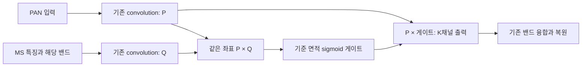

# 4. 공간 좌표 정렬과 sigmoid 게이트 결합

**변경 내용:** 같은 위치의 PAN·MS 특징을 곱하고, 공간 softmax 대신 기준 크기 sigmoid 게이트를 적용합니다.

| 확인된 결과 | 상태 | 개선 여부 |
|---|:---:|:---:|
| A0·A1 학습 중이며 A2·A3는 대기합니다. 성능 평가 전입니다. | 학습 중 2026-10-14 15:58 KST | 판단 보류 |

## 1. 목적과 상태

실험자는 이병현입니다. 2026-10-14 15:58 KST에 A0는 74에폭, A1은 75에폭을 진행합니다. GPU 응답 정지 후 저장된 A0 72에폭·A1 73에폭에서 optimizer·난수 상태를 복원했습니다. 미완료 에폭을 다시 계산했으며 학습 소스·설정·배치·정밀도는 유지했습니다. 재개한 73·74에폭의 학습·validation·latest 저장과 strict load·추론을 확인했습니다. 장애의 근본 원인은 미확정입니다. 좌표 정렬과 sigmoid 변경의 결합 효과를 검증합니다. 이전 실험의 배치 경로 차이를 제거하기 위해 네 후보 모두 처음부터 같은 micro batch로 학습합니다.

## 2. 변경한 구조와 비교 조건

공식 대조군은 원본 SSA-MRN·K4·MSE·단일 복원·공간 4배 확대입니다. backbone·복원 구조·손실·데이터 처리·분할을 유지합니다. A0는 원본, A1은 좌표 정렬, A2는 원본 좌표 연산과 sigmoid, A3는 좌표 정렬과 sigmoid의 결합입니다.

각 밴드 SSAI 입력은 PAN 한 채널과 현재 MS 특징에 해당 밴드를 붙인 C+1 채널입니다. 기존 convolution이 P·Q를 각각 K채널로 변환합니다. A3는 `P * (2/reference_area) * sigmoid(P*Q)`를 계산합니다. 출력은 같은 공간 크기의 K채널이며 기존 밴드 연결·융합·복원으로 전달합니다. 새 파라미터나 연결부 변경은 없습니다. 기준 면적은 전체·절반·1/4 단계에서 4096·1024·256입니다. K=4는 내부 특징 차원이고 공간 확대 4배와 별개입니다.

| 비교 조건 | 고정값 |
|---|---|
| 데이터 | 원본 QB H5 train·validation 분할, 정규화 2047, 추가 augmentation 없음 |
| 초기값 | seed42의 동일 초기 파라미터·샘플 순서, 이전 가중치 재개 없음 |
| 학습 | Adam lr1e-4, MSE, 일정 LR, 100에폭, FP32·TF32 off |
| 배치 | 유효32·micro32를 첫 에폭부터 끝까지 유지합니다. |
| 선택 | 최소 validation MSE, 같은 값이면 먼저 도달한 에폭입니다. |
| 실행 | 새 runtime, 두 학습 병렬·GPU 데이터 캐시, 여섯 후보 조합 모두 저장·재로드 시험을 통과했습니다. |

## 3. 정량 결과

전체 성능 평가 결과는 아직 없습니다. validation으로 체크포인트를 고정한 뒤 RR·FR 전체 장면을 평가합니다. RR은 PSNR·SAM·ERGAS·SCC·Q2n, FR은 Dλ·Ds·QNR을 기록합니다. 기존 MATLAB 지표 일치 검증은 미완료이며 FR 지표는 잠정 지표로 해석합니다.

## 4. 기준선 대비 차이와 해석

A3−A0는 결합 변경, A3−A1은 정렬 상태에서 게이트 변경, A3−A2는 sigmoid 상태에서 좌표 정렬 효과입니다. `A3−A1−A2+A0`로 지표별 상호작용을 기술하되 단일 시드 유의성 주장은 하지 않습니다. 기존 QB test는 이미 탐색에 사용됐으므로 독립 최종 holdout으로 표시하지 않습니다.

여섯 조합의 합산 학습 처리량은 337.8-351.4 patch/s, 최소 VRAM 여유는 776MiB였습니다. 작업 시작 전 필요한 메모리와 512MiB 여유를 확인하며 부족하면 대기합니다. OOM 발생 시 추가 시작을 중단하고 기존 정상 작업을 임의로 종료하지 않습니다. 실행 중 배치 변경이나 VRAM 확보용 더미 할당은 하지 않습니다.

## 5. 학습·평가 그래프

아직 실측 그래프가 없습니다. 학습 MSE·validation PSNR/SAM·전체 RR/FR 차이와 장면별 차이를 완료 후 본문에 표시합니다.

## 6. 결과 이미지

RR의 사전 고정 장면 인덱스 1·8·11·13·19를 전체 장면으로 표시합니다. LR MS·PAN·예측·정답 순서를 유지하고 seed42와 대비 조건을 기록합니다. FR에는 정답을 만들지 않습니다. 아직 예측 이미지가 없습니다.

## 7. 재현 자료

[설정](config.json), [모델](model.py), [원본 실행 소스](provenance/launch_source.zip), [실제 실행 계획](provenance/plan.json), [병렬 사전 시험](results/benchmark.json), [모델 사전 검증](results/preflight.json), [첫 에폭 저장·진행 확인](results/launch_check.json), [복구 체크포인트 검증](provenance/recovery_20261014/checkpoint_check.json), [재개 후 저장·진행 확인](results/resumed_check.json)을 제공합니다. 실행은 공통 `common/ssai_suite.py`를 사용합니다. 실제 소스·설정은 provenance에 보존하며 best/latest와 compact 학습 기록은 학습 후 보관합니다. manifest 해시 검증과 성능 재평가는 별개입니다.

## 8. 개선 여부와 다음 단계

현재 판단 보류입니다. validation으로 사전 고정한 후보를 반복 seed43·44로 확인한 뒤 필요하면 GF2·WV3로 확장합니다. 후속 반복 학습은 이번 seed42 실행에 자동 포함하지 않습니다. 기준 모델은 원본으로 유지합니다.
