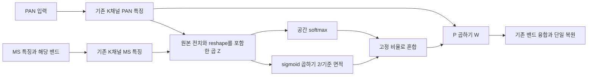
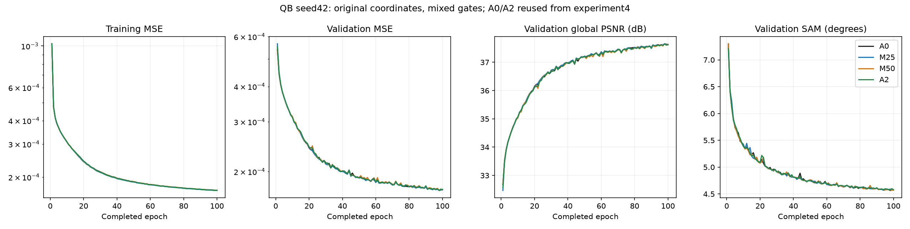
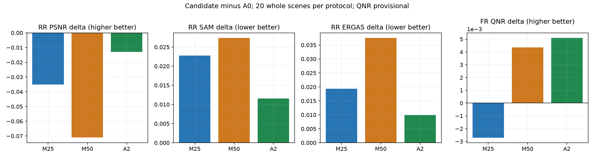
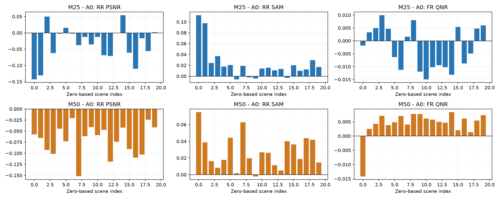
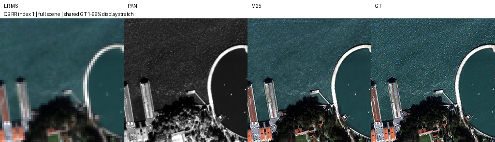
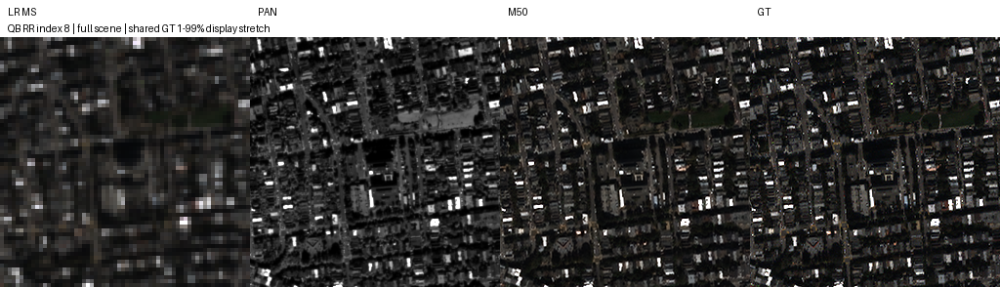
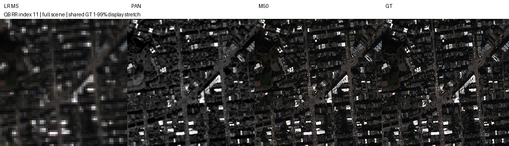
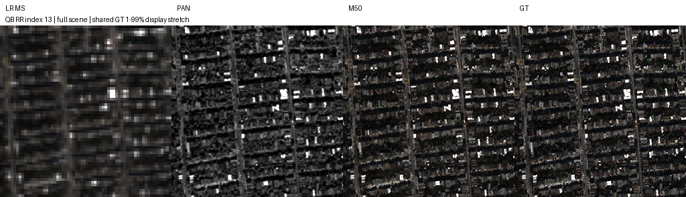
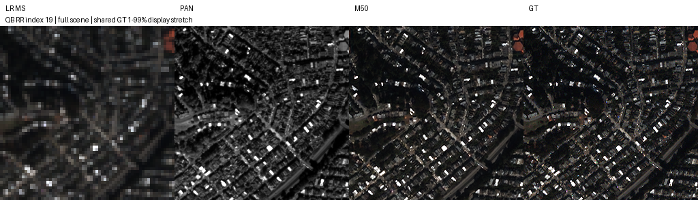

# 5. softmax와 sigmoid 혼합 게이트

**연구 분야:** SSAI 개선 (`ssai`)<br>**실험자:** 이병현<br>**변경 내용:** 원본 좌표 연산을 유지하고 공간 softmax와 기준 크기 sigmoid를 고정 비율로 혼합합니다.

| 확인된 결과 | 상태 | 개선 여부 |
|---|:---:|:---:|
| M25는 RR·FR 악화, M50은 FR 개선·RR 악화입니다. 원본을 유지합니다. | 평가 완료 | 부분 개선 |

[실행 설정](config.json) · [전체 숫자](results/evaluation/summary.json) · [보존 manifest](manifest.json)

## 1. 목적과 상태

sigmoid의 FR 개선을 일부 얻으면서 원본의 RR 성능을 유지할 수 있다는 가설을 검증했습니다. 신규 후보 M25·M50만 같은 서버에서 각각 100에폭 학습했고, validation으로 선택한 98에폭 best를 평가했습니다. 기존 실험4의 동일조건 A0·A2는 재학습하거나 체크포인트를 복제하지 않았습니다.

새 후보 RR·FR 각20장면, 총80개 예측을 실제 평가했습니다. A0·A2의 기존80개 평가를 참조해 비교했습니다. M25는 개선 없음, M50은 부분 개선이며 두 후보 모두 validation 후속 기준을 통과하지 못했습니다. 원본 SSA-MRN을 기준 모델로 유지합니다.

## 2. 변경한 구조와 비교 조건

PAN `N×1×H×W`와 MS 특징·해당 밴드 `N×(C+1)×H×W`가 기존 convolution을 통해 K채널 P·Q로 변환됩니다. 원본의 두 전치·reshape를 유지하여 logit Z를 만들고, 가중치만 아래처럼 변경합니다.

`W=(1−α)×softmax_공간(Z)+α×(2/A_ref)×sigmoid(Z)`<br>`출력=P⊙W`, 형상 `N×K×H×W`.

softmax는 공간 위치 사이의 상대적인 선택을, sigmoid는 위치별 독립적인 게이트를 제공합니다. 각 밴드 출력을 기존 convolution으로 혼합하고 전체·절반·1/4 단계의 기존 단일 복원으로 전달합니다. 정사각 입력에서 원본 logit은 Pᵀ⊙Q이며 직사각 입력에는 reshape 재배열이 포함됩니다. 좌표 정렬은 적용하지 않았습니다. 혼합 가중치 합을 추가로 정규화하지 않았습니다.

| 후보 | sigmoid 비중 α | 처리 |
|---|---:|---|
| A0 | 0 | 실험4 원본 가중치·결과 참조 |
| M25 | 0.25 | 새로운 동일 초기값에서 학습 |
| M50 | 0.50 | 새로운 동일 초기값에서 학습 |
| A2 | 1 | 실험4 sigmoid 가중치·결과 참조 |

기준 면적4096·1024·256은 학습 형상으로 고정했습니다. 내부 특징차원 K=4와 공간 확대4배는 서로 다른 설정입니다. 추가 학습 파라미터는0이며 backbone·복원 구조·연결부·MSE·원본 분할·정규화·보간·학습조건은 동일합니다.



| 비교 조건 | 확인한 설정 |
|---|---|
| 데이터 | QB 원본 train17139·validation1905, 정규화2047, 추가 augmentation 없음 |
| 형상 | train PAN/LMS64×64·MS16×16, RR256×256, FR512×512 |
| 학습 | seed42·100에폭·Adam lr1e-4·betas.9/.999·eps1e-8·weight decay0·일정 LR·MSE |
| 배치·정밀도 | 처음부터 micro/effective32·FP32·AMP off·TF32 off·결정론 |
| 초기화 | 같은 새 초기 파라미터와 샘플 순서, warm start 없음 |
| 환경 | 같은 RTX3060Ti8GB·5600X·RAM16GB, Python3.10.6·Torch2.7.1+cu128·CUDA12.8·cuDNN90701 |
| 선택 | 최소 validation MSE, 정확한 동률은 최초 epoch; test로 checkpoint·비율을 선택하지 않음 |

원본 데이터·읽기 전용 캐시·기준코드·환경과 재사용 체크포인트 설정/해시를 검사했습니다. 초기값 일치 및 α=0이면 A0, α=1이면 A2의 전체 출력이 정확히 같은 것을 확인했습니다. train/validation/loader/seeding/save의 실제 학습 소스도 실험4와 동일함을 확인했습니다. [조건 검증](results/reused_conditions_check.json) · [재사용 경로·해시](provenance/reference_assets.json).

## 3. 정량 결과

모든 checkpoint는 validation으로 고정한 best98이며 latest100도 보관했습니다. RR·FR은 각각20개 전체 장면 평균, FP32·clipping 없음입니다. validation global PSNR과 RR 밴드별 평균 PSNR의 정의를 구분합니다.

| 후보 | α | best epoch | validation MSE↓ | RR PSNR↑ | SAM↓ | ERGAS↓ | SCC↑ | Q2n↑ | FR Dλ↓ | Ds↓ | 잠정 QNR↑ |
|---|---|---:|---:|---:|---:|---:|---:|---:|---:|---:|---:|
| A0 | 0（재사용） | 98 | 0.000171550928 | 37.453589 | 4.928274 | 4.110100 | 0.976948 | 0.923239 | 0.045167 | 0.039614 | 0.917411 |
| M25 | 0.25 | 98 | 0.000171696093 | 37.418527 | 4.951035 | 4.129482 | 0.976741 | 0.922828 | 0.047120 | 0.040389 | 0.914699 |
| M50 | 0.50 | 98 | 0.000171722265 | 37.382550 | 4.955621 | 4.147606 | 0.976335 | 0.921317 | 0.041899 | 0.038464 | 0.921756 |
| A2 | 1（재사용） | 98 | 0.000171701993 | 37.440578 | 4.939821 | 4.120005 | 0.976758 | 0.922445 | 0.039728 | 0.039773 | 0.922514 |

원본 대비 M25는 PSNR−0.035062dB·SAM+0.022761°·ERGAS+0.019382·QNR−0.002711입니다. M50은 PSNR−0.071040dB·SAM+0.027346°·ERGAS+0.037505·QNR+0.004345입니다. M50의 Dλ·Ds는 각각−0.003268·−0.001150으로 개선했습니다.

M25·M50의 best validation MSE는 원본보다 각각 약0.085%·0.100% 높습니다. M50은 기존 순수 sigmoid A2에 비해서도 PSNR−0.058028dB·QNR−0.000759입니다. 혼합이 순수 sigmoid보다 유리하다는 결과는 얻지 못했습니다. 현재 test 결과를 보고 새 비율을 선택하거나 튜닝하지 않았습니다.





## 4. 장면별 차이와 비교 이미지

아래 숫자는 각20장면 중 개선/악화 개수입니다. 평균만 좋아진 경우와 여러 장면에서 반복된 변화를 구분합니다.

| 후보 | RR PSNR 개선/악화 | SAM 개선/악화 | ERGAS 개선/악화 | FR QNR 개선/악화 |
|---|---:|---:|---:|---:|
| M25 | 5/15 | 4/16 | 4/16 | 9/11 |
| M50 | 0/20 | 1/19 | 0/20 | 19/1 |

M50은 RR PSNR·ERGAS·SCC·Q2n이20장면 모두 악화했고 SAM은19장면 악화했습니다. FR QNR은19장면 개선했습니다. M25는 FR Dλ가18장면 악화했으며 QNR은9장면 개선·11장면 악화했습니다. RR/FR 장면은 각각의 프로토콜이며 정답이 없는 FR에서 RR 정답을 대용하지 않았습니다.



예시는 평가 전에 고정한 zero-based1·8·11·13·19이며, 유리한 장면을 test로 골라 표시하지 않았습니다. 각 패널은 LRMS·PAN·예측·RR GT 순서입니다. RGB밴드[2,1,0], LRMS의 nearest 확대, GT의1–99% 대비를 MS·예측·GT에 공유하고 PAN은 별도로 표시했습니다. 표시용 대비이며 실제 지표 계산에는 적용하지 않았습니다. 차이가 작아 육안상 유사해도 정량 결과를 우선합니다.

**같은 RR 장면1의 대조군과 두 후보**





**사전에 고정한 나머지 M50 예시**









M25의 [장면8](results/evaluation/M25/scene_08.png) · [장면11](results/evaluation/M25/scene_11.png) · [장면13](results/evaluation/M25/scene_13.png) · [장면19](results/evaluation/M25/scene_19.png)도 보관했습니다. FR에는 GT 이미지가 없습니다.

## 5. 파라미터·연산 비용과 실행

두 후보는426654개 등록 파라미터로 대조군과 같습니다. Conv MAC은64/256/512에서 각각1.243976/19.903611/79.614444GMAC으로 같습니다. 이는 convolution만 세며 softmax·sigmoid·원소 곱·덧셈의 비용은 제외합니다. 두 게이트를 함께 계산하므로 총 연산량이 동일하다고 주장하지 않습니다.

| 후보 | 파라미터 | 64×64 median ms | RR256 median ms | FR512 median ms | FR peak allocated MiB |
|---|---:|---:|---:|---:|---:|
| A0 | 426,654 | 15.425 | 15.539 | 28.335 | 334.946 |
| M25 | 426,654 | 16.445 | 16.591 | 29.089 | 334.946 |
| M50 | 426,654 | 16.201 | 17.558 | 29.170 | 334.946 |
| A2 | 426,654 | 15.425 | 17.339 | 28.024 | 334.946 |

3회 warmup·10회 단일프로세스·동일 synthetic 입력 형상입니다. A0·A2의 시간은 실험4 측정치를 참조해 다른 측정 시점이 포함되며 정밀 속도 비교나 유의한 차이를 확정하지 않습니다. 두 신규 후보의 측정치에서 빨라졌다는 증거는 없습니다. 추론 메모리와 GPU 학습 캐시 메모리는 별개입니다.

두 후보만 병렬 실행한 probe는 합산336.07patch/s·최소 여유VRAM1324MiB였고 train/validation/atomic save-reload를 통과했습니다. worker budget3168MiB와 여유512MiB를 시작 시 검사했습니다. 실제 학습에서 GPU99%·VRAM약6701MiB·여유1324MiB를 관측했습니다. 학습은10월15일00:25경100에폭 완료했고 queue의 failed는 비어 있습니다. 시작 전 VRAM 검사는 실행 중 상시 감시나 driver hang 복구 장치가 아닙니다.

## 6. 재현·보존과 검증

전용 runtime `C:/CtrS-ssai5/runtime/qb_s42_100`, 원본 학습 source `C:/CtrS-ssai5/SSA-MRN`을 유지합니다. 기존 실험4 cache는 읽기 전용 경로 참조입니다. SSH와 독립적인 WMI controller로 실행했습니다. 기존 runtime·가중치·원본 설정을 삭제하거나 덮어쓰지 않았습니다.

준비는 이 폴더의 run.py, 병렬 benchmark/start는 common/ssai_suite.py를 사용합니다. 준비 후 plan의 source hash를 고정하고 학습하며 같은 조건 대조군을 다시 학습하지 않습니다. 아래는 실제 서버 실행 명령입니다.

```powershell
& C:\CtrS\.venv\Scripts\python.exe C:\CtrS-ssai5\SSA-MRN\experiments\ssai\5_mixed_gating\run.py --runtime C:\CtrS-ssai5\runtime\qb_s42_100 --previous C:\CtrS-ssai4\runtime\qb_s42_100
& C:\CtrS\.venv\Scripts\python.exe C:\CtrS-ssai5\SSA-MRN\common\ssai_suite.py benchmark --runtime C:\CtrS-ssai5\runtime\qb_s42_100
& C:\CtrS\.venv\Scripts\python.exe C:\CtrS-ssai5\SSA-MRN\common\ssai_suite.py start --runtime C:\CtrS-ssai5\runtime\qb_s42_100
```

재실행에는 새 runtime이 필요하며 현재 완료된 runtime에 prepare를 다시 실행하지 않습니다. 평가 당시에는 학습 소스를 별도 evaluation_source로 복사한 후 evaluator의 M25/M50 로딩 및 기존 평가 참조만 확장했습니다. 기존 지표·전처리·preview 구현과 평가 데이터 해시가 같을 때만 참조를 허용했습니다. 학습 당시 source는 수정하지 않았습니다. 전체 평가 명령은 다음과 같습니다.

```powershell
& C:\CtrS\.venv\Scripts\python.exe C:\CtrS-ssai5\evaluation_source\common\ssai_evaluate.py --source-root C:\CtrS-ssai5\evaluation_source --runtime C:\CtrS-ssai5\runtime\qb_s42_100 --data C:\CtrS\SSA-MRN\data\dataset --output C:\CtrS-ssai5\runtime\qb_s42_100\evaluation_final --arms M25 M50 --reference-evaluation C:\CtrS-ssai4\runtime\qb_s42_100\evaluation_final
```

이 평가 output도 이미 존재하므로 원본을 보존하고 재평가할 때 새 output을 사용합니다. 실제 신규 best/latest4개는 checkpoints/M25_QB_s42와 M50_QB_s42에 보관하며 full optimizer·RNG·checkpoint 내부 설정을 유지했습니다. 실험4 A0/A2의 가중치4개는 [참조 경로·해시](provenance/reference_assets.json)로 연결합니다.

[실제 학습 소스·최종 plan](provenance/training_source.zip), [출발 소스](provenance/launch_source.zip), [실제 evaluator](provenance/evaluator.py), [exporter](provenance/exporter.py), [원본 export manifest](provenance/export_manifest.json), [체크포인트 검증](results/checkpoint_verification.json), [로컬 복구 검증](results/local_recovery_check.json)을 함께 보관했습니다. training_complete.json의 evaluation_complete=false는 학습 종료 시점 원본 기록이며, 이후 results/evaluation/complete.json이 실제80개 예측 평가 완료를 증명합니다. 원본 이벤트 기록을 덮어쓰지 않았습니다.

[복구 검증 도구](verify.py)는 이 폴더와 참조한 실험4 파일이 있는 checkout에서 `python experiments/ssai/5_mixed_gating/verify.py`로 실행합니다. 공식 network는 실제 학습 소스 zip에서 임시 경로로 복원하고 저장소의 후보 코드·loader로 네 가중치를 strict load·유한 추론합니다.

성능 재평가는 서버에서 실제 RR/FR 추론·지표 계산을 수행한 것이며, 해시·strict load·유한 출력 검증은 파일 보존과 복구 검증입니다. 두 검증을 서로 대신하지 않습니다.

## 7. 결론과 한계

M25는 개선 없음, M50은 FR에서 부분 개선입니다. 두 후보 모두 validation과 RR에서 원본보다 악화했고 M50의 RR 악화는20장면에 걸쳐 관측됐습니다. 원본의 RR 성능을 유지하면서 sigmoid의 FR 이점을 얻겠다는 이번 고정 혼합 가설은 현재 조건에서 지지되지 않았습니다. 원본을 유지하고, 자동 반복 시드·센서 확장 또는 혼합비율 추가 탐색을 진행하지 않았습니다.

단일QB·seed42 결과입니다. 기존에 탐색에 사용된 test를 재사용했으므로 독립 최종 holdout이 아닙니다. QNR·Q2n·SCC의 MATLAB parity는 미검증이며 FR 정답은 없습니다. 작은 validation 차이에 통계적 유의성을 부여하지 않습니다. 센서·시드를 넘어 일반화하거나 최종 성능 향상을 확정하지 않습니다.

## 8. 남은 일

이번100에폭 학습·두 후보 RR/FR 평가·결과와 실제 가중치 보관을 완료했습니다. 저장소 원격 복구 검증을 PR 검증 항목으로 보고합니다. 다음 연구 가설은 별도로 설계하며 기존 실험 결과를 중복 학습하지 않습니다. 성능 향상 채택은 보류합니다.
