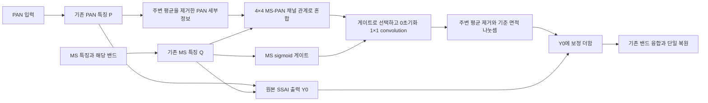
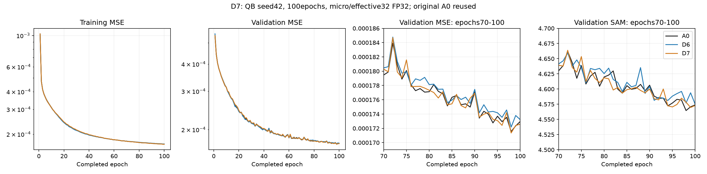
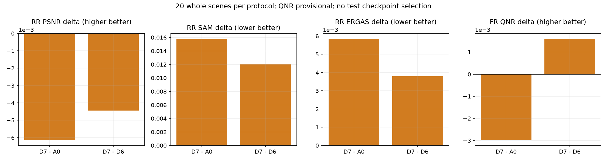
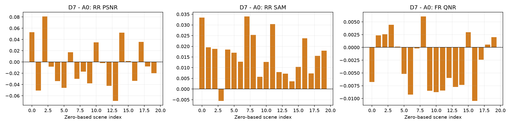
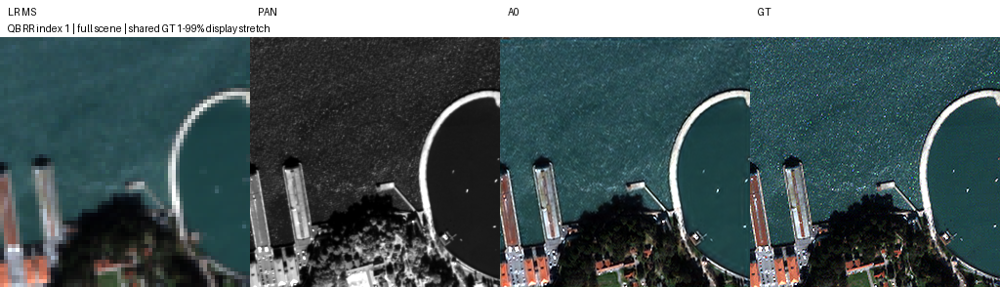
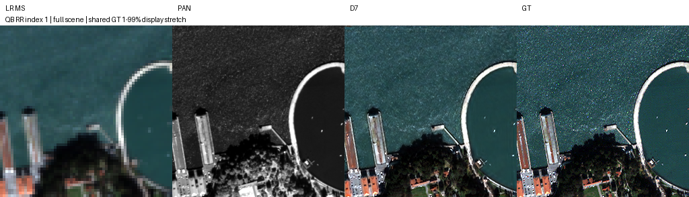
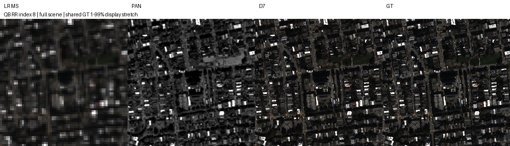
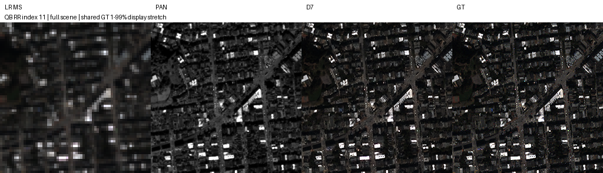
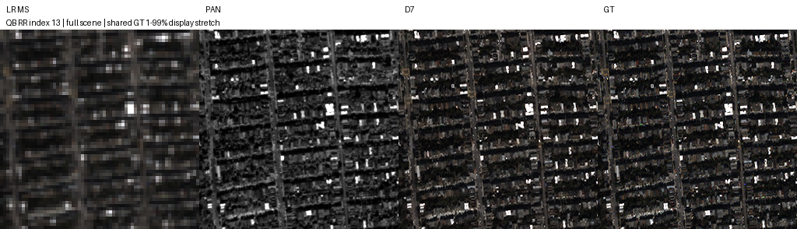
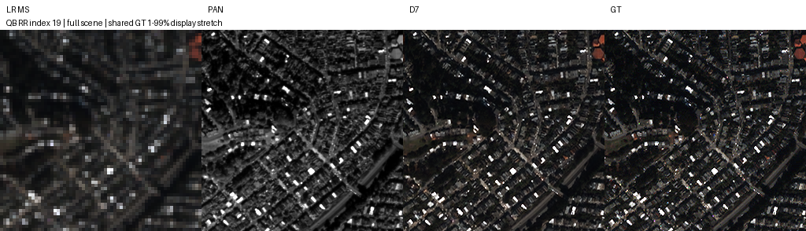

# 7. MS–PAN 채널 관계 기반 세부정보 보정

**연구 분야:** SSAI 개선 (`ssai`)<br>**실험자:** 이병현<br>**변경 내용:** 7번은6번과 같은 추가192개 파라미터를 가지며,4×4채널 관계로 세부정보를 혼합하는 연산의 추가효과를 검증합니다. 기존5×5국소 교차어텐션 실험9와 달리 공간 위치별 이웃집계는 하지 않습니다.

| 확인된 결과 | 상태 | 개선 여부 |
|---|:---:|:---:|
| 원본 대비 RR PSNR -0.006145dB·SAM +0.015805°·잠정 FR QNR -0.002991. 원본을 유지합니다. | 평가 완료 | 개선 없음 |

[설정](config.json) · [전체 숫자](../6_ms_conditioned_detail/results/evaluation/summary.json) · [manifest](manifest.json)

## 1. 목적과 상태

원본 SSAI 출력에 MS가 선택한 PAN 세부정보를 잔차로 더해 큰 성능 향상이 가능한지 검증했습니다. 7번은6번과 같은 추가192개 파라미터를 가지며,4×4채널 관계로 세부정보를 혼합하는 연산의 추가효과를 검증합니다. 기존5×5국소 교차어텐션 실험9와 달리 공간 위치별 이웃집계는 하지 않습니다. QB seed42·100에폭을 완료했고 종료 시각은2026-10-15 05:23:47 KST입니다. validation으로 선택한98에폭 best에서 RR·FR각20장면을 실제 평가했습니다. 두 연구를 함께80개 신규 예측으로 평가하고, 기존 실험4 A0·A2의80개 기록을 참조했습니다. 신규 학습은6·7번뿐이며 대조군을 다시 학습하지 않았습니다.

원본 대비 종합 성능 향상을 확인하지 못해 **개선 없음**으로 기록합니다. 큰 향상의 연구 목표 RR PSNR+0.2dB에 도달하지 못했습니다. 목표는 예상치나 관측치가 아닙니다. best validation MSE가 원본보다0.116% 낮아 validation 기준은 통과했습니다. 그러나 이는 RR·FR 성능 개선을 보장하지 않았습니다.

## 2. 바뀐 위치·입력·연산·출력과 비교 조건

기준은 원본 SSA-MRN·K4·MSE·단일복원·공간4배확대입니다. PAN `N×1×H×W`와 MS전체특징·해당밴드 `N×(C+1)×H×W`를 기존 convolution으로 K채널 P·Q로 바꿉니다. 원본의 전치·reshape·공간 softmax와 그 출력Y0은 유지하고, 아래 보정만 SSAI 내부에 추가했습니다. 출력 `N×K×H×W`는 기존 밴드융합·작은 크기부터 복원하는 구조에 전달됩니다. 연결부 수정은 없습니다.

`H(x)=x−3×3주변평균(x)`, 경계는reflect padding입니다.<br>`D=softmax(Qhat×H(P)hatᵀ/0.25)×H(P), Qhat와H(P)hat는 공간축L2정규화한 K×HW 특징`<br>`G=2×sigmoid(Q)`<br>`Y=Y0+H(Wout(G⊙D))/A_ref`.

Wout은K4→K4의1×1 convolution·bias없음이며0으로 초기화했습니다. 기존 모든 파라미터와 RNG를 보존해 초기 전체 출력이 원본과 같았고, 새 Wout의 gradient가0이 아닌 것을 확인했습니다. 실제 체크포인트의 보정 가중치도 학습됐습니다. 고주파 보정과0초기화가 분광보존이나 성능개선을 보장하는 것은 아닙니다.

7번 관계행렬은4×4이며 온도0.25는 사전고정입니다. 공간HW×HW행렬은 만들지 않습니다. MS의 Value를 직접 더하는 구조가 아니라 MS로 PAN 세부정보를 선택하는 구조입니다.

전체·절반·1/4단계의 기준 면적4096·1024·256은 고정했습니다. K4와 공간확대4배는 서로 다른 설정입니다. 추가 파라미터는192개, 총426846개로 두 연구에서 동일합니다. backbone·복원·MSE·원본 분할·정규화·보간·학습예산은 동일합니다. 1번 공간좌표 정렬을 기반으로 하지 않았습니다. 실험1의 개선이 실험4의 micro32 재비교에서 재현되지 않아 원본을 대조군으로 유지한 별도 가설입니다.



| 비교 조건 | 확인한 설정 |
|---|---|
| 데이터 | QB original H5 train17139·validation1905, /2047, 새로운augmentation 없음 |
| 형상 | train PAN/LMS64×64·MS16×16, RR256×256, FR512×512 |
| 학습 | seed42·100에폭·Adam lr1e-4·betas.9/.999·eps1e-8·weight decay0·MSE·일정LR |
| 배치·정밀도 | 처음부터 micro/effective32·FP32·AMP off·TF32 off·결정론 |
| 초기화 | 새 동일 원본 초기값·같은 RNG와 샘플순서·보정 convolution0초기화·warm start 없음 |
| 환경 | 같은 RTX3060Ti8GB·5600X·RAM16GB·Python3.10.6·Torch2.7.1+cu128·CUDA12.8·cuDNN90701 |
| 선택 | minimum validation MSE·정확한동률 최초epoch·test로 선택하지 않음 |

캐시 저장위치는 GPU85%·RAM/mmap15%로 달라졌습니다. 기존 전체GPU캐시와 실제2에폭의 모든FP32배치·epoch경계RNG 및3회 원본A0 Adam업데이트 state가 정확히 같은 것을 검증했습니다. train/validate/seed/save 구현도 동일합니다. [캐시 검증](results/partial_cache_check.json) · [수치 경로 검증](../6_ms_conditioned_detail/results/numerical_path_check.json). 전체100에폭의 캐시방식간 재학습 동등성은 별도로 측정하지 않았으며, 반복시드 없는 작은 차이를 SSAI효과로 확정하지 않습니다.

## 3. 정량 결과

모든 checkpoint는 validation으로 선택한best98입니다. latest100도 보관했습니다. test로 checkpoint·온도·형상·후속 후보를 고르지 않았습니다. RR·FR각20전체장면·FP32·clipping없음입니다. validation global PSNR과 RR band평균·peak2047 PSNR의 정의를 구분합니다.

| 후보 | best epoch | validation MSE↓ | RR PSNR↑ | SAM↓ | ERGAS↓ | SCC↑ | Q2n↑ | FR Dλ↓ | Ds↓ | 잠정 QNR↑ |
|---|---:|---:|---:|---:|---:|---:|---:|---:|---:|---:|
| A0 | 98 | 0.000171550928 | 37.453589 | 4.928274 | 4.110100 | 0.976948 | 0.923239 | 0.045167 | 0.039614 | 0.917411 |
| D6 | 98 | 0.000172175814 | 37.451883 | 4.932086 | 4.112154 | 0.976941 | 0.922448 | 0.048766 | 0.040816 | 0.912805 |
| D7 | 98 | 0.000171351877 | 37.447444 | 4.944080 | 4.115951 | 0.976940 | 0.923404 | 0.047228 | 0.040627 | 0.914419 |

원본 대비 PSNR -0.006145dB·SAM +0.015805°·ERGAS +0.005851, FR Dλ +0.002061·Ds +0.001014·QNR -0.002991입니다. RR Q2n만+0.000165로 소폭 개선됐지만 PSNR·SAM·ERGAS·SCC와 FR의 Dλ·Ds·QNR은 악화했습니다. Q2n도20장면 중6장면만 개선돼 평균 상승을 폭넓은 개선으로 표현하지 않습니다. 6번 대비 validation·Q2n·FR은 나아졌지만 RR PSNR은−0.004439dB·SAM은+0.011994°로 악화했습니다.





## 4. 장면별 차이와 비교 이미지

| 지표 | 개선 장면 | 악화 장면 | 동일 장면 |
|---|---:|---:|---:|
| RR SAM | 1 | 19 | 0 |
| RR ERGAS | 6 | 14 | 0 |
| RR PSNR | 7 | 13 | 0 |
| RR SCC | 8 | 12 | 0 |
| RR Q2n | 6 | 14 | 0 |
| FR D_lambda | 0 | 20 | 0 |
| FR D_s | 10 | 10 | 0 |
| FR QNR | 8 | 12 | 0 |

두 연구 모두FR Dλ가20장면 전부 악화했습니다. 7번은RR SAM이19장면 악화했고 FR QNR은12장면 악화했습니다. validation 향상과 일부Q2n 향상만으로 최종 개선을 판단할 수 없습니다.



예시는 사전에 고정한zero-based1·8·11·13·19이며 유리한 장면을 골라 바꾸지 않았습니다. LRMS·PAN·예측·RR GT 순서, RGB[2,1,0], LRMS nearest 확대, MS/예측/GT에 GT1–99% 표시대비를 공유하며 PAN은 별도대비입니다. 표시용 대비는 지표 계산에 사용하지 않았습니다. FR에는GT를 만들지 않았습니다. 작은 차이는 육안만으로 판단하지 않습니다.













## 5. 파라미터·연산 비용과 실행

원본426654개에서 각각426846개로192개(+0.045%) 늘었습니다. 두 연구의 Conv MAC은64/256/512에서1.244320/19.909116/79.636464GMAC이며, 원본1.243976/19.903611/79.614444보다 조금 큽니다. convolution만 세므로 평균풀링·sigmoid·norm·원소연산·7번BMM/softmax는 포함하지 않습니다. 7번채널관계는O(K²HW)입니다. 총연산량이 같다고 주장하지 않습니다.

| 후보 | 파라미터 | 64×64 median ms | RR256 median ms | FR512 median ms | FR peak allocated MiB |
|---|---:|---:|---:|---:|---:|
| A0 | 426,654 | 15.425 | 15.539 | 28.335 | 334.946 |
| D6 | 426,846 | 18.955 | 19.407 | 31.547 | 334.952 |
| D7 | 426,846 | 22.476 | 22.561 | 33.068 | 366.952 |

동일synthetic형상의 단일프로세스·3warmup·10반복입니다. A0 비용은 실험4의 이전측정치라 측정시점 차이가 있습니다. 안정적인 속도향상이나 통계적 비용차이를 확정하지 않습니다. 이번실측에서 신규보정은 더 긴 지연시간을 보였고,7번은6번보다 높은 메모리를 사용했습니다. 추론메모리와 학습데이터 GPU캐시는 별개입니다.

최대2개 병렬·GPU85%/RAM15%·micro32·FP32를 사용했습니다. 전체GPU캐시probe는 최소여유339MiB로 안전기준을 통과하지 못했습니다. 분할캐시probe는 합산306.33patch/s·최소여유1079MiB·train/validation/atomic save-reload를 통과했습니다. worker budget2968MiB·시작여유512MiB를 적용했고 학습중 GPU99%·VRAM6943MiB·여유1082MiB를 관측했습니다. 6번종료 후7번은단독으로 이어졌습니다. 배치·조건변경·학습중단·재부팅 없이100에폭을 완료했습니다. 시작전 검사는 실행중 상시VRAM 감시나driver hang복구 장치가 아닙니다.

## 6. 재현·원본 보존과 검증

source는C:/CtrS-ssai-detail/SSA-MRN, 최종 runtime은C:/CtrS-ssai-detail/runtime/qb_s42_100_partial_cache입니다. 초기qb_s42_100은probe 전용이며 실제100에폭 학습을 시작하지 않았습니다. 두runtime의 source/provenance·probe 기록과 기존실험4/5runtime을 유지했습니다. 기존자료를 삭제·덮어쓰기하지 않았습니다.

common/ssai_detail.py는두가설이 공유하는연산, 각folder model.py는해당가설선택, common/ssai_detail_prepare.py는공동suite준비입니다. WMI detached controller로 SSH와독립적으로 실행했습니다. 실제 명령은 다음과 같습니다. 이미 완료된 runtime에 prepare/benchmark를 재실행하지 않습니다.

```powershell
& C:\CtrS\.venv\Scripts\python.exe C:\CtrS-ssai-detail\SSA-MRN\common\ssai_detail_prepare.py --runtime C:\CtrS-ssai-detail\runtime\qb_s42_100_partial_cache --previous C:\CtrS-ssai4\runtime\qb_s42_100
& C:\CtrS\.venv\Scripts\python.exe C:\CtrS-ssai-detail\SSA-MRN\common\ssai_suite.py benchmark --runtime C:\CtrS-ssai-detail\runtime\qb_s42_100_partial_cache
& C:\CtrS\.venv\Scripts\python.exe C:\CtrS-ssai-detail\SSA-MRN\common\ssai_suite.py start --runtime C:\CtrS-ssai-detail\runtime\qb_s42_100_partial_cache
```

평가용source복사본에서D6/D7선택만확장하고 기존metric·데이터·preview코드와해시가동일할때A0/A2기존평가를참조했습니다. 학습 당시 source는 변경하지 않았습니다. 실제평가명령은다음과같으며재평가에는새output이필요합니다.

```powershell
& C:\CtrS\.venv\Scripts\python.exe C:\CtrS-ssai-detail\evaluation_source\common\ssai_evaluate.py --source-root C:\CtrS-ssai-detail\evaluation_source --runtime C:\CtrS-ssai-detail\runtime\qb_s42_100_partial_cache --data C:\CtrS\SSA-MRN\data\dataset --output C:\CtrS-ssai-detail\runtime\qb_s42_100_partial_cache\evaluation_final --arms D6 D7 --reference-evaluation C:\CtrS-ssai4\runtime\qb_s42_100\evaluation_final
```

실제 가중치checkpoints/D7_QB_s42/best.pt·latest.pt는 full optimizer·RNG·checkpoint내부plan을보존했습니다. source/config의학습 시점 값과 현재 보고 상태의 config.json은 구분합니다. [실제 공동 학습 소스·plan](../6_ms_conditioned_detail/provenance/training_source.zip) · [실제 evaluator](../6_ms_conditioned_detail/provenance/evaluator.py) · [공동 평가 원본](../6_ms_conditioned_detail/results/evaluation/summary.json) · [참조 경로·해시](provenance/shared_evidence.json)를보존했습니다. [원본참조 경로·해시](../6_ms_conditioned_detail/provenance/reference_assets.json)로기존대조군을연결하며중복가중치를만들지않았습니다. 7번공동증거의상대경로는7번실험folder를기준으로합니다.

학습종료training_complete.json의evaluation_complete=false는원본학습종료이벤트입니다. 이후공동results/evaluation/complete.json이새 80개 실제 추론 완료를 증명합니다. 원본 이벤트를 덮어쓰지 않았습니다. 성능 평가는 서버의 RR/FR 추론·지표 계산이고,해시·strict load·유한 CPU 추론은 파일 보존·복구 검증입니다. 두 검증을 구분합니다. 복구는`python common/ssai_detail_verify.py`로두실험과실험4참조파일이있는checkout에서수행합니다.

## 7. 결론과 한계

**판정: 개선 없음.** best validation MSE가 원본보다0.116% 낮아 validation 기준은 통과했습니다. 그러나 이는 RR·FR 성능 개선을 보장하지 않았습니다. RR Q2n만+0.000165로 소폭 개선됐지만 PSNR·SAM·ERGAS·SCC와 FR의 Dλ·Ds·QNR은 악화했습니다. Q2n도20장면 중6장면만 개선돼 평균 상승을 폭넓은 개선으로 표현하지 않습니다. 6번 대비 validation·Q2n·FR은 나아졌지만 RR PSNR은−0.004439dB·SAM은+0.011994°로 악화했습니다. 원본 기준 모델을 유지합니다. validation을통과한7번도성능평가에서가설의목표를달성하지못해반복시드·센서확장을새로시작하지않았습니다. 성능 향상이나 좌표 정렬과의 결합 효과를 확정하지 않습니다.

단일 QB·seed42입니다. 기존탐색test를재사용했으므로독립최종holdout이아닙니다. QNR/Q2n/SCC MATLAB parity는미검증이고FR정답은없습니다. 작은RR평균차나validation향상의통계적유의성은확인하지않았습니다. 환경·캐시위치차이의수치검증범위도위에명시했습니다.

## 8. 남은 일과 연구 방향

이번100에폭학습·RR/FR평가·장면별/비용분석·실제가중치와소스보관을완료했습니다. 원격freshcheckout복구검증은PR검증항목으로보고합니다. main 병합은 담당자가 진행합니다. 다음 우선 검토는1번공간좌표정렬의반복시드재현성입니다. 이는현재 결과에 따른 제안이며이번 PR에서 새 학습을 시작하지 않습니다. 원본과의 동일 조건 재현성을 확인한 뒤 새 구조 결합 여부를 결정합니다.
