# 8. 공간 가중치 평균 정규화

연구 분야: **SSAI** · 연구 담당자·실험자: **이병현**

## 1. 목적과 상태

공간 softmax의 평균이 위치 수의 역수인 점이 SSAI 학습을 약하게 만드는지 진단합니다. 같은 좌표 연산에서 출력 크기만 정규화하며, 가중치 변화와 성능을 구분합니다. N1·N2 각각100에폭 학습과 RR20·FR20 평가를 완료했습니다. 두 후보 모두 사전 기준의 학습 가능화 성공이며 N1은 개선 없음, N2는 부분 개선입니다. 기준 모델은 실험4의 원본 A0를 유지합니다.

## 2. 바뀐 위치·입력·연산·출력과 비교 조건

RestoredPansharpeningNet의 세 해상도별 4개 밴드 SSA 블록만 교체합니다. PAN 1채널과 현재 특징 4채널+해당 MS 밴드 1채널을 입력받고 K=4채널을 출력합니다. 원본의 두 전치·직사각 reshape를 보존합니다.

`p=conv6t6(ReLU(conv1t6(PAN)))`, `q=conv7t6_3(band_input)`에서 원본 좌표의 z를 만들고 `w=softmax(z, spatial)*H*W`, `out=p*w*gamma`를 사용합니다. N1은 gamma=1 고정, N2는 블록별 학습 스칼라 gamma=0.1에서 시작합니다. gamma는 제한하거나 clip하지 않습니다. K=4와 공간 확대4배는 별개이며 모두 유지합니다. 학습 입력 크기 강제 조건은 없습니다.

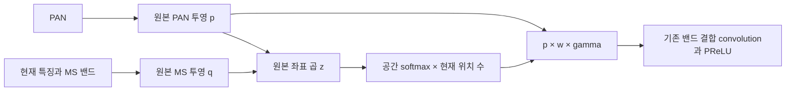

QB·seed42·100에폭·micro/effective32·FP32·AMP/TF32 off·결정론·Adam lr1e-4 일정·MSE로 실험4 A0와 맞춥니다. 원본 H5와 2047 정규화, 데이터 순서, 초기 공통 파라미터 해시를 확인합니다. GPU85%/RAM15% 캐시는 6·7번의 동일 배치·RNG·3 Adam 업데이트 검증과 실제 함수 AST 일치를 재사용합니다. 100에폭 캐시 방식별 A0 재학습은 하지 않습니다.

진단은 validation 인덱스0–511, 원본 seed42 첫20 train배치(640개), RR/FR 장면0으로 고정합니다. train 기울기는 optimizer 업데이트 없이 측정합니다. 파라미터 그룹 L2와 원소 수로 보정한 RMS를 함께 기록합니다. RMS 비율은 전체 표본의 제곱합을 합친 뒤 계산하며 단순 비율 평균이 아닙니다. 블록 비율은 gamma를 포함한 실제 출력/p, 융합 비율은 fusion+PReLU 출력/해당 단계 더하기 전 res입니다.

<!-- DIAGNOSTIC_TABLE -->
| 측정 | 전체 | 절반 | 1/4 |
|---|---:|---:|---:|
| A0 validation 출력/p | 0.000244140661 | 0.000976448789 | 0.0039073608 |
| A0 validation pan_ms/res | 0.194474033 | 0.338866365 | 0.186879127 |
| A0 100에폭 가중치 상대 변화 | 0.00655520783 | 0.011091698 | 0.028567893 |
| A0 초기 기울기 L2 | 2.10371704e-06 | 6.80506902e-06 | 4.26057537e-06 |
| N1 초기 기울기 L2 | 0.014129945 | 0.00474381064 | 0.00304217334 |
| N2 초기 기울기 L2(gamma 포함) | 0.00130220548 | 0.000888008435 | 0.000116349105 |

실제 서버에서 측정했습니다. A0 초기 기울기는20배치·업데이트0회입니다. 전체 그룹 원시 수치는 [diagnostics.json](results/diagnostics.json)에 보존합니다. N2 기울기 그룹은 gamma를 포함하므로 N1/A0와 순수 convolution 기울기 비율로 해석하지 않습니다.

기울기 L2 평균은 초기값에서 고정20배치·업데이트0회로 측정했습니다.

| 그룹 | A0 | N1 | N2(gamma 포함) |
|---|---:|---:|---:|
| backbone | 0.0925758789 | 0.0677957958 | 0.0917316059 |
| conv64t48 | 0.149259944 | 0.106635901 | 0.147527592 |
| SSA_blocks | 2.10371704e-06 | 0.014129945 | 0.00130220548 |
| SSA_blocks1 | 6.80506902e-06 | 0.00474381064 | 0.000888008435 |
| SSA_blocks2 | 4.26057537e-06 | 0.00304217334 | 0.000116349105 |
| conv48tnum1 | 0.0125638382 | 0.032823217 | 0.0123221912 |
| conv48tnum2 | 0.0131526699 | 0.0151857617 | 0.0130775897 |
| conv48tnum3 | 0.00157563534 | 0.00564839216 | 0.00156014387 |
| decoder | 0.143343137 | 0.117251499 | 0.141550605 |
| other | 0.0333870272 | 0.0245827785 | 0.0330683244 |
<!-- END_DIAGNOSTIC_TABLE -->

## 3. 정량 결과

| 후보 | best 에폭 | validation MSE | A0 대비 | 판정 |
|---|---:|---:|---:|---|
| A0 | 98 | 0.000171550927924 | +0.0000% | 원본 대조군 |
| N1 | 98 | 0.000172655201447 | +0.6437% | 개선 없음 |
| N2 | 98 | 0.000171618302795 | +0.0393% | 부분 개선 |

**RR 전체20장 평균**

| 후보 | PSNR | SAM | ERGAS | 잠정 SCC | 잠정 Q2n |
|---|---:|---:|---:|---:|---:|
| A0 | 37.45358907 | 4.92827439 | 4.11010019 | 0.97694833 | 0.92323899 |
| N1 | 37.40014063 | 4.97947803 | 4.14289281 | 0.97658064 | 0.92240769 |
| N2 | 37.46402444 | 4.93190840 | 4.10941328 | 0.97698100 | 0.92293454 |

| A0 대비 차이 | PSNR | SAM | ERGAS | SCC | Q2n |
|---|---:|---:|---:|---:|---:|
| N1 | -0.05344843 | +0.05120364 | +0.03279263 | -0.00036769 | -0.00083131 |
| N2 | +0.01043537 | +0.00363401 | -0.00068691 | +0.00003268 | -0.00030445 |

**FR 전체20장 평균**

| 후보 | D_lambda | D_s | 잠정 QNR |
|---|---:|---:|---:|
| A0 | 0.04516672 | 0.03961365 | 0.91741058 |
| N1 | 0.04899412 | 0.04077200 | 0.91267037 |
| N2 | 0.04608670 | 0.04060482 | 0.91554648 |

| A0 대비 차이 | D_lambda | D_s | QNR |
|---|---:|---:|---:|
| N1 | +0.00382740 | +0.00115835 | -0.00474022 |
| N2 | +0.00091997 | +0.00099117 | -0.00186410 |

best는 최소 validation MSE이며 정확한 동률은 먼저 나온 에폭입니다. 두 후보 모두best98·latest100입니다. test로 선택하지 않았습니다. N1은 주요 RR/FR 지표가 모두 악화했습니다. N2는PSNR·ERGAS·잠정SCC가 소폭 개선됐지만SAM·잠정Q2n·QNR이 악화해 부분 개선입니다. 원본A0를 유지합니다.

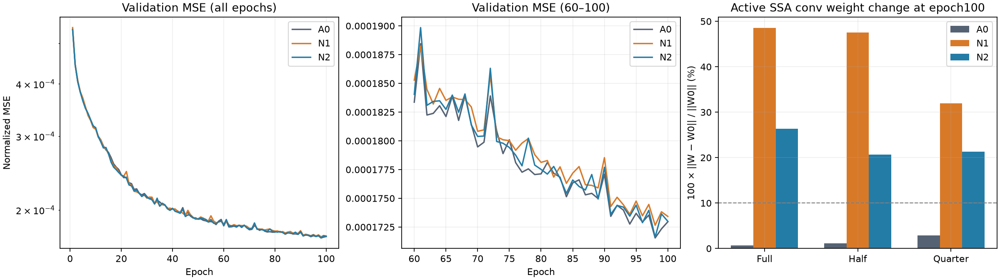

1에폭 validation MSE는 N1 0.000545220881678516, N2 0.0005393954868864738로 사전 중단 한계0.0010792540327653171 미만이었습니다.

## 4. 장면별 차이와 비교 이미지

RR256·FR512의 장면0을 학습 전 진단으로 고정했습니다. 측정한 실제 출력/p RMS 비율입니다.

| 장면0 | 전체 | 절반 | 1/4 |
|---|---:|---:|---:|
| RR | 1.5259099e-05 | 6.10317369e-05 | 0.00024419918 |
| FR | 3.81518178e-06 | 1.52565198e-05 | 6.10706478e-05 |

해상도가 커질수록 감쇠가 커졌습니다. 각단계 pan_ms/res까지 포함한 원시값은 [diagnostics.json](results/diagnostics.json)에 있습니다. FR에는 정답을 만들지 않았습니다.

| 장면별 개선/악화 개수 | RR PSNR | RR SAM | RR ERGAS | 잠정 SCC | 잠정 Q2n | FR Dλ | FR Ds | 잠정 QNR |
|---|---:|---:|---:|---:|---:|---:|---:|---:|
| N1 | 2/18 | 0/20 | 1/19 | 1/19 | 1/19 | 0/20 | 7/13 | 1/19 |
| N2 | 11/9 | 7/13 | 10/10 | 9/11 | 7/13 | 7/13 | 10/10 | 6/14 |

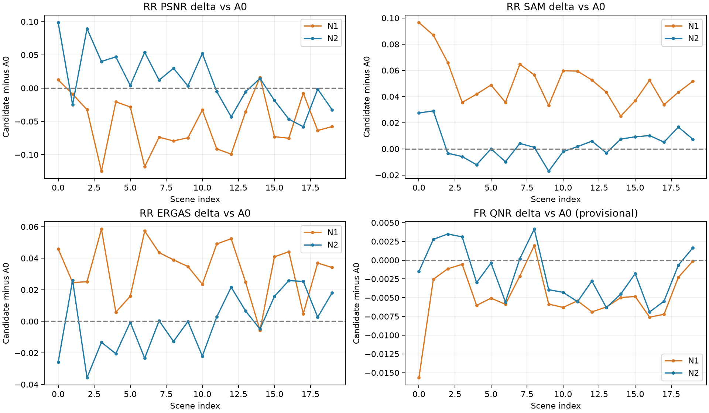

고정한 RR 장면1·8·11·13·19를 모두 보존합니다. LMS·PAN·예측·GT 순서, RGB밴드[2,1,0], LMS는 표시용 nearest 확대입니다. GT1–99% 공통 대비를 LMS·예측·GT에 적용했고 지표에는 표시 대비를 적용하지 않았습니다.

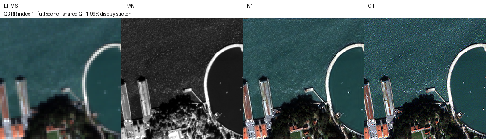

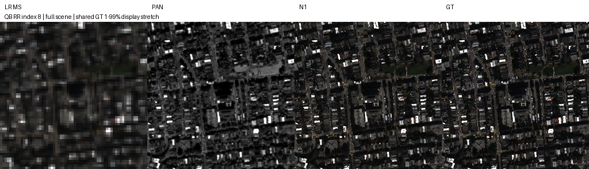

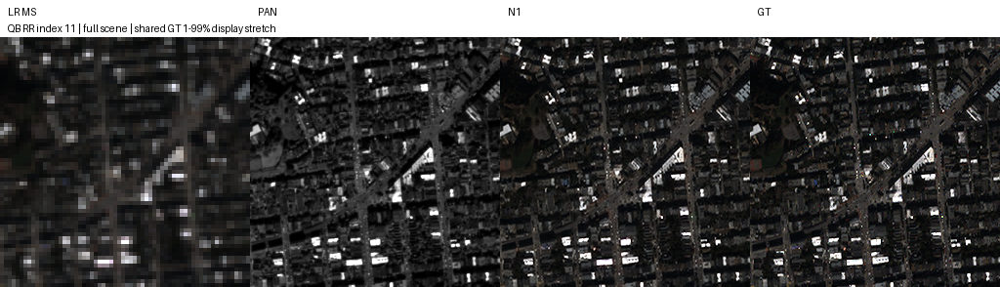

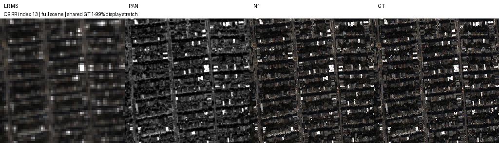

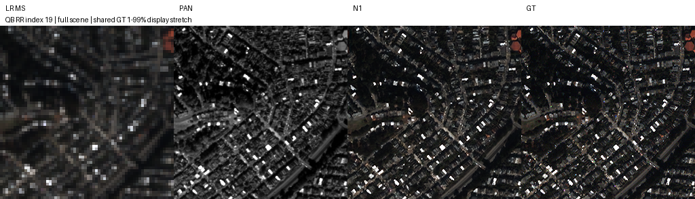

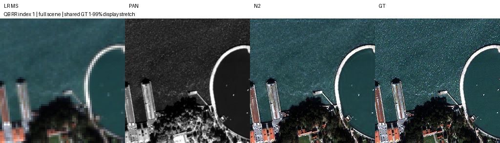

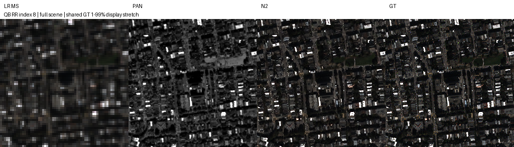

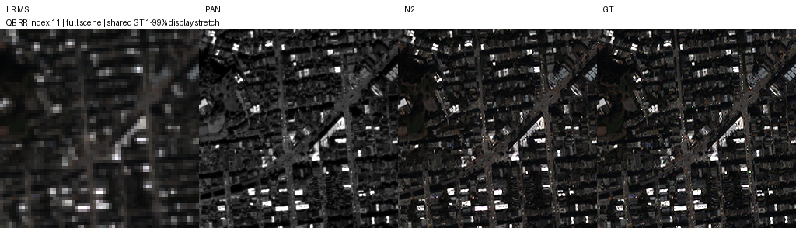

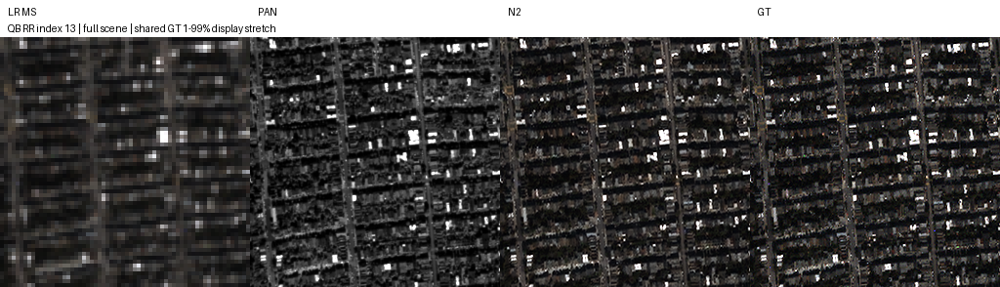

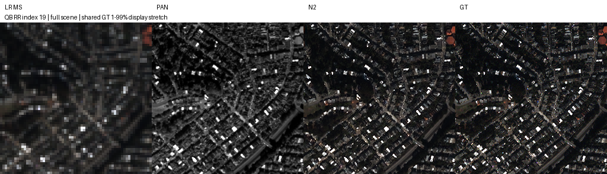

## 5. 파라미터·연산 비용과 실행

| 후보 | 등록 파라미터 | 추가량 |64/256/512 convolution GMAC |
|---|---:|---:|---|
| A0 | 426,654 | 0 | 1.243976 / 19.903611 / 79.614444 |
| N1 | 426,654 | 0 | 1.243976 / 19.903611 / 79.614444 |
| N2 | 426,666 | 12 | 1.243976 / 19.903611 / 79.614444 |

| 후보 |64/256/512 GPU 중앙 추론시간(ms) |64/256/512 최대 allocated(MiB) |
|---|---|---|
| A0 | 15.765 / 15.581 / 28.541 | 6.903 / 85.008 / 334.946 |
| N1 | 15.728 / 16.688 / 28.644 | 6.903 / 85.008 / 334.946 |
| N2 | 15.531 / 16.531 / 28.826 | 6.909 / 85.014 / 334.952 |

현재위치수·gamma 곱과 softmax 등은 convolution GMAC에 포함하지 않았으므로 전체연산비용이 같다는 뜻은 아닙니다. FP32·단일프로세스·합성입력·3회warmup·10회반복입니다. 세 후보를 같은 환경에서 측정했으며 작은 시간차에 통계적 우열을 부여하지 않습니다. P95와 reserved는 profile.json에 있습니다.

5600X·16GB·RTX3060Ti8GB에서 GPU85%/RAM15% 캐시·micro/effective32로2개 병렬 학습했습니다. 재부팅 후 probe는합산333.094패치/초·최소여유VRAM1,329MiB를 기록했습니다. 본학습은2026-10-15 14:21경 시작해N1 17:33:10·N2 17:33:13 KST에100에폭을 완료했습니다. 9번은 실행하지 않았습니다.

NaN/Inf 손실·기울기 또는1에폭 validation이A0 1에폭의2배 이상이면 중단하는 규칙을 적용했고 발산 중단은 없었습니다. 자동lr·batch변경·재시작은 하지 않았습니다.

## 6. 재현·원본 보존과 검증

학습당시 원본소스·config·plan은 [training_source.zip](provenance/training_source.zip)에 그대로 보존합니다. 현재config는결과상태를 추가했으므로 원본설정은ZIP과checkpoint내부plan을 기준으로 합니다. 초기값도 실제 학습 환경의 PyTorch로 재구성한 뒤 학습 전 기록한 텐서 해시와 일치시켜 [initial_state.pt](provenance/initial_state.pt)에 보존했습니다. 다른 PyTorch 버전에서 난수 초기화를 재생성한 값으로 대체하지 않습니다. best/latest4개는 optimizer·torch/CUDA/loader/python/numpy RNG를 포함합니다. 모델소스·초기값·원본data/cache·A0참조가중치의 해시를 검증했습니다.

현재드라이버610.88은 이전채팅의591.86과 다릅니다. PyTorch·CUDA runtime·cuDNN은 기존plan과 일치합니다. 현환경의A0 validation1,905개 MSE는0.0001715509279241805로기록과 정확히 같았습니다. 최종평가는 사용자 서버작업완료후 **A0·N1·N2를 모두 같은CUDA FP32환경에서 처음부터 재평가**했고 기존A0 RR/FR 평균과도 정확히 일치했습니다. 이전평가 시도 결과는 사용자 요청으로 삭제했고 최종결과에 섞지 않았습니다. 드라이버변경전후100에폭 학습궤적이 같다는 의미는 아닙니다.

실험4·6·7과 지표함수·전처리·장면루프·미리보기·비용측정코드가 동일함을 AST로확인했습니다. 변경은N1/N2모델선택과기존A0가중치경로해결뿐입니다. 최종평가는원본peak2047·전체장면·clipping없음이며best는test전에고정했습니다. [evaluator_equivalence.json](results/evaluator_equivalence.json), [selection.json](results/evaluation/selection.json)을확인할수있습니다.

캐시검증은6·7의두전체에폭배치/loader RNG·3Adam업데이트 일치를 재사용했고실제수치함수 AST도일치합니다. 100에폭캐시방식별A0재학습은하지않았습니다. 추가진단은 RNG를보존합니다. 원본좌표복원64·직사각32×48정확일치,정규화w평균1 오차1e-6이내,공통초기값해시,12gamma기울기,64·256·512순전파를실제검증했습니다.

```bash
python SSA-MRN/experiments/ssai/8_spatial_mean_normalization/verify.py --root SSA-MRN
```

검증기는 manifest·원본source ZIP·참조8파일·실제best/latest4개를검증하고strict load·유한CPU추론·optimizer/RNG보존·최신가중치에서의변화량 재계산을확인합니다. 이검증은RR/FR성능재평가가아닙니다. 원격fresh clone에서다시검증한뒤PR로전달합니다.

## 7. 결론과 한계

**두 후보 모두 학습 가능화 성공**입니다. gamma·bias·PReLU와forward미사용conv6t12를제외한실제convolution가중치를기준으로100에폭값을재계산했습니다. 세해상도모두10%이상·A0 latest대비2배이상입니다.

| 후보 | 전체 변화량 | 절반 변화량 |1/4 변화량 |
|---|---:|---:|---:|
| A0 | 0.656% | 1.109% | 2.857% |
| N1 | 48.510% | 47.497% | 31.992% |
| N2 | 26.309% | 20.636% | 21.308% |

N2의100에폭gamma12개는

| 밴드 | 전체 | 절반 |1/4 |
|---|---:|---:|---:|
| 0 | 0.105913 | 0.157550 | 0.213330 |
| 1 | 0.099687 | 0.170735 | 0.244283 |
| 2 | 0.105646 | 0.129894 | 0.122107 |
| 3 | 0.109644 | 0.143012 | 0.110556 |

가중치·gamma는매에폭,고정512개 RMS는1·10·50·100에폭에기록했고전체200개compact행을보존합니다. [N1 history](results/training/N1/history.json), [N2 history](results/training/N2/history.json)에원시값이있습니다.

출력감쇠와작은초기기울기는실측으로확인했고정규화후실제가중치변화도커졌습니다. 그러나학습가능화와성능개선은다릅니다. N1은개선없음,N2는부분개선이므로원본A0유지입니다. 기존1–7실험의작은효과가오직감쇠때문이었다고확정하지않습니다. 단일QB seed42·반복사용exploratory test·독립holdout없음이며잠정QNR/Q2n/SCC의MATLAB parity는미검증입니다.

## 8. 남은 일과 연구 방향

9번의기준후보로 **N2**를제안합니다. validation MSE가N1보다낮고선택된N2자체가학습가능화기준을통과했습니다. 이선택은test결과를사용하지않습니다. 8번학습·RR/FR평가·실제가중치원격보관과복구검증을마친후에만9번을진행합니다. 현재9번은설계만있으며학습미착수입니다. 원본기준모델은A0로유지하고seed43·44반복은사용자에게제안만합니다.
