# 9. PAN 재구성 오차 기반 보정

**연구 분야:** SSAI 개선<br>**연구 담당자·실험자:** 이병현

| 확인된 결과 | 상태 | 개선 여부 |
|---|:---:|:---:|
| A1·A2 모두 주요 RR 지표와 잠정 FR QNR이 악화했습니다. 원본 A0를 유지합니다. | 평가 완료 | 개선 없음 |

[설정](config.json) · [전체 수치](results/evaluation/summary.json) · [판정](results/decision.json) · [보존 manifest](manifest.json)

## 1. 목적과 상태

현재 복원에 부족하거나 과한 PAN 구조를 수정하면 단순 PAN 세부정보 주입보다 복원 성능을 높일 수 있는지 검증했습니다.

A1·A2를 각각100에폭 학습하고 최소 validation MSE의98에폭 best로 RR20·FR20 전체를 평가했습니다. A0도 같은 평가 환경에서 다시 추론해 총120개 장면 예측을 기록했습니다. 두 후보 모두 개선 없음이며 기준은 실험4 원본 A0입니다. 추가 학습을 시작하지 않았습니다.

## 2. 변경한 구조와 비교 조건

SSAI는 backbone이 만든 현재4채널 특징과 PAN을 받아 밴드별 정보를 결합하는 부분입니다. 전체·절반·1/4 해상도에서4개 밴드 블록을 적용하고, 기존 밴드 융합 convolution·PReLU와 작은 크기부터 복원하는 decoder로 연결합니다.

이번에는 각 블록의 PAN1채널·현재 특징4채널+해당 MS밴드1채널 입력과 K4채널 출력을 유지하면서 내부 연산을 교체했습니다. backbone·밴드 융합·decoder·손실·데이터 처리·분할은 같습니다. K=4와 공간 확대4배는 서로 다른 값이며 모두 유지합니다.

`HP(x)=x-reflect_avgpool5x5(x)`로 정의하고 두 후보는 `gamma × HP(PAN투영(HP(입력오차)) × 2sigmoid(MS투영))`를 출력합니다. PAN투영은 bias 없는3x3(1→4)·ReLU·3x3(4→4), MS투영은 기존3x3(5→4)입니다. gamma는 블록별 스칼라12개로 초기0.1입니다. 공간 softmax·면적 나누기·출력 RMS 강제 정규화는 없습니다. 마지막 투영과 고주파 연산은 양수·음수 보정을 허용합니다.

| 후보 | 입력오차 | 확인하는 효과 |
|---|---|---|
| A0 | 원본 공간 softmax SSAI | 원본 대조군·재학습 없음 |
| A1 | PAN | 감쇠 없는 PAN 고주파 직접 보정 |
| A2 | PAN−현재 특징의 예측 PAN | 이미 복원한 정보를 뺀 오차 보정 |

A1·A2의 모듈·파라미터 수·추가 초기값은 같습니다. A0와 비교하면 게이트·고주파·bias 처리 등도 함께 달라지므로, **재구성 오차 사용의 효과는 A2와 A1을 비교해 해석합니다.** 원본 conv6t12와 PAN투영의 bias들은 state 호환을 위해 남겼지만 두 후보의 forward에서 사용하지 않습니다. bias 제외는 입력 구조 오차0이면 블록 출력도 정확히0이 되게 합니다. 미사용 파라미터가 포함된 등록 개수와 실제 사용 개수를 구분합니다.

예측 PAN은 train512개의 저주파 LMS/PAN 입력으로 ridge affine 계수4개와 offset1개를 추정해 고정했습니다. GT·validation·test로 계수를 맞추지 않았으며 추가 학습 손실도 없습니다. 이 계수를 현재 특징4채널에 적용하므로 정확한 센서 관측식이라는 보장은 없습니다. 현재 특징은 원본 MS 자체가 아닙니다.

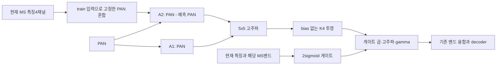

| 조건 | 실제 설정 |
|---|---|
| 데이터 | QB 원본 train17,139·validation1,905·2047 정규화·추가 augmentation 없음 |
| 학습 | seed42·100에폭·micro/effective32·FP32·AMP/TF32 off·결정론 |
| 최적화 | Adam lr1e-4 일정·betas0.9/0.999·eps1e-8·weight decay0·MSE |
| 초기값 | 원본 A0의 동일 공통 초기값·동일 샘플 순서·가중치 warm start 없음 |
| 크기 | train64×64·RR256×256·FR512×512·K4·공간4배 |
| 캐시 | 기존 GPU85%/RAM15%·동일 배치/난수/Adam 경로 재사용 |
| 선택 | 최소 validation MSE·정확한 동률은 먼저 나온 에폭·test 선택 없음 |
| 환경 | 5600X·16GB·3060Ti8GB·PyTorch2.7.1+cu128·cuDNN90701·driver610.88 |

사전 검증에서 공통 초기값 해시, 전체12블록 기울기,64·256·512·직사각32×48 순전파, A2 입력 오차0에서 출력0을 확인했습니다. 기존 cache 수치 경로를 유지했습니다. 병렬 probe는합산328.116패치/초·최소 VRAM 여유2,089MiB였고 worker 예산2,810MiB와 추가512MiB 여유를 두고 실행했습니다. OOM 시 자동 배치·캐시 변경이나 재시작을 하지 않습니다. NaN/Inf 또는1에폭 validation MSE가 A0 1에폭의2배 이상이면 중단하는 규칙을 적용했고 중단은 없었습니다.

## 3. 정량 결과

| 후보 | best 에폭 | validation MSE ↓ | A0 대비 |
|---|---:|---:|---:|
| A0 | 98 | 0.000171550928 | +0.0000% |
| A1 | 98 | 0.000172310610 | +0.4428% |
| A2 | 98 | 0.000171721973 | +0.0997% |

**RR 전체20장 평균**

| 후보 | PSNR ↑ | SAM ↓ | ERGAS ↓ | 잠정 SCC ↑ | 잠정 Q2n ↑ |
|---|---:|---:|---:|---:|---:|
| A0 | 37.45358907 | 4.92827439 | 4.11010019 | 0.97694833 | 0.92323899 |
| A1 | 37.42217626 | 4.94554274 | 4.13111155 | 0.97664749 | 0.92185938 |
| A2 | 37.41836506 | 4.94559364 | 4.13159546 | 0.97657482 | 0.92218081 |

| A0 대비 차이 | PSNR | SAM | ERGAS | SCC | Q2n |
|---|---:|---:|---:|---:|---:|
| A1 | -0.03141281 | +0.01726835 | +0.02101136 | -0.00030083 | -0.00137961 |
| A2 | -0.03522401 | +0.01731925 | +0.02149528 | -0.00037350 | -0.00105818 |

**FR 전체20장 평균**

| 후보 | Dλ ↓ | Ds ↓ | 잠정 QNR ↑ |
|---|---:|---:|---:|
| A0 | 0.04516672 | 0.03961365 | 0.91741058 |
| A1 | 0.04540355 | 0.03960497 | 0.91718670 |
| A2 | 0.04412187 | 0.04078140 | 0.91732208 |

| A0 대비 차이 | Dλ | Ds | QNR |
|---|---:|---:|---:|
| A1 | +0.00023683 | -0.00000868 | -0.00022389 |
| A2 | -0.00104485 | +0.00116774 | -0.00008850 |

RR은 peak2047·밴드별 평균 PSNR이며 validation global MSE 기반 PSNR과 정의가 다릅니다. clipping 없이 전체 장면을 평가했습니다. QNR·Q2n·SCC는 MATLAB parity 미검증이므로 잠정입니다. FR에는 정답이 없으며 FR 지표를 RR 정확도와 동일하게 해석하지 않습니다.

| 장면별 개선/악화 개수 | RR PSNR | RR SAM | RR ERGAS | 잠정 SCC | 잠정 Q2n | FR Dλ | FR Ds | 잠정 QNR |
|---|---:|---:|---:|---:|---:|---:|---:|---:|
| A1 | 2/18 | 3/17 | 2/18 | 0/20 | 3/17 | 9/11 | 10/10 | 10/10 |
| A2 | 2/18 | 2/18 | 1/19 | 1/19 | 3/17 | 15/5 | 5/15 | 10/10 |

동률 장면은 없습니다. 두 후보 모두 PSNR 개선 장면은2/20개입니다. A1의 FR Ds와 A2의 FR Dλ는 평균이 소폭 좋아졌지만 RR 주요 지표와 잠정 QNR이 모두 악화해 두 후보 모두 개선 없음입니다.

| 후보 | 등록 파라미터 | A0 대비 | 실제 사용 SSAI 파라미터 |64/256/512 Conv GMAC |
|---|---:|---:|---:|---|
| A0 |426,654 |0 |4,464 |1.243976 /19.903611 /79.614444 |
| A1 |426,666 |12 |4,380 |1.243976 /19.903611 /79.614444 |
| A2 |426,666 |12 |4,380 |1.243976 /19.903611 /79.614444 |

bias를 사용하지 않아 실제 사용 개수는 줄고 gamma12개가 추가됩니다. functional convolution으로 실행한 PAN투영도 MAC에 포함하도록 계수했습니다. 평균 필터·고주파·게이트·원소 곱·메모리 이동은 Conv GMAC에 포함하지 않으므로 전체 연산 비용이 같다는 뜻은 아닙니다.

| 후보 |64/256/512 GPU 중앙 추론 시간(ms) |64/256/512 최대 allocated(MiB) |
|---|---|---|
| A0 | 15.463 / 15.532 / 28.828 | 6.903 / 85.008 / 334.946 |
| A1 | 17.331 / 17.873 / 29.307 | 6.915 / 85.020 / 334.958 |
| A2 | 17.630 / 18.532 / 29.806 | 6.915 / 85.020 / 334.958 |

같은 GPU·단일 프로세스·FP32 합성 입력에서3회 warmup·10회 반복했습니다. 실제 전체 forward를 측정했으며 P95·reserved는 profile.json에 있습니다. 후보의 필터 연산으로 시간이 증가했지만 적은 반복의 시간 차이에 통계적 우열을 부여하지 않습니다.

## 4. 기준선 대비 차이와 해석

A2는 validation MSE가 A1보다 낮았지만 A0를 넘지 못했습니다. RR PSNR도 A1보다 낮고 SAM·ERGAS도 더 나빴습니다. 이 비교에서 PAN 재구성 오차 사용의 이득은 확인하지 못했습니다.

학습 전 A0 best의 validation128개에서, 현재 단계 특징과 크기를 맞춘 GT 사이 고주파 오차에 대한 방향을 진단했습니다. GT는 진단에만 사용했고 중간 감독이나 추가 손실로 쓰지 않았습니다.

| 단계 | PAN 직접 고주파 방향 유사도 | PAN 재구성 오차 방향 유사도 |
|---|---:|---:|
| 전체 | 0.433645 | 0.507064 |
| 절반 | 0.402995 | 0.453462 |
| 1/4 | 0.332968 | 0.374816 |

모든 단계에서 양수 방향 필요 조건을 통과했고 오차 방식의 pooled cosine이 높았습니다. 그러나 최종 RR/FR 향상으로 연결되지 않았습니다. 진단의 최적 스칼라는 모델에 적용하지 않았습니다. GT 크기는 bilinear로 맞춘 진단이며 실제 단계별 정답 특징이라는 보장은 없습니다.

**학습량 증가와 성능 개선을 구분합니다.** 실제100에폭 가중치에서 bias·gamma·미사용 conv6t12를 제외한 convolution 가중치 상대 변화를 재계산했습니다.

| 후보 | 전체 | 절반 |1/4 |
|---|---:|---:|---:|
| A0 | 0.656% | 1.109% | 2.857% |
| A1 | 72.095% | 68.548% | 33.678% |
| A2 | 83.823% | 80.714% | 41.828% |

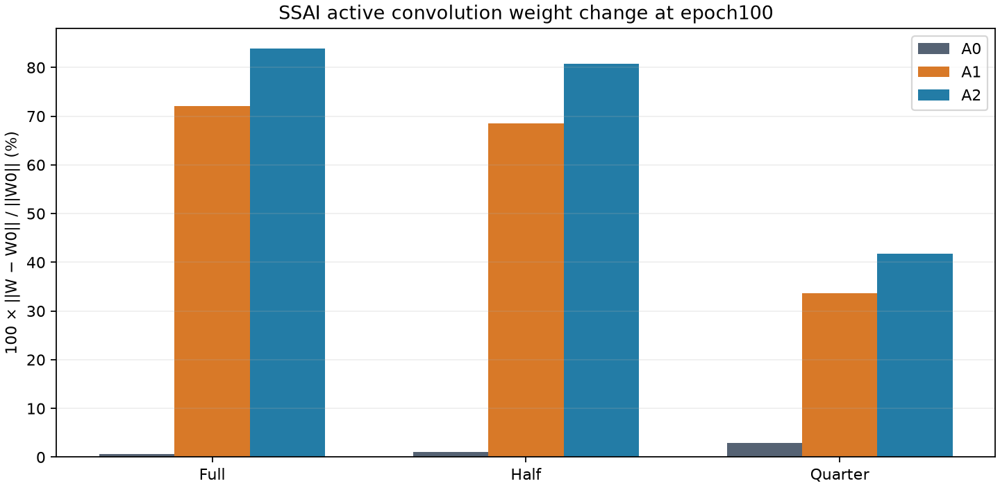

새 블록은 실제로 학습됐지만, 가중치가 많이 바뀌거나 중간 오차 방향이 맞는 것만으로 유용한 복원을 보장하지 않았습니다. 고정 분광 혼합·고주파 제한·게이트·기존 decoder와의 상호작용 중 어느 요인이 원인인지는 이번 비교만으로 확정하지 않습니다.

## 5. 학습·평가 그래프

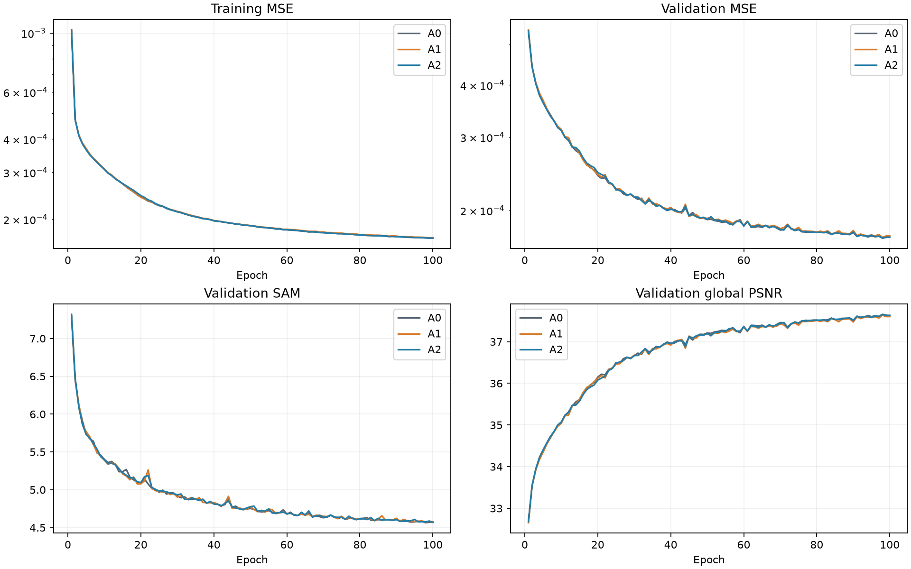

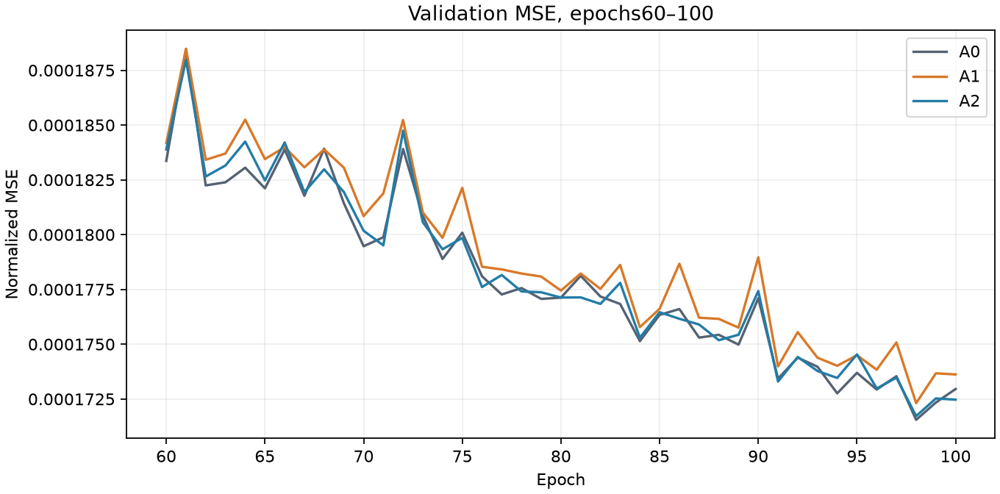

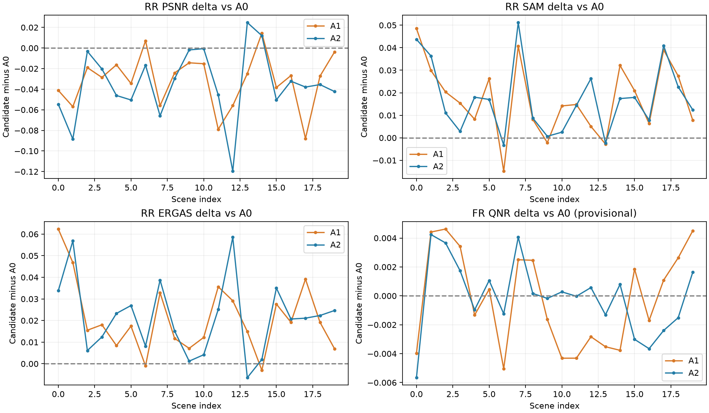

A1은2026-10-15 21:54:07, A2는21:59:01 KST에100에폭을 마쳤습니다. 에폭별 compact200개 기록에 train/validation MSE·SAM·global PSNR·gamma12개·해상도별 가중치 변화를 보존했습니다. 두 best는98에폭이고 latest는100에폭입니다. 현재 첫 에폭 기록은 초기 실행 검증 자료이며 최종 성능 수치와 구분합니다.

## 6. 결과 이미지

사전 고정 RR 장면1·8·11·13·19를 후보별로 모두 표시합니다. LR MS·PAN·예측·GT 순서입니다. RGB밴드[2,1,0], GT1–99% 표시 대비를 LR MS·예측·GT에 공통 적용하고 PAN은 별도 대비로 표시했습니다. LR MS의 nearest 확대는 표시용이며 지표 계산에 사용하지 않았습니다. FR에는 GT를 만들지 않았습니다.


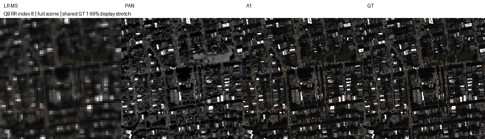

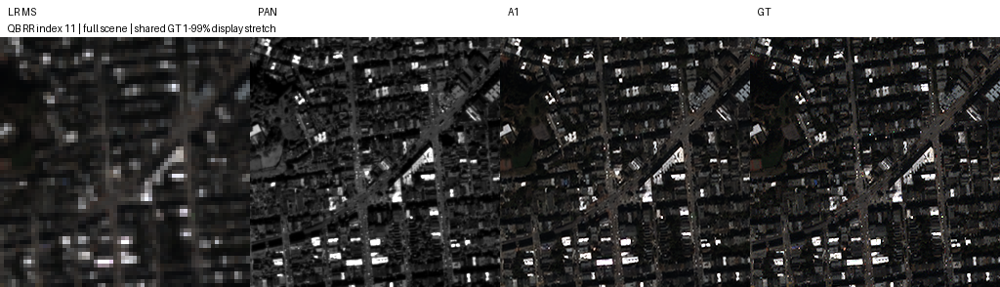


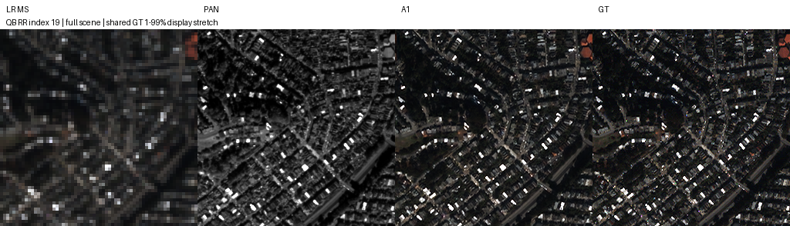

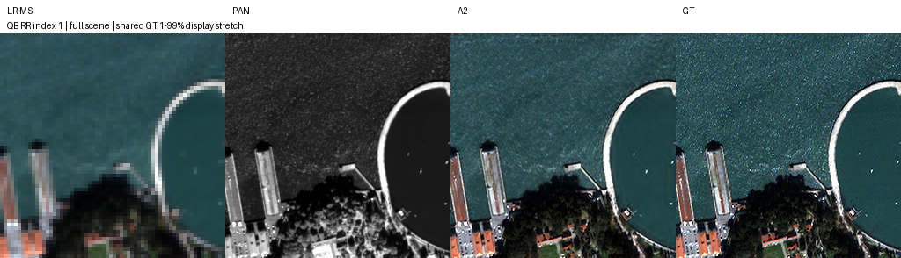

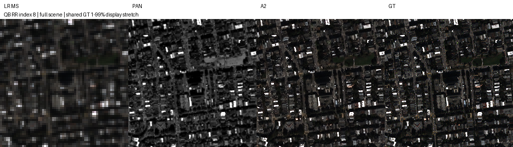

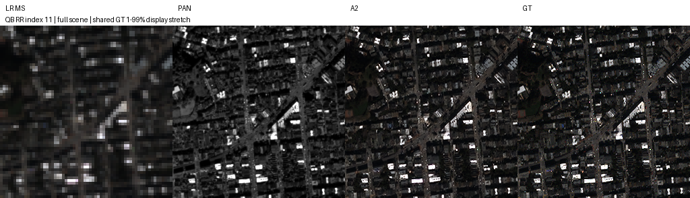

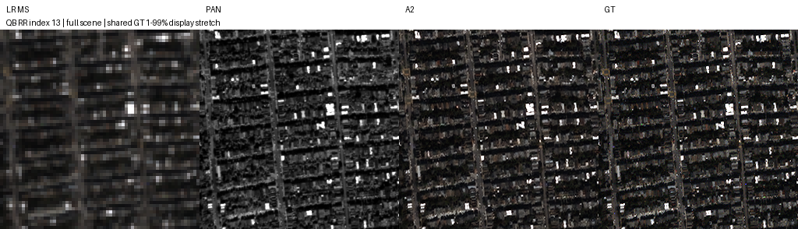

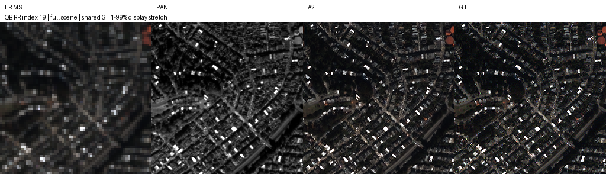

## 7. 재현 자료

실제 best/latest4개·학습 당시 소스/설정·원본 초기값·전체 compact 기록·RR/FR 지표와 예시를 보존합니다. 현재 config에는 완료 상태를 추가했으므로 실제 학습 설정은 [training_source.zip](provenance/training_source.zip)과 checkpoint 내부 plan을 기준으로 합니다. 원본 snapshot과 체크포인트 내부 설정·식별자는 바꾸지 않았으며 현행 로더가 해당 가중치를 읽도록 연결합니다. 초기값은 실제 서버 환경에서 생성해 학습 전 A0 텐서 해시와 일치시켰습니다.

최종 evaluator는 실험8의 RR/FR 장면 루프·지표·전처리·미리보기 코드와 AST가 같습니다. 변경은 후보 dispatch·A0 경로·새로운 functional PAN convolution의 MAC 계수입니다. [evaluator_equivalence.json](results/evaluator_equivalence.json)을 확인합니다. A0도 동일 CUDA FP32 환경에서 재평가했고 기존 RR/FR 평균과 정확히 일치했습니다. 원본 A0의 학습 당시 driver는 checkpoint plan에서 확인하지 못했으므로 모든 학습 궤적의 환경 일치까지 주장하지 않습니다.

공통 체크포인트 로더에9번 후보 판별을 추가했습니다. 기존6·7·8번 실제 가중치 로드와 유한 CPU추론, 다른 실험 체크포인트의9번 오인 방지를 확인했습니다. 기존 학습 소스는 그대로 보존하고6·7 manifest의 현행 공유 로더 해시만 갱신합니다.

```bash
python SSA-MRN/experiments/ssai/9_pan_innovation_correction/verify.py --root SSA-MRN
```

검증기는 manifest·원본 source ZIP·참조 A0 파일3개·실제 가중치4개·optimizer/RNG·strict load·유한 CPU추론·최종 가중치 변화량을 검증합니다. **파일 무결성·복구 검증이며 RR/FR 성능 재평가가 아닙니다.** 원격 fresh clone에서 이 검증을 다시 실행해 복구 가능 여부를 확인합니다.

## 8. 개선 여부와 다음 단계

**A1·A2 모두 개선 없음**입니다. 사전 도전 목표PSNR +0.3dB에 도달하지 못했고 주요 RR 지표와 잠정 QNR이 악화했습니다. 기준 모델은 원본 A0를 유지하며 A2를 자동 승격하지 않습니다.

단일 QB seed42·반복 사용한 탐색 test·독립 holdout 없음·잠정 지표의 MATLAB parity 미검증 한계가 있습니다. 이번 결과는 SSAI의 모든 오차 보정 방식이 무효라는 결론이 아닙니다. 기존 backbone과 SSAI의 중복 역할, 실제 오류의 성격을 먼저 진단하는 후속 설계가 필요하며 추가 학습은 시작하지 않았습니다.
