# 1. 가변 배율 복원과 배율 조건

**연구 분야:** 가변 배율 확장

**실험자:** 김윤지

**변경 내용:** 입력 배율과 내부 복원 피라미드를 분리하고 2·3·4배 전용 학습, 공동 학습, 배율 FiLM 조건을 비교했습니다.

| 확인된 결과 | 상태 | 개선 여부 |
|---|:---:|:---:|
| 공동 모델은 세 배율을 처리했으나 전용 대비 PSNR이 약 0.40-0.98 dB 낮았습니다. FiLM은 조건 없는 공동 모델 대비 3·4배에서 소폭 개선했습니다. | 학습&nbsp;완료·일부&nbsp;평가 | 판단&nbsp;보류 |

[실험 목록](../../../README.md#variable_scale-experiments) · [수치](#results) · [그래프](#graphs) · [이미지](#images) · [재현 자료](#evidence)

## 1. 목적과 상태

기존 고정 4배 복원을 여러 입력 배율에서 동작하도록 확장하고, 하나의 공동 모델이 배율별 전용 모델 대비 어느 정도의 성능과 학습 비용을 유지하는지 확인했습니다. 2026-10-14 20:29 KST 기준 6개 모델 각각 100에포크 학습과 배율별 RR 전체 20개 test 샘플 평가를 마쳤습니다. 전체 suite 경과 시간은 약 4시간 54분입니다. 원본 장면 출처와 FR 평가는 미검증이므로 전체 독립 장면 평가 완료로 표시하지 않습니다.

## 2. 변경한 구조와 비교 조건

원본 SSAI 연산·K=4·backbone·복원 convolution·MSE를 유지했습니다. 새 구조는 내부 전체·절반·1/4 피라미드를 유지하면서 입력 MS를 각 단계 목표 size로 정렬합니다. 공동 모델 C는 배율마다 같은 구조를 사용하고, D는 backbone 특징에 log2(r)→MLP→FiLM을 추가합니다. FiLM은 항등 변환으로 초기화했습니다.

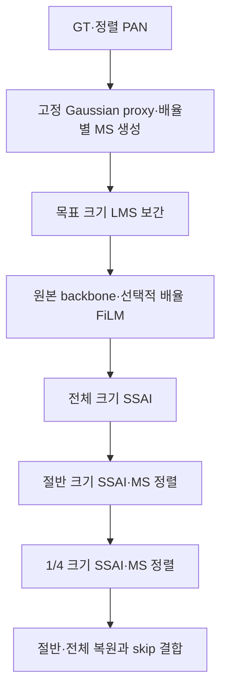

| 항목 | 실제 조건 |
|---|---|
| 센서·입력 | QB, MS 4밴드·PAN 1밴드, DN/2047, 원값 clip 없음 |
| A_x4 | 보존한 원본 4배 경로·제공 MS/LMS, native RR 참고 대조군 |
| B_x2/B_x3/B_x4 | 새 정렬 구조, 배율별 전용 모델3개 |
| C_mixed | 2·3·4배 공동 모델, 조건 모듈 없음 |
| D_mixed | C와 같은 구조·열화·배치 순서, 배율 FiLM 추가 |
| 학습·validation | train 17,139개, validation 1,905개 H5 샘플; 원본 장면 ID 없음 |
| 합성 target | 64×64 학습 입력을 60×60, RR 256×256을 252×252로 공통 top-left crop |
| LR MS 크기 | 학습 2/3/4배에서30/20/15, RR에서126/84/63 |
| 열화 | GT에 Gaussian sigma=r/2, radius=ceil(3sigma), reflect 적용 후 floor(r/2)위상 stride decimation |
| 보간 | bilinear align_corners=False; 축소 AA, 확대 AA 없음; 원본 A 좌표와 구분 |
| 장치·정밀도 | Tesla T4 ×2, 독립 worker·GPU 큐, FP32, AMP=False |
| 학습 | seed 42, 각 100에포크, 유효/micro batch 32, Adam(foreach), 고정 LR 1e-4, MSE |
| best 선택 | validation의 배율별 평균 MSE 동일 가중 평균; test 선택 없음 |
| 비교 통제 | 6군 공통 초기화·100에포크 인덱스 순서 해시 일치, 실제 update 각 53,600회 |

배율별 전용 모델은 해당 배율에서 53,600회, 공동 모델은 각 배율에서 17,866 또는17,867회 갱신했습니다. 총 학습량을 같게 맞춘 비교이며 배율별 노출량이 같지는 않습니다. 학습에서 보지 않은 배율·비정수 배율·8배 일반화는 평가하지 않았습니다. Gaussian은 통제된 합성 proxy이며 실제 센서의 MTF 열화가 검증된 결과가 아닙니다. 사전처리 MS/LMS의 유한한 범위 이탈은 원값을 유지하고 기록했습니다.

CUDA strict deterministic과 native bilinear backward의 충돌은 native forward를 보존하고 고정 보간 행렬의 전치 곱으로 backward를 계산해 처리했습니다. 원본 A에도 같은 backward 처리를 적용했습니다. 이는 GPU 반복 재개 비트 일치까지 검증했다는 뜻은 아닙니다.

## 3. 정량 결과

전체 RR 20샘플의 각 지표를 계산해 평균했습니다. 자동 생성된 UNVERIFIED ID는 독립 원본 장면으로 검증된 ID가 아닙니다. PSNR은 정규화 peak 1의 밴드별 평균, MSE는 정규화 값, SAM은 degree, ERGAS는 해당 입력 배율을 사용합니다. prediction clip과 경계 제외는 하지 않았습니다.

| 모델 | 배율 | PSNR↑ | SAM↓ | ERGAS↓ | SSIM↑ | MSE↓ |
|---|---:|---:|---:|---:|---:|---:|
| B_x2 | 2배 | 40.2414 | 3.5890 | 5.9537 | 0.976964 | 0.00011185 |
| B_x3 | 3배 | 38.5002 | 4.3810 | 4.8562 | 0.964509 | 0.00016681 |
| B_x4 | 4배 | 37.8425 | 4.8426 | 3.9453 | 0.957199 | 0.00019561 |
| C_mixed | 2배 | 39.2574 | 3.9833 | 6.6566 | 0.971219 | 0.00013983 |
| C_mixed | 3배 | 37.9991 | 4.5841 | 5.1626 | 0.960691 | 0.00018864 |
| C_mixed | 4배 | 37.3661 | 5.0276 | 4.1862 | 0.952675 | 0.00021983 |
| D_mixed | 2배 | 39.2566 | 3.9733 | 6.6597 | 0.971328 | 0.00014001 |
| D_mixed | 3배 | 38.0825 | 4.5490 | 5.1101 | 0.961295 | 0.00018488 |
| D_mixed | 4배 | 37.4403 | 4.9932 | 4.1443 | 0.953506 | 0.00021600 |

원본 A_x4의 제공 native RR 결과는 PSNR 37.3107 dB·SAM 4.9479°입니다. 제공 입력과 합성 열화·crop이 달라 위 합성 B/C/D와 직접 delta를 계산하지 않았습니다. 모든 모델의 FR은 **미평가**입니다.

| 모델 | best epoch | latest 완료 epoch |
|---|---:|---:|
| A_x4 | 100 | 100 |
| B_x2 | 97 | 100 |
| B_x3 | 100 | 100 |
| B_x4 | 99 | 100 |
| C_mixed | 100 | 100 |
| D_mixed | 100 | 100 |

## 4. 기준선 대비 차이와 해석

같은 배율·같은 합성 규약의 전용 B에 대한 현재−기준 차이입니다.

| 공동 모델 | 배율 | ΔPSNR(dB) | ΔSAM(°) | ΔMSE |
|---|---:|---:|---:|---:|
| C_mixed | 2배 | -0.9840 | +0.3942 | +0.00002798 |
| C_mixed | 3배 | -0.5011 | +0.2031 | +0.00002183 |
| C_mixed | 4배 | -0.4764 | +0.1850 | +0.00002422 |
| D_mixed | 2배 | -0.9848 | +0.3842 | +0.00002816 |
| D_mixed | 3배 | -0.4177 | +0.1680 | +0.00001808 |
| D_mixed | 4배 | -0.4022 | +0.1507 | +0.00002040 |

공동 C와 D는 모두 전용 B보다 낮았습니다. D−C는2배PSNR−0.0008dB·SAM−0.0100°, 3배PSNR+0.0834dB·SAM−0.0351°, 4배PSNR+0.0742dB·SAM−0.0344°입니다. FiLM의3·4배 이득은 관측됐으나 전용 모델을 넘지 못했고 단일 시드의 소폭 차이이므로 최종 채택을 확정하지 않습니다.

| 모델 | parameter 수 | 측정 batch 연산 시간(분) | 실제 update |
|---|---:|---:|---:|
| A_x4 | 426,654 | 75.92 | 53,600 |
| B_x2 | 426,654 | 72.56 | 53,600 |
| B_x3 | 426,654 | 69.51 | 53,600 |
| B_x4 | 426,654 | 72.59 | 53,600 |
| C_mixed | 426,654 | 69.13 | 53,600 |
| D_mixed | 428,862 | 73.58 | 53,600 |

전용 B 3개의 측정 batch 시간 합계는약 214.65분, 공동 C는약 69.13분·D는약 73.58분입니다. CUDA event로 누적한 batch 연산 시간이며 validation·저장·프로세스 시작을 포함한 전체 wall time과 구분합니다. GPU별 작업은 병렬 실행됐으므로 단순 시간 합계를 suite 경과 시간으로 해석하지 않습니다. 실제 처리 sample/pixel, validation/저장 시간, peak 메모리와 입력 크기별 추론 시간은 [비용 원본](results/D_mixed/costs.json)에 보존합니다.

## 5. 학습·평가 그래프

실제 100에포크 train MSE·validation MSE/PSNR/SAM을 표시합니다. 추정 곡선은 없습니다.

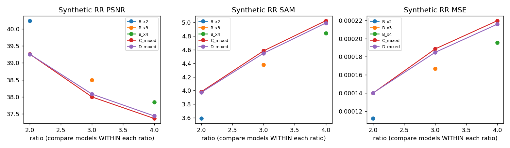

### A_x4

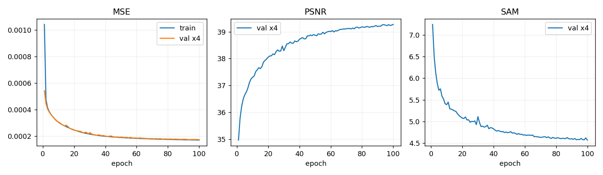

### B_x2

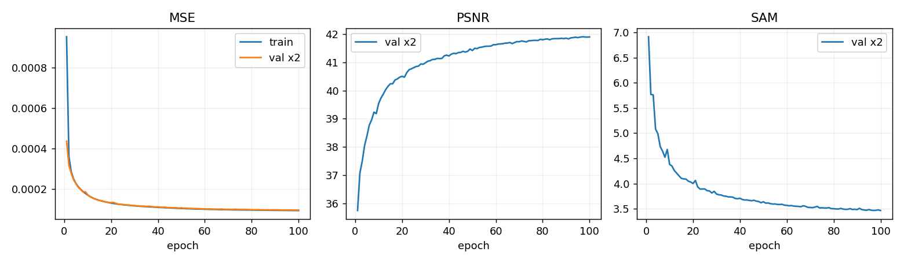

### B_x3

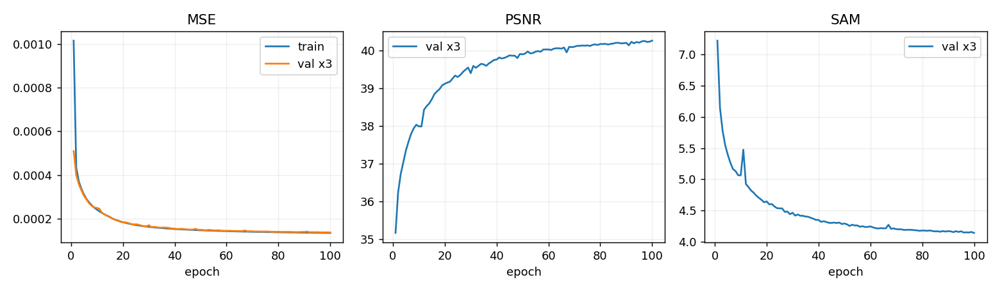

### B_x4

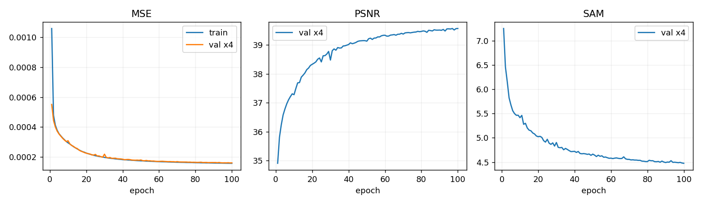

### C_mixed

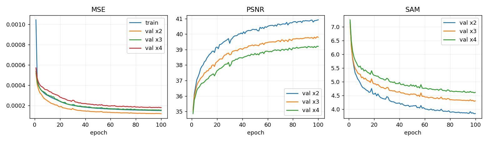

### D_mixed

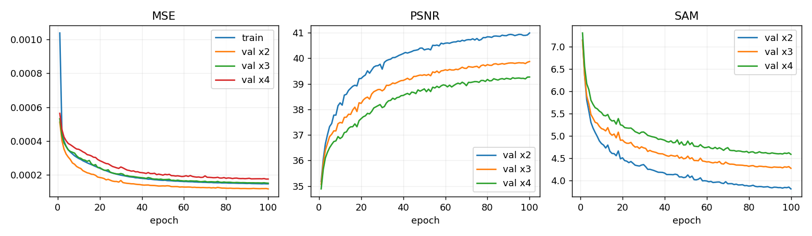

## 6. 결과 이미지

학습 전에 seed 42로 고정한 RR index 1·8·11·13·19입니다. 왼쪽부터 LR MS(최근접 확대)·PAN·예측·GT이며, 같은 샘플의 MS 패널에는 GT에서 정한 2/98 percentile 공통 대비를 적용했습니다. RGB 표시 밴드[2,1,0]은 가정입니다. 아래는 D_mixed의 4배 결과이며, 원본 장면 출처는 미검증입니다.

### 고정 예시 1

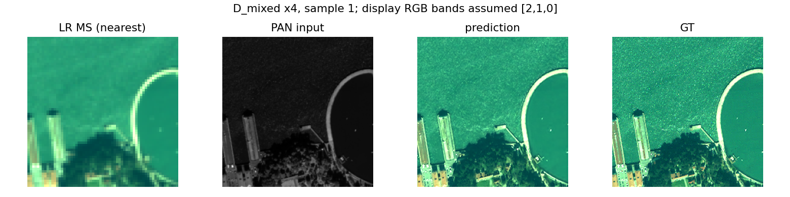

### 고정 예시 8

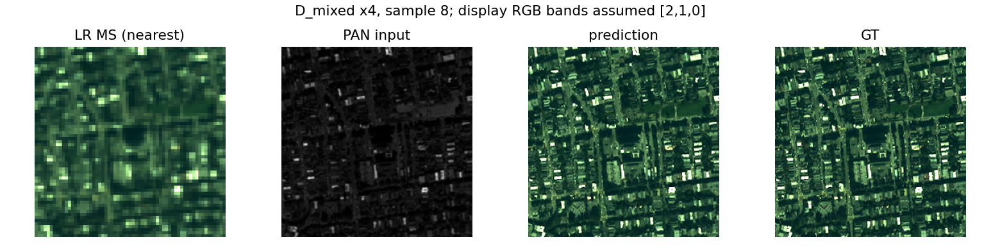

### 고정 예시 11

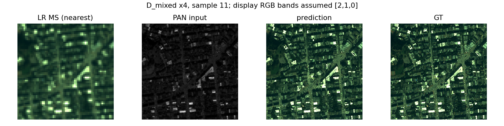

### 고정 예시 13

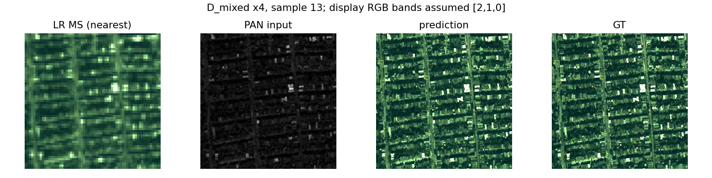

### 고정 예시 19

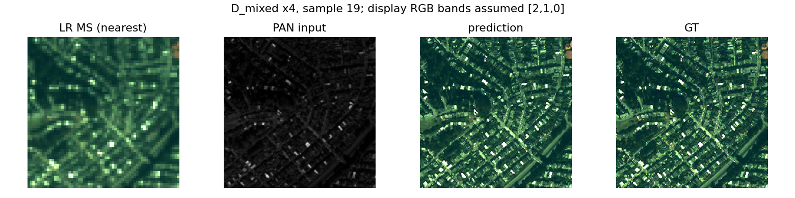

다른 모델·배율의 고정 예시 45개

- [A_x4 4배 · 예시 1](results/A_x4/rr_x4_sample_001.png)
- [A_x4 4배 · 예시 8](results/A_x4/rr_x4_sample_008.png)
- [A_x4 4배 · 예시 11](results/A_x4/rr_x4_sample_011.png)
- [A_x4 4배 · 예시 13](results/A_x4/rr_x4_sample_013.png)
- [A_x4 4배 · 예시 19](results/A_x4/rr_x4_sample_019.png)
- [B_x2 2배 · 예시 1](results/B_x2/rr_x2_sample_001.png)
- [B_x2 2배 · 예시 8](results/B_x2/rr_x2_sample_008.png)
- [B_x2 2배 · 예시 11](results/B_x2/rr_x2_sample_011.png)
- [B_x2 2배 · 예시 13](results/B_x2/rr_x2_sample_013.png)
- [B_x2 2배 · 예시 19](results/B_x2/rr_x2_sample_019.png)
- [B_x3 3배 · 예시 1](results/B_x3/rr_x3_sample_001.png)
- [B_x3 3배 · 예시 8](results/B_x3/rr_x3_sample_008.png)
- [B_x3 3배 · 예시 11](results/B_x3/rr_x3_sample_011.png)
- [B_x3 3배 · 예시 13](results/B_x3/rr_x3_sample_013.png)
- [B_x3 3배 · 예시 19](results/B_x3/rr_x3_sample_019.png)
- [B_x4 4배 · 예시 1](results/B_x4/rr_x4_sample_001.png)
- [B_x4 4배 · 예시 8](results/B_x4/rr_x4_sample_008.png)
- [B_x4 4배 · 예시 11](results/B_x4/rr_x4_sample_011.png)
- [B_x4 4배 · 예시 13](results/B_x4/rr_x4_sample_013.png)
- [B_x4 4배 · 예시 19](results/B_x4/rr_x4_sample_019.png)
- [C_mixed 2배 · 예시 1](results/C_mixed/rr_x2_sample_001.png)
- [C_mixed 2배 · 예시 8](results/C_mixed/rr_x2_sample_008.png)
- [C_mixed 2배 · 예시 11](results/C_mixed/rr_x2_sample_011.png)
- [C_mixed 2배 · 예시 13](results/C_mixed/rr_x2_sample_013.png)
- [C_mixed 2배 · 예시 19](results/C_mixed/rr_x2_sample_019.png)
- [C_mixed 3배 · 예시 1](results/C_mixed/rr_x3_sample_001.png)
- [C_mixed 3배 · 예시 8](results/C_mixed/rr_x3_sample_008.png)
- [C_mixed 3배 · 예시 11](results/C_mixed/rr_x3_sample_011.png)
- [C_mixed 3배 · 예시 13](results/C_mixed/rr_x3_sample_013.png)
- [C_mixed 3배 · 예시 19](results/C_mixed/rr_x3_sample_019.png)
- [C_mixed 4배 · 예시 1](results/C_mixed/rr_x4_sample_001.png)
- [C_mixed 4배 · 예시 8](results/C_mixed/rr_x4_sample_008.png)
- [C_mixed 4배 · 예시 11](results/C_mixed/rr_x4_sample_011.png)
- [C_mixed 4배 · 예시 13](results/C_mixed/rr_x4_sample_013.png)
- [C_mixed 4배 · 예시 19](results/C_mixed/rr_x4_sample_019.png)
- [D_mixed 2배 · 예시 1](results/D_mixed/rr_x2_sample_001.png)
- [D_mixed 2배 · 예시 8](results/D_mixed/rr_x2_sample_008.png)
- [D_mixed 2배 · 예시 11](results/D_mixed/rr_x2_sample_011.png)
- [D_mixed 2배 · 예시 13](results/D_mixed/rr_x2_sample_013.png)
- [D_mixed 2배 · 예시 19](results/D_mixed/rr_x2_sample_019.png)
- [D_mixed 3배 · 예시 1](results/D_mixed/rr_x3_sample_001.png)
- [D_mixed 3배 · 예시 8](results/D_mixed/rr_x3_sample_008.png)
- [D_mixed 3배 · 예시 11](results/D_mixed/rr_x3_sample_011.png)
- [D_mixed 3배 · 예시 13](results/D_mixed/rr_x3_sample_013.png)
- [D_mixed 3배 · 예시 19](results/D_mixed/rr_x3_sample_019.png)

## 7. 재현 자료

원본 best/latest 12개를 [checkpoints](checkpoints)에 보존했습니다. checkpoint 내부 설정을 바꾸지 않았고 큰 원본 파일은 Git LFS로 추적합니다. clone 시 Git LFS를 설치하고 `git lfs pull`로 원본을 받습니다. 배율별 전체 샘플 숫자는 각 모델의 `results/<모델>/rr_metrics.json`, 실측 compact 기록은 `compact_history.json`에 있습니다. 복구에 필요한 전체 학습 상태는 원본latest에 그대로 남아 있습니다.

[실제 설정](config.json) · [예시 선택](provenance/selection.json) · [원본 소스](provenance/runtime/variable_scale) · [소스·데이터 식별](provenance/suite_identity.json) · [다운로드 검증](results/download_verification.json) · [현재 파일 manifest](manifest.json)

다운로드 ZIP의 CRC·분할 전체 해시·내부 216파일 SHA-256을 확인했습니다. best의 validation 최솟값 선택·유한한 가중치·100에포크 history도 확인했습니다. 이 검사는 실제 H5를 다시 입력한 성능 재평가와 별개입니다. 원본 데이터는 Git에 넣지 않습니다. 데이터 경로는 `config.json`에 보존했습니다.

학습 재현은 `run.py` 전체를 Kaggle 한 셀에서 사용하며 새 `OUTPUT_DIR`를 지정합니다. 기존 실행 checkout을 덮어쓰거나 과거 runtime을 새 코드로 재개하지 않습니다. 6개 best의 strict load와 CPU 합성 입력 추론을 확인했습니다. [체크포인트 검사](results/checkpoint_verification.json)는 실제 H5 성능 재평가와 구분합니다.

## 8. 개선 여부와 다음 단계

**판단 보류**입니다. 정수 2·3·4배를 공동 모델 하나로 처리하는 실행·평가는 완료했지만 전용 모델 대비 복원 성능 개선은 확인하지 못했습니다. FiLM의 추가 이득은3·4배에서만 작게 관측됐습니다. FR 미평가, 원본 장면 분할 미검증, 합성 proxy, 단일 QB seed 42라는 제한이 있습니다.

다음에는 원본 장면 출처를 확보한 독립 분할, 배율별 노출량을 맞춘 공동 학습, 반복 시드, 검증된 실제4배 FR 평가를 확인합니다. 현재 test 결과로 이번 best 선택이나 기존 평가 조건을 바꾸지 않습니다.
