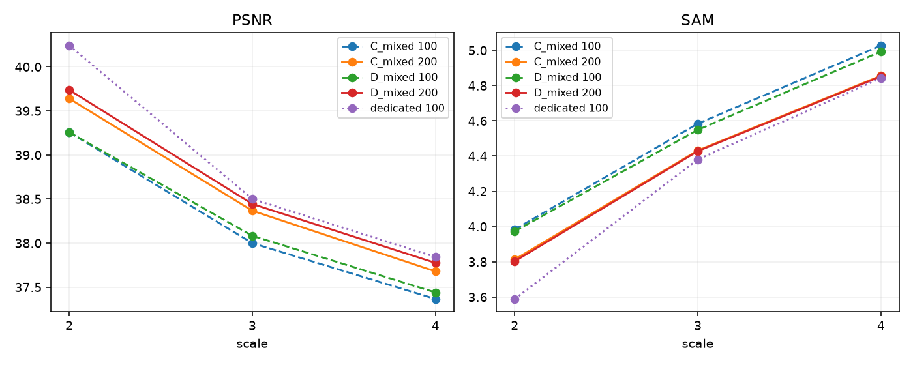
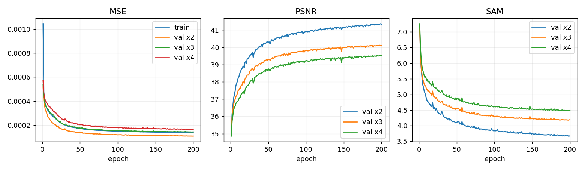
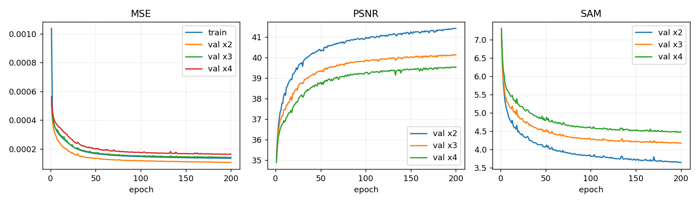
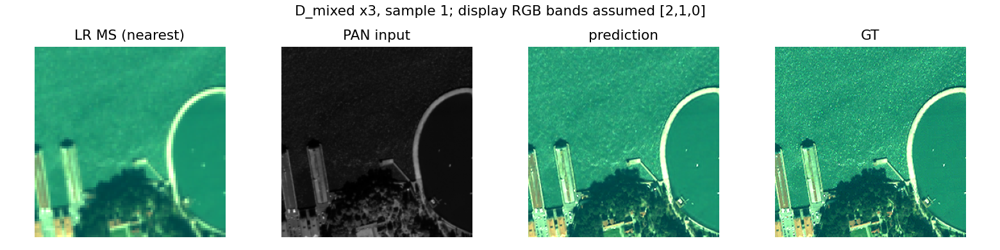
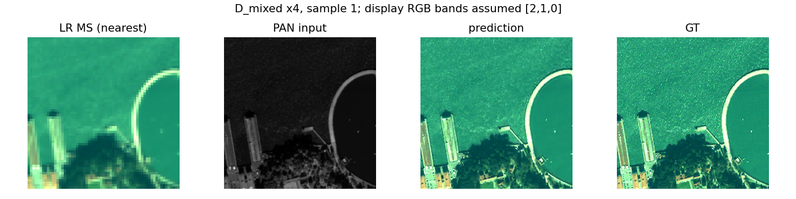

# 2. 배율별 학습 노출량 확장

**연구 분야:** 가변 배율 확장
**실험자:** 김윤지

**변경 내용:** 조건 없는 공동 C와 FiLM 공동 D를 기존 latest에서 100→200에포크로 연장했습니다.

| 확인된 결과 | 상태 | 개선 여부 |
|---|:---:|:---:|
| 두 모델의 모든 배율에서 100에포크 대비 RR 지표가 개선됐으나 전용 모델의 PSNR에는 도달하지 못했습니다. | 학습&nbsp;완료·일부&nbsp;평가 | 판단&nbsp;보류 |

## 1. 목적과 상태

모델 구조를 유지하고 추가 학습이 공동 모델의 성능 격차를 줄이는지 확인했습니다. C/D는 각 200에포크·107,200회 update를 완료했습니다. RR은 기존과 같은 20개 샘플이며 독립 원본 장면 분할은 미검증입니다. FR은 미평가입니다.

## 2. 변경한 구조와 비교 조건

QB·seed42·K=4·SSAI·MSE·Adam·고정 LR 1e-4·batch/micro32·FP32와 기존 합성 Gaussian 열화·보간·crop을 유지했습니다. C는 조건이 없고 D는 기존 log2 배율 FiLM을 사용합니다. 100에포크 latest의 optimizer와 RNG를 복원했으며 모델별 부모 체크포인트 해시를 원본 ZIP과 대조했습니다. validation 기록은 평균으로 압축하고 RR 샘플별 지표는 유지했습니다.

학습 target60×60·RR252×252, 배율2/3/4, DN/2047을 유지했습니다. 이번 배율별 update는35,733/35,734/35,733회입니다. 전용 모델53,600회의 약2/3이므로 완전한 노출량 통제 실험은 아닙니다.

## 3. 정량 결과

| 모델 | 배율 | PSNR↑ | SAM↓ | ERGAS↓ | SSIM↑ | MSE↓ |
|---|---:|---:|---:|---:|---:|---:|
| C_mixed | 2 | 39.6389 | 3.8131 | 6.3745 | 0.973607 | 0.00012817 |
| C_mixed | 3 | 38.3668 | 4.4318 | 4.9371 | 0.963604 | 0.00017191 |
| C_mixed | 4 | 37.6788 | 4.8562 | 4.0207 | 0.956203 | 0.00020247 |
| D_mixed | 2 | 39.7374 | 3.8029 | 6.3059 | 0.974163 | 0.00012563 |
| D_mixed | 3 | 38.4433 | 4.4282 | 4.8956 | 0.963876 | 0.00016968 |
| D_mixed | 4 | 37.7748 | 4.8528 | 3.9795 | 0.956530 | 0.00019910 |

C의 best는198에포크, D는197에포크입니다. 세 배율 validation MSE 동일 가중 평균으로 선택했습니다. test로 checkpoint를 선택하지 않았습니다. prediction clip과 경계 제외는 없으며 ERGAS에 실제 배율을 전달했습니다.

## 4. 기준선 대비 차이와 해석

| 모델 | 배율 | 100대비 ΔPSNR | 전용100대비 ΔPSNR |
|---|---:|---:|---:|
| C_mixed | 2 | +0.3815 | -0.6025 |
| C_mixed | 3 | +0.3677 | -0.1334 |
| C_mixed | 4 | +0.3127 | -0.1638 |
| D_mixed | 2 | +0.4808 | -0.5040 |
| D_mixed | 3 | +0.3608 | -0.0569 |
| D_mixed | 4 | +0.3345 | -0.0677 |

추가 학습은 C/D의 세 배율 PSNR·SAM·ERGAS·SSIM·MSE를 모두 개선했습니다. D−C PSNR은2/3/4배에서 각각+0.0985/+0.0765/+0.0960dB입니다. D는 C보다 다섯 지표가 모두 좋았지만 단일 seed와 미검증 장면 분할로 FiLM 효과를 확정하지 않습니다. 전용 모델과의 PSNR 격차도 남았습니다.

학습 시간은 costs.json의 누적 CUDA batch 시간입니다. 이전100에포크 비용을 빼면 추가 구간 비용을 구할 수 있지만 validation·저장·대기 시간을 포함한 전체 실행 wall time은 별도 기록이 없어 미측정으로 둡니다.

## 5. 학습·평가 그래프

## 6. 결과 이미지

기존 고정 예시의 index1을 학습 전 선택해 C/D 각 배율1개씩만 저장했습니다. LR MS·PAN·예측·GT 순서이며 GT2/98 percentile 공통 대비, RGB[2,1,0] 가정입니다. 이는5개 독립 장면 예시 완료 조건을 만족하지 않습니다. 장면 출처도 미검증입니다.

## 7. 재현 자료

[실제 설정](config.json) · [학습 당시 worker](run.py) · [원본 소스](provenance/code/variable_scale) · [수치 비교](results/comparison.json) · [검증 기록](results/verification.json) · [파일 manifest](manifest.json)

run.py는 원본 worker snapshot이며 continuation_spec.json을 인자로 받습니다. 원본100에포크 latest와 같은 데이터가 필요합니다. CPU 합성 입력의 strict load·2/3/4배 forward는 확인했지만 실제 H5의 성능 재평가는 수행하지 않았습니다. ZIP의CRC·외부해시·내부manifest를 검사했습니다.

결과 ZIP은 약12.4MiB입니다. 원본 best2개를 보존했습니다. C의200에포크 latest는 별도 다운로드 파일의 signature로 확인해 보존했습니다. D의200에포크 latest는 다운로드에서 확보하지 못했습니다. latest가 없는 모델의200에포크 학습 재개와 전체 원격 복구 검증은 완료로 표시하지 않습니다. 원본100에포크 latest를200에포크 latest로 대체하지 않습니다.

## 8. 개선 여부와 다음 단계

**판단 보류**입니다. 추가 학습의 RR 개선은 관측됐지만 FR·장면 분할 검증·반복 seed·완전한 노출량 통제가 남았습니다. 먼저 누락된 최신 재개 파일을 보관하고 원본 장면 출처를 확인합니다. 이후300에포크 노출량 통제와 반복 seed를 검토합니다.
