# 3. 배율별 학습 노출량 통제

**연구 분야:** 가변 배율 확장

**실험자:** 김윤지

**변경 내용:** 기존 전용·공동·배율 FiLM 구조를 유지하고, 공동 모델이 각 배율에서 전용 모델과 같은 표본 순서·갱신 횟수로 학습하도록 데이터 순회를 바꿨습니다.

| 확인된 결과 | 상태 | 개선 여부 |
|---|:---:|:---:|
| 배율별53,600회 갱신을 통제했습니다. FiLM 공동 D는 전용 대비3·4배 PSNR이+0.1420/+0.1471dB 높았으나2배는-0.2256dB 낮았습니다. | 학습&nbsp;완료·일부&nbsp;평가 | 판단&nbsp;보류 |

[실험 목록](../../../README.md#variable_scale-experiments) · [수치](#results) · [그래프](#graphs) · [이미지](#images) · [재현 자료](#evidence)

## 1. 목적과 상태

이전 실험의 공동 모델은100에포크에서 각 배율 약17,867회,200에포크에서 약35,733회 갱신하여 전용 모델의53,600회보다 배율별 학습량이 적었습니다. 이번에는 새로 학습한 전용 B_x2/B_x3/B_x4와 공동 C_mixed/D_mixed의 **배율별 학습 노출량**을 맞춰 성능 차이를 확인했습니다.

2026-10-18 00:09:55 KST 기준5개 모델의100회 exposure round와 RR 전체20개 H5 표본 평가를 마쳤습니다. worker 큐 시작 후 suite 경과 시간은7시간41분56초입니다. 이 시간에는 사전 데이터 검증이 포함되지 않습니다. FR은 미평가이며 원본 장면 단위 독립 분할은 검증되지 않았습니다. 따라서 전체 독립 test 장면·RR/FR 평가 완료로 표시하지 않습니다.

## 2. 변경한 구조와 비교 조건

기존 SSAI·K=4·backbone·복원 convolution·MSE는 유지했습니다. 입력 배율과 내부 전체·절반·1/4 피라미드를 분리한 기존 모델을 사용하며 D만 backbone 뒤에 log2(r)→MLP→FiLM을 적용합니다. FiLM은 항등 변환으로 초기화했습니다.

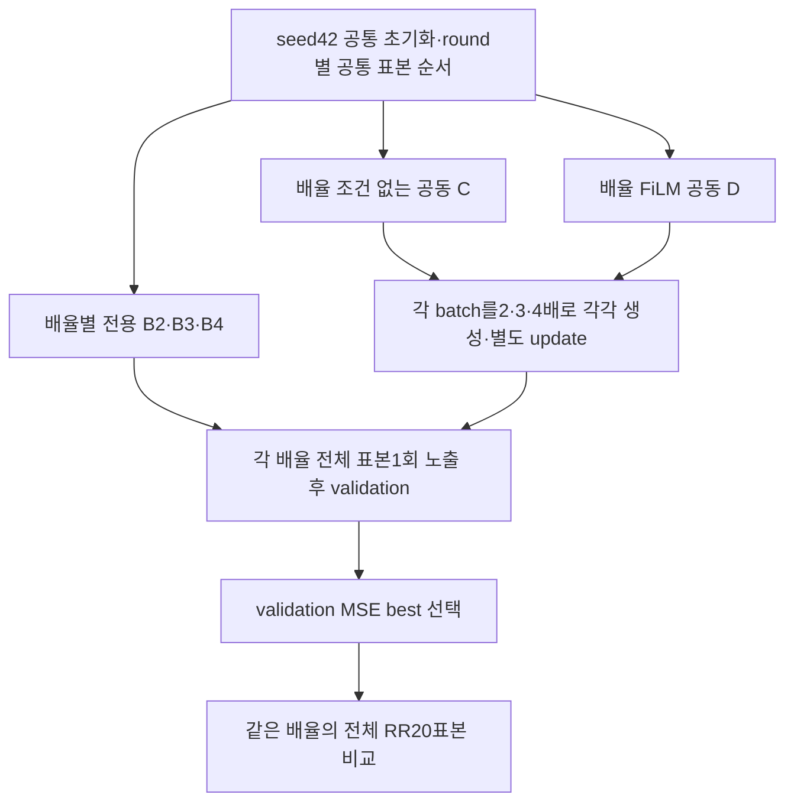

| 항목 | 실제 조건 |
|---|---|
| 센서·입력 | QB, MS4밴드·PAN1밴드, DN/2047, 원값 clip 없음 |
| 전용 B | B_x2/B_x3/B_x4를 각각 새로 학습합니다. 각 모델은 해당 배율만 학습합니다. |
| 공동 C/D | 각각 단일 모델로2·3·4배를 학습합니다. D에만 기존 배율 FiLM이 있습니다. |
| 학습·validation·test | train17,139·validation1,905·RR20 H5 표본; 원본 scene ID 없음 |
| 학습/평가 배율 | 모두 정수2·3·4배입니다. 미학습·비정수 배율은 평가하지 않았습니다. |
| 입력·출력 | 학습 PAN/GT60×60·MS30/20/15, RR PAN/GT252×252·MS126/84/63; LMS는 목표 크기 |
| 열화·crop | 원래 GT에서 Gaussian sigma=r/2, radius=ceil(3sigma), reflect 후 공통 top-left12배수 crop과 floor(r/2) 위상 stride sampling |
| 보간 | bilinear size 지정·align_corners=False, 축소 AA·확대 AA 없음; deterministic backward 사용 |
| 장치·정밀도 | Tesla T4×2 독립 worker, FP32, AMP=False, 공통 seed42 |
| 학습 | Adam(foreach), 고정 LR1e-4, effective/micro batch32, MSE,100 exposure rounds |
| 노출량 | 모든 비교군이 각 해당 배율에서53,600 updates·1,713,900 samples·6,170,040,000 target pixels |
| 선택 | round마다 validation1회, 전용은 해당 배율 MSE, 공동은 세 배율 MSE의 동일 가중 평균 |

하나의 round는 각 학습 배율에서 전체 표본을 한 번씩 보는 단위입니다. 전용은 round당536회, 공동은 round당1,608회 갱신합니다. 공동의100 rounds는 기존 한 배율 batch를 번갈아 쓰던 설정의300에포크와 총 갱신 수가 같지만, 표본 배치 방식과 validation 빈도가 달라 같은 학습 경로는 아닙니다. 세 배율이 같은 base batch를 공유하며 마지막 불완전 batch도 같습니다. 공통 초기화·round별 인덱스 해시와 배율별 노출량이 일치했습니다.

Gaussian은 합성 proxy입니다. 실제 센서의 MTF/Wald 관측 모델 검증으로 해석하지 않습니다. 제공 MS/LMS의 유한한 범위 이탈은 기록하고 보존했으며 임의 clip이나 NaN 대체를 하지 않았습니다. 합성 B/C/D 입력은 GT와 PAN에서 기존 규약으로 생성했습니다. 제공 native4배 입력을 쓰는 과거 A와 직접 개선량을 계산하지 않습니다.

## 3. 정량 결과

각 배율의 전체 RR20표본에 대해 표본별 지표를 계산하고 평균했습니다. 기록된 UNVERIFIED ID는 독립 원본 장면으로 확인된 ID가 아닙니다. PSNR은 peak1의 밴드별 PSNR 평균, SAM은 degree, ERGAS는 실제 입력 배율을 사용했습니다. prediction clip과 경계 제외는 하지 않았습니다. 아래는 validation으로 선택한 단일 best checkpoint의 test 결과입니다.

| 모델 | 배율 | PSNR↑ | SAM↓ | ERGAS↓ | SSIM↑ | MSE↓ |
|---|---:|---:|---:|---:|---:|---:|
| B_x2 | 2 | 40.2414 | 3.5890 | 5.9537 | 0.976964 | 0.00011185 |
| B_x3 | 3 | 38.5002 | 4.3810 | 4.8562 | 0.964509 | 0.00016681 |
| B_x4 | 4 | 37.8425 | 4.8426 | 3.9453 | 0.957199 | 0.00019561 |
| C_mixed | 2 | 39.9368 | 3.7115 | 6.1615 | 0.975381 | 0.00011985 |
| C_mixed | 3 | 38.6109 | 4.3740 | 4.7990 | 0.965126 | 0.00016263 |
| C_mixed | 4 | 37.9479 | 4.8035 | 3.8995 | 0.957876 | 0.00019102 |
| D_mixed | 2 | 40.0158 | 3.7032 | 6.1045 | 0.975640 | 0.00011755 |
| D_mixed | 3 | 38.6423 | 4.3696 | 4.7834 | 0.965144 | 0.00016147 |
| D_mixed | 4 | 37.9896 | 4.8122 | 3.8826 | 0.958070 | 0.00018961 |

validation 곡선과 선택 MSE는 [compact 기록](results/D_mixed/compact_history.json)에 있으며 test 선택에 사용하지 않았습니다. 모든 모델의 FR은 **미평가**입니다. 원본20표본의 수치가 있는 RR JSON과5개 예시는 보존했지만,5개 독립 원본 장면 검증 완료 조건은 충족하지 않습니다.

## 4. 기준선 대비 차이와 해석

같은 배율·초기화·표본 순서·배율별 학습량의 새 전용 B에 대한 공동 모델의 차이입니다. Δ는 현재−전용 B입니다.

| 공동 모델 | 배율 | ΔPSNR(dB) | ΔSAM(°) | ΔERGAS | ΔSSIM | ΔMSE |
|---|---:|---:|---:|---:|---:|---:|
| C_mixed | 2 | -0.3046 | +0.1225 | +0.2078 | -0.001583 | +0.00000800 |
| C_mixed | 3 | +0.1107 | -0.0070 | -0.0573 | +0.000617 | -0.00000418 |
| C_mixed | 4 | +0.1054 | -0.0390 | -0.0458 | +0.000677 | -0.00000459 |
| D_mixed | 2 | -0.2256 | +0.1142 | +0.1508 | -0.001324 | +0.00000570 |
| D_mixed | 3 | +0.1420 | -0.0114 | -0.0728 | +0.000635 | -0.00000534 |
| D_mixed | 4 | +0.1471 | -0.0304 | -0.0627 | +0.000871 | -0.00000599 |

C/D는3·4배에서 전용 B보다 다섯 RR 지표가 모두 나아졌고,2배에서는 다섯 지표가 모두 나빠졌습니다. 배율별 노출량을 맞추면 이전에 관측한 격차가 줄거나 역전되지만2배 격차는 남습니다. 이 결과만으로 잔여 격차의 원인이 배율 간 gradient 충돌이라고 확정하지 않습니다.

| 배율 | D−C PSNR(dB) | D−C SAM(°) |
|---|---:|---:|
| 2 | +0.0791 | -0.0083 |
| 3 | +0.0313 | -0.0044 |
| 4 | +0.0417 | +0.0087 |

FiLM은 C보다 세 배율 PSNR을 높였지만4배 SAM은+0.0087° 악화했습니다. FiLM이 모든 지표를 개선한다고 해석하지 않습니다.

직전 실험2의200에포크 결과와의 참고 비교입니다. 이번에는 새로 학습했고 배율별 표본 순서와 validation 빈도도 바꿨으므로, 아래 차이를 단순히100에포크 연장만의 효과로 분리하지 않습니다.

| 공동 모델 | 배율 | 실험2 PSNR | 이번 PSNR | ΔPSNR(dB) |
|---|---:|---:|---:|---:|
| C_mixed | 2 | 39.6389 | 39.9368 | +0.2979 |
| C_mixed | 3 | 38.3668 | 38.6109 | +0.2441 |
| C_mixed | 4 | 37.6788 | 37.9479 | +0.2692 |
| D_mixed | 2 | 39.7374 | 40.0158 | +0.2784 |
| D_mixed | 3 | 38.4433 | 38.6423 | +0.1989 |
| D_mixed | 4 | 37.7748 | 37.9896 | +0.2148 |

| 모델 | parameter 수 | 실제 updates | 누적 CUDA batch 시간(분) | best round | latest 완료 round |
|---|---:|---:|---:|---:|---:|
| B_x2 | 426,654 | 53,600 | 72.47 | 97 | 100 |
| B_x3 | 426,654 | 53,600 | 72.63 | 100 | 100 |
| B_x4 | 426,654 | 53,600 | 72.47 | 99 | 100 |
| C_mixed | 426,654 | 160,800 | 217.07 | 98 | 100 |
| D_mixed | 428,862 | 160,800 | 220.18 | 98 | 100 |

전용3개 합계의 CUDA batch 시간은217.57분이며 공동 C는217.07분·D는220.18분입니다. 배율별 학습량을 맞춘 비교에서 공동 모델의 학습 시간 절감은 확인하지 못했습니다. 공동 D의 parameter 수는전용3개 합계1,279,962개의 약33.5%입니다. 배포 모델 수·parameter 수 절감과 학습 비용을 구분합니다. CUDA batch 시간은 validation·저장·시작·대기를 포함하는 suite 경과 시간과 다릅니다. 같은 GPU의 작업은 순차, 두 GPU는 병렬로 실행했습니다.

## 5. 학습·평가 그래프

아래는 실제 저장된 학습·validation 곡선과 RR 비교 그래프입니다. 원본 그림의 epoch 축은 이번 실험의 exposure round를 뜻하며 공동 모델은 round마다 세 배율을 모두 순회했습니다.

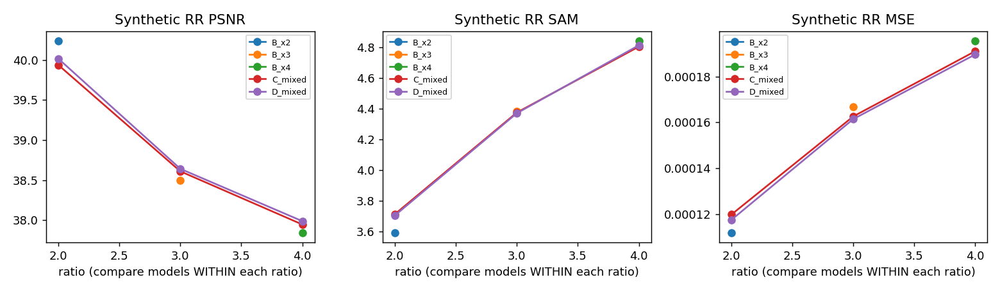

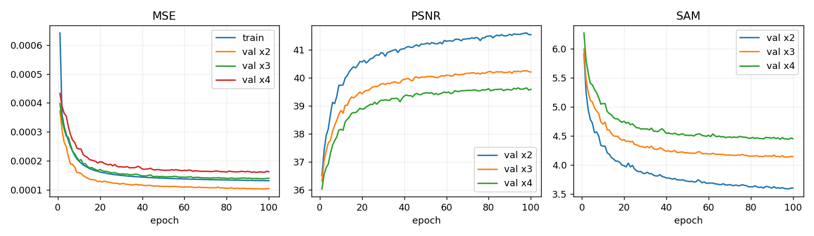

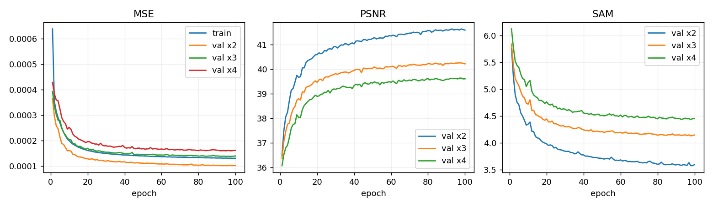

전용 모델3개의 실제 곡선

## 6. 결과 이미지

학습과 test scoring 전에 seed42로 고정한 RR index1·8·11·13·19입니다. 원본 scene ID가 없어5개 H5 표본을5개 독립 장면이라고 표시하지 않습니다. 아래는 D의4배 결과이며 왼쪽부터 **LR MS(최근접 확대) · PAN 입력 · 예측 · GT**입니다. MS 패널에는 GT2/98 percentile에서 정한 공통 대비를 적용했고 RGB[2,1,0]은 표시 가정입니다. 예측만 따로 보정하거나 결과를 보고 예시를 다시 고르지 않았습니다.

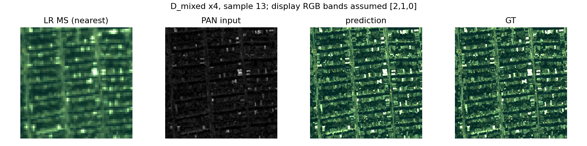

같은 고정 표본의 다른 모델·배율 결과40개

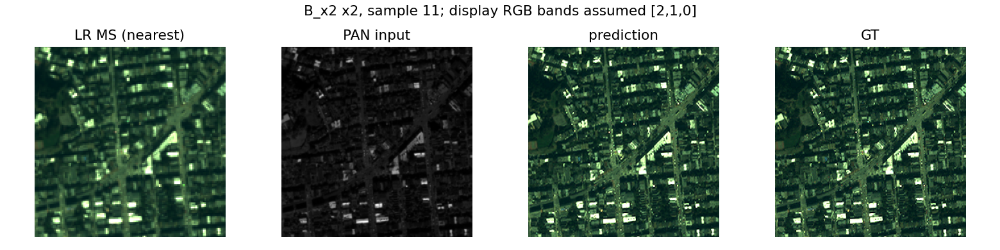

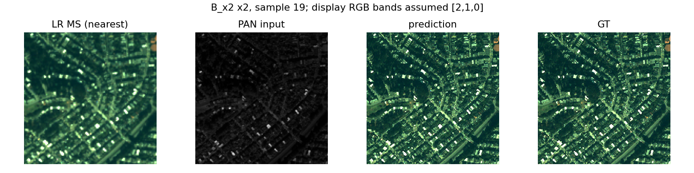

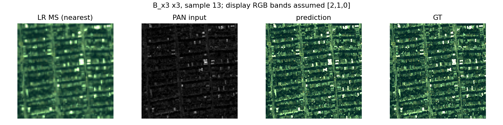

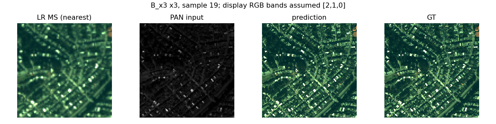

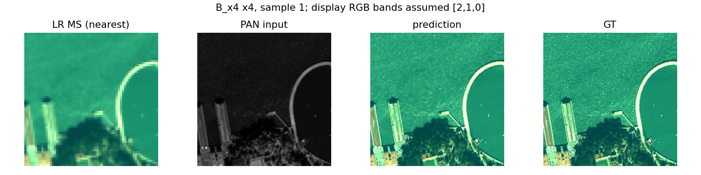

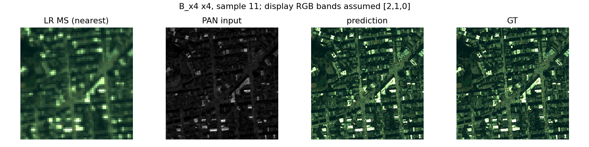

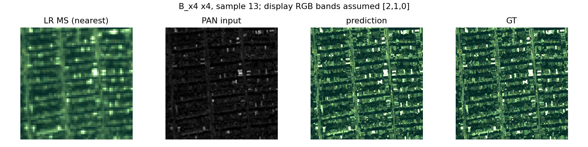

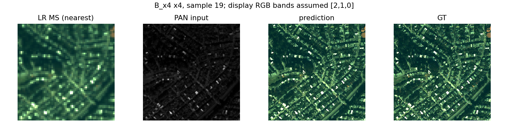

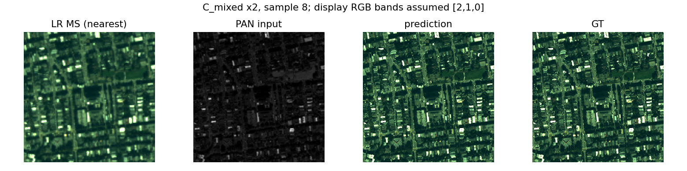

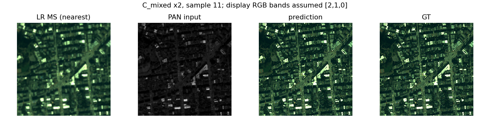

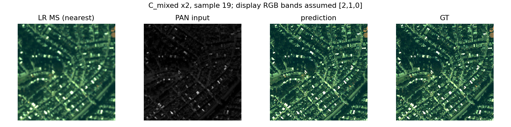

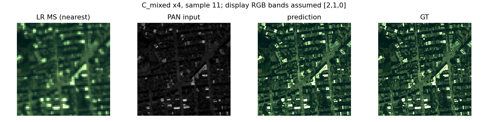

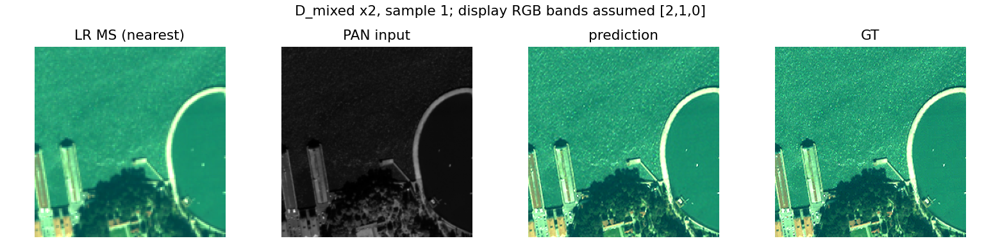

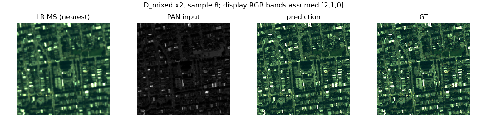

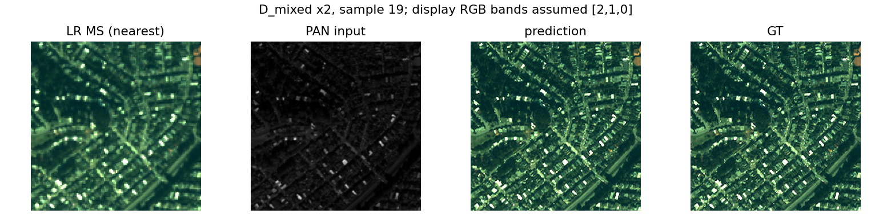

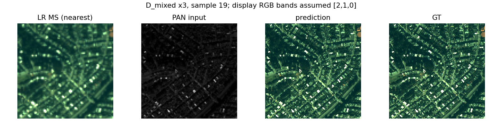

## 7. 재현 자료

[실제 설정](config.json) · [단일 셀 실행](run.py) · [실제 원본 소스](provenance/code/variable_scale) · [소스·데이터 식별](provenance/suite_identity.json) · [데이터 manifest](provenance/data_manifest.json) · [고정 예시 선택](provenance/selection.json)

[원본 best/latest10개](checkpoints) · [학습 노출량 검증](results/exposure_verification.json) · [체크포인트 검사](results/checkpoint_verification.json) · [복구 배치 검사](results/recovery_layout_verification.json) · [ZIP 검증](provenance/archive_verification.json) · [현재 보관 manifest](manifest.json) · [결과 비교](results/comparison.json) · [직전 실험 비교](results/previous_experiment_comparison.json)

다운로드 ZIP의 외부 SHA-256과 내부194개 manifest 항목의 해시·CRC를 확인했습니다. 실제 best/latest10개의 원본 바이트를 유지했습니다. best의 validation 최솟값 선택·100 rounds 완료·latest 내 전체 학습 상태와 best 복구 정보를 확인했으며,10개 checkpoint의 strict load와 CPU 합성 입력18회 추론을 검사했습니다. compact100개 round 기록은 원본 latest의 validation 평균과 일치합니다. 이 검사는 실제 H5를 다시 입력한 성능 재평가나 GPU 재개 실행 검증과 별개입니다.

`run.py`는 보관된13개 원본 실행 소스가 모두 일치하는 단일 셀 래퍼입니다. 학습 데이터는 포함하지 않습니다. 다른 출력 폴더에서 새로 실행하고 기존 학습 runtime은 덮어쓰지 않습니다. 체크포인트 내부 설정·원본 소스는 변경하지 않았습니다. 원본 latest에는 재개에 필요한 전체 history가 있으므로 compact 기록으로 대체하지 않습니다.

정리된 보관 폴더를 기존 runtime 배치로 복구할 때는 `python prepare.py --restore-output <새 경로>/seed_42`를 사용합니다. 원본 H5·동일 소스·호환 GPU/소프트웨어가 필요합니다. 복구 원본 폴더는 새 단일 셀의 `RESUME_INPUT`으로 연결합니다. `python prepare.py`와 `python SSA-MRN/common/verify.py --research-track variable_scale --experiment 3`은 보관 해시만 검사합니다. 실제 데이터 성능 재평가나 원격 재개 성공을 자동으로 뜻하지 않습니다.

## 8. 개선 여부와 다음 단계

**판단 보류**입니다. 같은 배율별 노출량에서는 공동 C/D의3·4배 RR 개선을 관측했지만2배는 전용 모델에 못 미쳤습니다. FiLM 자체의4배 SAM은 C보다 악화했으며 FR·반복 시드·독립 장면 검증이 남아 있습니다. 따라서 모든 배율 개선이나 최종 기준 모델 채택으로 표시하지 않습니다.

다음에는 원본 장면 출처를 확보하고 같은 프로토콜의 반복 시드를 확인합니다.2배 잔여 격차는 배율별 학습·검증 곡선과 공유 gradient 진단으로 원인을 살핀 뒤 별도 가설로 다룹니다. 이후2·4배만 학습한 미학습3배 실험을 분리해 진행합니다. 현재 결과만으로 비정수 배율·미학습 배율·실제 센서 FR 지원을 주장하지 않습니다.
