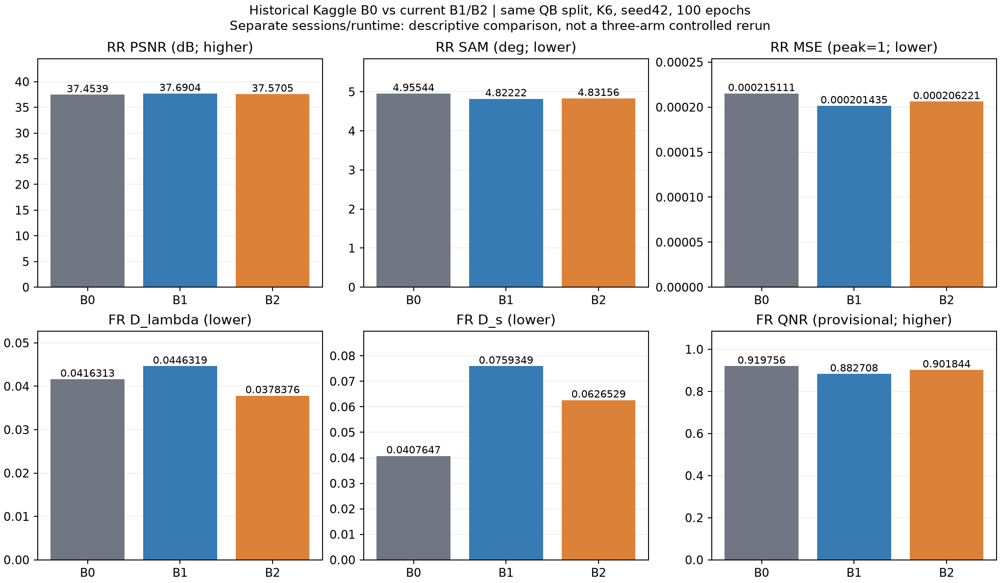
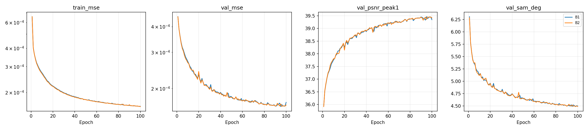
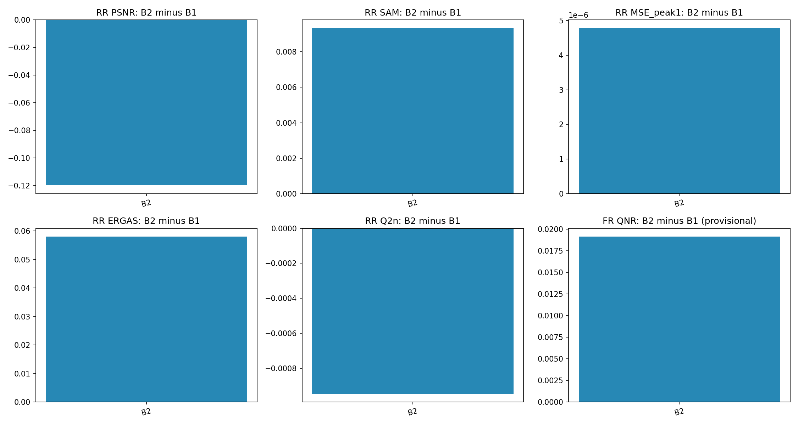
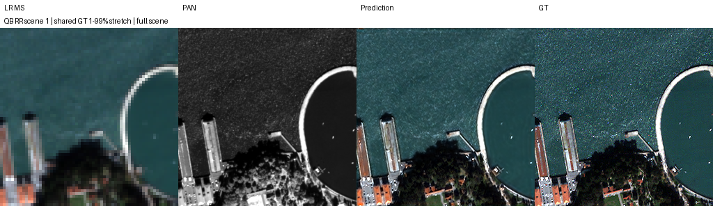
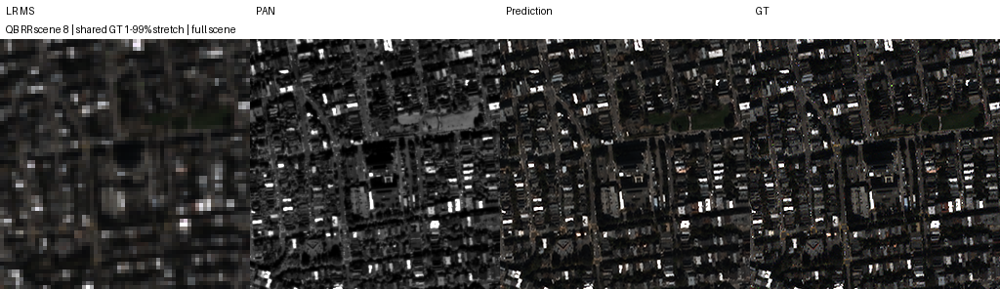
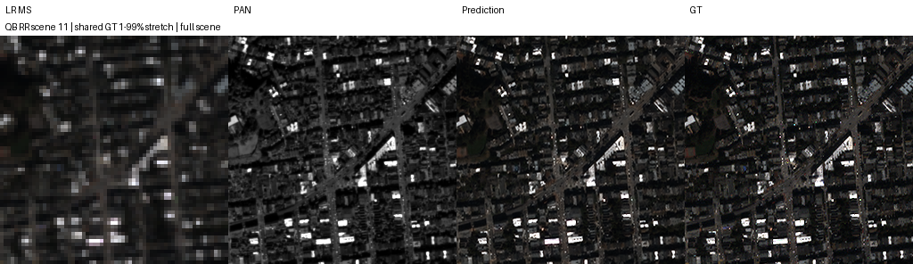
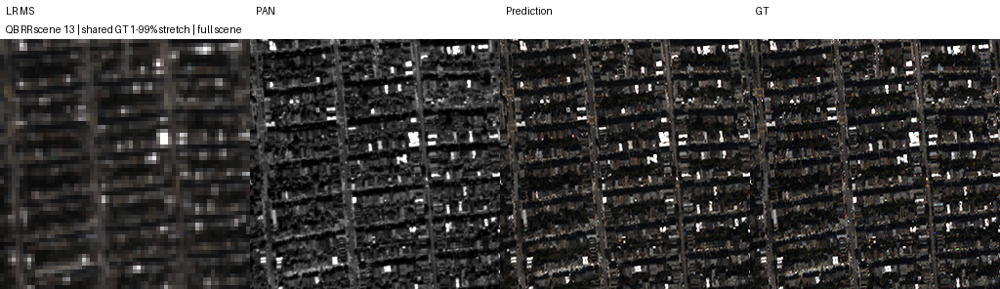
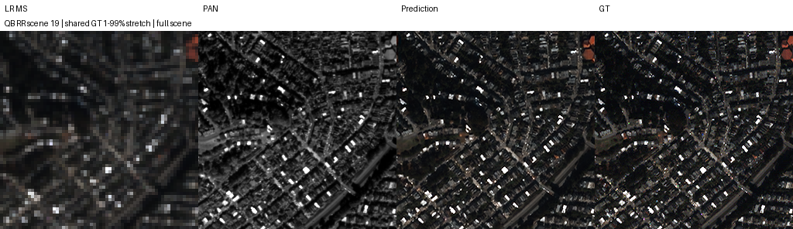

# 반복 복원·관측 오차 전달의 재개 학습

**변경 내용:** 반복 복원과 관측 오차 후보를 재개해 기준선과 비교했습니다.

| 확인된 결과 | 상태 | 개선 여부 |
|---|---|---|
| 기준선 대비 RR 개선·잠정 QNR 하락; 별도 세션 비교 | 평가 완료 | **부분 개선** |


[실험 목록](../../../README.md#experiments) · [수치](#results) · [그래프](#graphs) · [이미지](#images) · [가중치·근거](#evidence)

| 비교 기준 | 이번에 바꾼 점 | 관측된 차이 | 판단 |
|---|---|---|---|
| 보관된 Kaggle 원본 구조 B0 | B1 3단계 반복 / B2 관측 피드백 | RR PSNR B1 +0.236541 / B2 +0.116622 dB; 잠정 QNR -0.037049 / -0.017912 | 별도 실행의 관측 비교. RR 이득·FR 악화 혼재, 논문 성능 우위 확정 아님 |
| 같은 실행의 B1 · 3단계 공유 복원 | B2에 MS−MTF(current) 관측 오차 전달 | RR PSNR -0.119919 dB, SAM +0.009337°, MSE +4.78585561e-06; 잠정 FR QNR +0.019136 | RR 악화·FR 개선이 엇갈려 종합 채택 보류 |
| 이전 B1/B2 100에폭 실행 | Fused Adam·검증한 FFT 관측 계산, 200 셀의 초반 체크포인트 가져오기·배치 재개 | 이전 B2−B1 PSNR +0.115759 dB에서 이번 −0.119919 dB로 방향 변경 | 단순 재현·동일 수치 반복으로 취급하지 않음 |

> **실제 K=6 기록입니다.** 현재 연구 기본값 [K4](../../../README.md#decision)의 성능 결과로 바꾸지 않습니다. 이 보고서는 사용자 제공 Output을 보관·검증한 기록입니다.

**같은 연구의 후속 K4 통제 검증:** [B0/B1 새 학습 결과](../15_shared_reconstruction/README.md)에서 B1−B0 RR PSNR **+0.300014dB**, SAM **−0.107839°**, 잠정 FR QNR **−0.039261**을 확인했습니다. QB 데이터·B1 zero-error 복원식·평가 구현은 같지만 K·B0 optimizer·새 학습/재개 조건이 달라 이 K6 실험과 동일한 실행으로 합치지 않습니다. 아래 K6 수치와 가중치는 유지합니다.

## 1. 목적과 상태

**비교 대상 정의:** B0는 이전 Kaggle 실행의 `github_QB_baseline_k6_s42`이며 원본 SSA-MRN 단일 출력 구조·K6·기본 MSE를 사용합니다. AMP·channels-last·GPU 데이터 상주 등 **실행 최적화**가 적용됐지만, 23탭·추가 손실·관측 피드백을 합쳐 고른 **성능 최적 baseline은 아닙니다.** 논문 표에 보고된 값이나 논문을 bitwise 그대로 재현한 결과와도 구분합니다. B1은 같은 core를 학습형 α로 3회 공유 반복하고, B2는 그 3단계에 입력 MS−MTF(current) 피드백을 추가합니다. B1의 error=0에서도 Conv bias는 학습 가능하므로 단순히 원본 출력을 세 번 내는 것과 다릅니다.

이번 셀에서 새로 실행한 모델은 **B1·B2 두 개뿐**이었습니다. 아래 B0 비교는 사용자가 이미 구해 둔 Kaggle 원본 baseline을 재사용한 수치 비교입니다. B0를 추가로 학습하거나 이번 실행의 동시 대조군으로 표시하지 않습니다.

**B1·B2 각각 100에폭 학습, RR 20장·FR 20장 전체 평가 완료.** 마지막 다운로드 근거 확인은 **2026-10-09 22:16 KST**이며 실제 학습 종료 시각이나 실시간 서버 상태를 뜻하지 않습니다. Notebook Version ID·정확한 종료 시각은 산출물에 없습니다. 로컬 재학습이나 원본 H5 재평가는 하지 않았습니다.

제공된 두 폴더는 독립된 두 실험이 아니라 **중간 복구본과 그 상태에서 이어진 최종 결과**입니다. `ssa_kaggle_B1_B2_200_cosine_v1_recovery`는 목표 200에폭이던 셀에서 B1 **12에폭**, B2 **11에폭**까지 완료한 latest를 보관합니다. 최종 `ssa_kaggle_B1_B2_100_resume_v1_results`는 그 latest 전체 상태를 가져와 **각각 총 100에폭**까지 실행했습니다. 가져온 초반 history와 원본 history가 일치하고 source latest SHA-256이 bootstrap manifest와 일치합니다. 200에폭 완료나 200+100에폭 학습으로 표시하지 않습니다. 복구본 status의 epoch13/12는 진행 중 표시이며, 완료 저장 지점 12/11과 구분합니다.

재현은 [단일 셀 Python](run.py)입니다. 재현 셀의 내장 worker·model이 실제 [실행 snapshot](provenance/code)과 SHA-256 일치합니다. launcher의 불완전 가져오기 방지 개선은 실행 뒤 추가된 것이며, worker와 모델의 동일성이 launcher 전체의 동일성을 뜻하지 않습니다.

## 2. 변경한 구조와 비교 조건

| 항목 | 실제 조건 |
|---|---|
| 대상·입력 | QuickBird, PAN 1밴드·MS 4밴드, NCHW, DN2047 정규화, K6 |
| train / validation | 17,139 / 1,905 패치. HR 64×64·LR 16×16 |
| 전체 RR / FR | 각각 별도 H5 20장. RR HR256×256·LR64×64, FR HR512×512·LR128×128 |
| 공통 3단계 | 제공 LMS에서 시작, 동일 SSA-MRN core·오차 Conv encoder·공유 scalar α를 3회 사용 |
| B1 / B2 | B1 error=0; B2 error=MS−D(current), LR 경계 5픽셀 mask 후 bilinear 확대 |
| 상태 갱신 | conditioned=current+encoder(error); proposal=core(PAN,conditioned,MS); current←current+α(proposal−current) |
| 오차 encoder·계수 | 4→4 3×3 Conv, bias 포함; α 초기0.1, 학습형·범위 제한 없음. B1도 encoder bias 학습 가능 |
| 관측 연산 | QB MTF 41×41 FIR·replicate padding·×4 sampling; 이번에는 FP32 FFT로 같은 correlation 계산 |
| 위상 | TRAIN GT/MS 정합 검사에서 (2,2)/(1,2)/(2,1) 고정. validation/test는 입력 LMS/MS만으로 선택, test GT 사용 안 함 |
| 학습 | seed42, 최종 출력 MSE, Fused Adam lr1e−4 **고정**, effective/micro batch32, 총100에폭 |
| 장치·정밀도 | T4×2, GPU0=B1/GPU1=B2, AMP FP16·GradScaler, 관측·validation/test FP32, channels-last·deterministic·TF32=False |
| 병목 감소 | train/val GPU FP32 상주, GPU randperm/index_select 배치, CPU DataLoader 없음, 주기적 상태 동기화 |
| 재개 | 약1분·에폭별 저장, 모델/optimizer/scaler/RNG/배치 순서·완료 배치 cursor 저장. 가져온 epoch에는 200 셀의 이전900초 간격 기록 유지 |
| 환경 | PyTorch2.11.0+cu128, CUDA12.8, Python3.13.15 |
| 선택·평가 | 최소 FP32 validation MSE의 best. full scene, 재정합·평가 crop·추가 test 선택 없음 |

100에폭 셀은 cosine 구간을 실행하지 않았습니다. [데이터 경로·해시](results/data_manifest.json) · [환경](results/environment.json) · [실행 변경](results/plan_deviations.json) · [관측 manifest](results/observation_train.json) · [B1 가져오기](results/runs/B1_QB_B1_k6_s42/bootstrap_manifest.json) · [B2 가져오기](results/runs/B2_QB_B2_k6_s42/bootstrap_manifest.json)

양쪽 core 초기화 SHA-256과 100에폭 sample-order 해시가 일치합니다. FFT 사전 검사 기록은 64×64 FP32 geometry에서 forward max abs **1.4305e−6**, backward **3.1948e−5**입니다. 수치적 FIR 일치성 검사이며 기존 학습 궤적의 bitwise 재현이나 FR 물리 타당성 검증이 아닙니다.

<a id="results"></a>

## 3. 정량 결과

모두 장면별 계산 후 **20장 산술평균**입니다. RR PSNR은 peak2047 밴드 PSNR 평균, MSE는 DN2047로 정규화한 원소 MSE, SAM은 도 단위입니다. validation PSNR은 peak1의 밴드 평균으로 단일 global MSE 변환과 다릅니다. FR에는 HR GT가 없으며 QNR·Ds 및 RR Q2n/SCC의 MATLAB parity 한계가 남는입니다.


### 보관된 Kaggle B0와 이번 B1/B2

같은 QB H5 4개 SHA-256·배열 shape, K6·seed42·100에폭·batch/micro32·lr1e−4·AMP가 일치함을 확인했습니다. **B0는 이전 세션**이고 Adam foreach=True를 사용했으며 이번은 Fused Adam입니다. 배치 순서 생성 위치·재개 정책도 달라 B0와 B1/B2의 동일 초기 가중치·샘플 순서는 주장하지 않습니다. B1/B2끼리의 초기화·순서 일치 검증과 구분합니다. 주 대조 결과 B2−B1을 유지하면서 B0 대비의 관측 차이를 추가합니다.

| 모델 | 학습 출처 | Best epoch | RR PSNR ↑ | RR SAM ↓ | RR MSE peak1 ↓ | FR QNR ↑ · 잠정 |
|---|---|---:|---:|---:|---:|---:|
| B0 | 보관된 이전 Kaggle | 100 | 37.453879 | 4.955443 | 0.000215111127 | 0.919756 |
| B1 | 이번 100에폭 재개 | 95 | 37.690421 | 4.822219 | 0.000201435063 | 0.882708 |
| B2 | 이번 100에폭 재개 | 96 | 37.570502 | 4.831556 | 0.000206220919 | 0.901844 |

| 비교 · 현재−B0 | ΔPSNR ↑ | ΔSAM ↓ | ΔMSE ↓ | ΔQNR ↑ · 잠정 |
|---|---:|---:|---:|---:|
| B1−B0 | +0.236541 | -0.133224 | -1.36760636e-05 | -0.037049 |
| B2−B0 | +0.116622 | -0.123887 | -8.890208e-06 | -0.017912 |

B0에 비해 두 변형의 RR PSNR·SAM·MSE는 개선됐지만 **FR QNR은 모두 악화**했습니다. 종합 개선을 확정하지 않으며, B1은 B2보다 이번 RR 전 장면 PSNR이 높다는 기존 판단을 유지합니다. B0의 전체 ERGAS/SCC/Q2n/Dλ/Ds·checkpoint 해시와 모든 차이는 [비교 JSON](results/b0_comparison.json)에 있습니다. [B0 원본 결과·20장별 수치](../7_band_gated_detail/results/results.json) · [B0 보고서](../7_band_gated_detail/README.md) · [B0 best](../7_band_gated_detail/checkpoints/runs/github_QB_baseline_k6_s42/best.pt) · [B0 latest](../7_band_gated_detail/checkpoints/runs/github_QB_baseline_k6_s42/latest.pt)

논문 표의 수치와 비교하려면 [기존 논문 K6 재현 보고서](../2_paper_setting_reproduction/README.md)의 논문 인용 열을 별도로 봐야 합니다. 그 열을 B0 실측값으로 섞지 않습니다. 원본 코드와 논문 수식의 차이·환경·지표 parity 제한이 있어 논문 그대로 재현 또는 논문 전체 성능 우위를 주장하지 않습니다.

### 이번 실행의 통제 비교 · B1/B2

| 모델 | Best epoch | Best validation MSE | RR PSNR dB ↑ | RR SAM ° ↓ | RR MSE peak1 ↓ |
|---|---:|---:|---:|---:|---:|
| B1 | 95 | 0.000163388293 | 37.690421 | 4.822219 | 0.000201435063 |
| B2 | 96 | 0.000163573088 | 37.570502 | 4.831556 | 0.000206220919 |
| B2−B1 | — | +1.84794771e-07 | -0.119919 | +0.009337 | +4.78585561e-06 |

| 지표 | B1 | B2 | B2−B1 |
|---|---:|---:|---:|
| RR ERGAS | 3.98942779 | 4.0474182 | +0.0579904108 |
| RR SCC | 0.97871355 | 0.977766662 | -0.000946887995 |
| RR Q2n | 0.924877636 | 0.923930608 | -0.000947027661 |
| RR MS_consistency_MSE_peak1_interior | 1.91711129e-06 | 1.7779351e-06 | -1.39176187e-07 |
| FR D_lambda | 0.0446319256 | 0.037837592 | -0.00679433363 |
| FR D_s | 0.0759348672 | 0.062652939 | -0.0132819282 |
| FR QNR | 0.882707869 | 0.901844286 | +0.0191364167 |
| FR MS_consistency_MSE_peak1_interior | 0.000166714195 | 0.000132805593 | -3.39086022e-05 |

이번 B2는 **RR PSNR 20/20장 모두 B1보다 낮고**, RR MSE는 **2.38% 증가**했습니다. RR SAM·ERGAS·SCC·Q2n도 악화했습니다. FR에서는 Dλ·Ds 감소·잠정 QNR 증가와 입력 MS consistency MSE **20.34% 감소**를 관측했습니다. 입력 일치도는 HR 정답 정확도가 아닙니다.

[전체 지표](results/results.json) · [CSV](results/summary.csv) · [paired 차이](results/paired_comparison.json) · [B1 RR](results/runs/B1_QB_B1_k6_s42/RR_per_scene.json) · [B2 RR](results/runs/B2_QB_B2_k6_s42/RR_per_scene.json) · [B1 FR](results/runs/B1_QB_B1_k6_s42/FR_per_scene.json) · [B2 FR](results/runs/B2_QB_B2_k6_s42/FR_per_scene.json)

기록된 100에폭 학습+validation 누적은 B1 **139.99분**, B2 **157.64분**입니다. 여기에는 주기적 recovery 저장이 포함되고 에폭 끝 저장·시동·test는 제외합니다. 재개 세션 worker 전체 시간은 B1 **125.36분**, B2 **142.28분**, 최종 suite 포장 전 시간은 **144.80분**입니다. 재개 전 실행과 미저장 뒤 다시 계산한 시간까지 완전히 합친 총 소요시간이 아니며 두 GPU 시간을 더하지 않습니다. [세션 시간](results/runs/B2_QB_B2_k6_s42/session_timing.json)

## 4. 기준선 대비 차이와 해석

직전 [B1/B2 보고서](../10_recurrent_observation/README.md)의 값을 보관된 JSON에서 인용했습니다.  아래는 **현재−직전 관측 차이**로, 같은 QB·K6·seed42·100에폭이나 Fused Adam·FFT 관측 계산·checkpoint/재개 정책이 달라 단일 구조 효과나 독립 반복 시드 검증으로 해석하지 않습니다. 이전과 이번 결과를 평균해 개선량을 만들지 않습니다.

| 모델·지표 | 직전 | 현재 | 현재−직전 |
|---|---:|---:|---:|
| B1 RR PSNR | 37.6047447921 | 37.6904206179 | +0.0856758258 |
| B1 RR SAM | 4.83269829084 | 4.82221901162 | -0.0104792792 |
| B1 RR MSE_peak1 | 0.000205615557702 | 0.000201435063286 | -4.18049442e-06 |
| B1 FR QNR · 잠정 | 0.904310113 | 0.882707869 | -0.021602243 |
| B2 RR PSNR | 37.7205036896 | 37.5705018674 | -0.150001822 |
| B2 RR SAM | 4.81441588207 | 4.83155582262 | +0.0171399406 |
| B2 RR MSE_peak1 | 0.00020025117562 | 0.000206220918895 | +5.96974328e-06 |
| B2 FR QNR · 잠정 | 0.886088768 | 0.901844286 | +0.015755518 |

직전 B2−B1은 RR PSNR **+0.115759 dB**, FR QNR **−0.018221**였고, 이번에는 RR PSNR **−0.119919 dB**, FR QNR **+0.019136**입니다. 방향 변화의 원인을 이번 두 실행만으로 Fused Adam·FFT 또는 재개의 특정 한 항목에 귀속하지 않습니다. [이전 숫자 snapshot](results/previous_b1_b2_results.json) · [인용 출처](results/previous_comparison_source.json)

B0는 이번 셀에서 재학습·재평가하지 않았지만, 3절에 **보관된 Kaggle B0 대비 수치 비교를 추가**했습니다. 이는 별도 세션 결과의 비교이며 논문 기준선의 같은 실행 대조군이 아니므로 **논문보다 성능이 높아졌다는 결론은 내리지 않습니다.**

<a id="graphs"></a>

## 5. 학습·평가 그래프

B0는 보관된 별도 세션, B1/B2는 이번 실행입니다. 원본 수치로 그린 세 모델 비교이며 동시 통제 재학습 그래프가 아닙니다.



실측 100에폭 train MSE·validation MSE/PSNR/SAM입니다. 가져온 초반 기록을 포함하고 누락 epoch를 추정하지 않았습니다.



이번 실행의 B1을 기준으로 B2−B1 전체 RR/FR 평균 차이를 표시합니다. QNR은 잠정 구현입니다.



<a id="images"></a>

## 6. 결과 이미지

평가 전에 seed42로 고정한 RR row index **1, 8, 11, 13, 19**, full scene·오름차순입니다. [selection](results/selection.json)에 seed·ID·tile·순서가 있습니다. 아래는 **LR MS · PAN · B2 예측 · GT** 4패널입니다. RGB [2,1,0]은 표시 가정이며 같은 장면 GT의 1–99% 범위를 MS·예측·GT에 공통 적용하고 LR MS만 최근접 확대합니다. B1은 수치 비교와 원본 이미지 보관에 유지합니다. FR GT는 생성하지 않습니다.



<details>
<summary>나머지 고정 4장면</summary>









</details>

<a id="evidence"></a>

## 7. 재현 자료

[공통 실행·평가 안내](../../../README.md#evaluate) · [파일 해시](manifest.json) · [실행 코드](run.py) · [모델](model.py) · [가중치](checkpoints) · [수치·그래프·예시](results) · [원본 실행 근거](provenance)

다음 명령으로 저장된 가중치를 확인합니다. 실제 test 평가는 `--h5`, `--protocol`, 새 `--output` 경로를 함께 지정합니다.

```bash
python SSA-MRN/common/checkpoint.py --experiment 13 --checkpoint checkpoints/recovery_200/runs/B1_QB_B1_k6_s42/best.pt
```

`run.py`는 Kaggle 한 셀 실행 코드입니다. 파일 전체를 셀에 넣고 상단 설정을 지정합니다. 학습 당시 고정된 소스 경로는 재현을 위해 유지했습니다.

## 8. 개선 여부와 다음 단계

**판정: 부분 개선.** 위 결과는 해당 보고서의 비교 조건에 한정합니다. 지표 일부의 개선을 최종 모델 채택으로 해석하지 않습니다.

**B2의 종합 채택을 보류합니다.** 이번 같은 실행의 RR에서는 B1이 모든 장면의 PSNR 및 전체 주요 지표에서 더 좋았입니다. 잠정 FR 지표 개선과 이전 실행의 반대 결과가 공존하므로 일관된 복원 성능 향상을 주장할 수 없습니다.

QB 단일 seed42, 같은 test split의 반복 탐색, 서로 다른 best epoch, 두 물리 GPU 고정 배정·교환 반복 없음, 비트 단위 재현 미보장이라는 제한이 있습니다. TRAIN은 GT/MS 위상, validation/test는 관측 LMS/MS 위상을 사용합니다. 정확한 합성 TRAIN 정합과 낮은 FR consistency가 실제 HR 디테일의 정확도를 보증하지 않습니다. 현재 K4 기본 연구나 논문 성능 우위를 입증한 결과도 아닙니다.

원인 분석은 validation 중심으로 Fused Adam·FFT·재개 여부를 하나씩 통제한 실행과 독립 시드·새 장면 확인이 필요합니다. 이는 후속 후보이며 이번 작업에서 새 학습을 시작하지 않았습니다.
