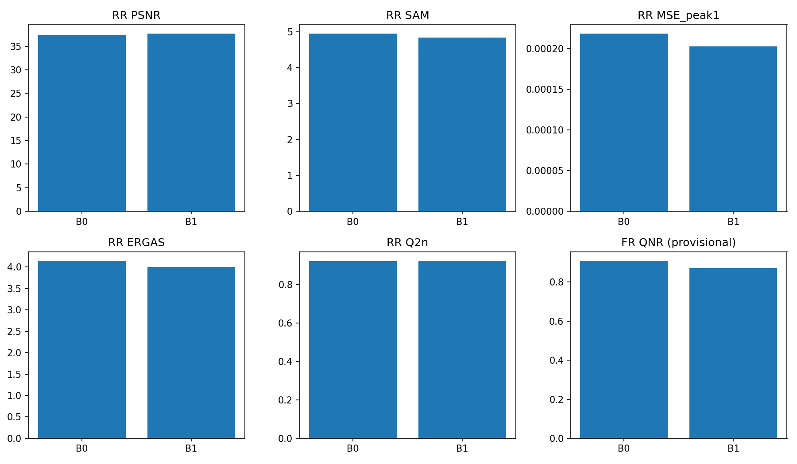
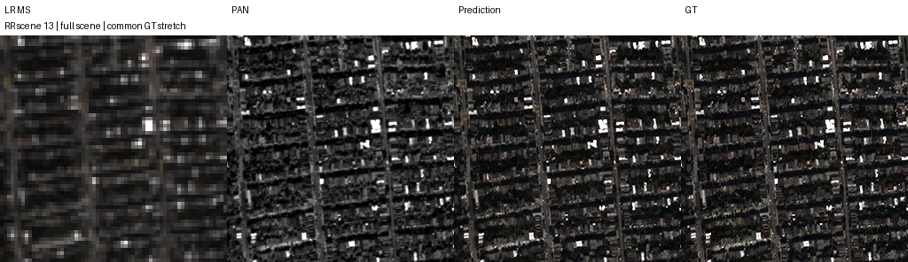

# 단일 복원과 3단계 공유 복원

**변경 내용:** 동일 초기값과 학습 조건에서 복원 횟수를 변경했습니다.

| 확인된 결과 | 상태 | 개선 여부 |
|---|---|---|
| 반복 복원: PSNR +0.3000 dB, SAM −0.1078°, 잠정 QNR −0.0393 | 평가 완료 | **부분 개선** |


[실험 목록](../../../README.md#experiments) · [수치](#results) · [그래프](#graphs) · [이미지](#images) · [가중치·근거](#evidence)

| 비교 기준 | 이번에 바꾼 점 | 관측된 차이 | 판단 |
|---|---|---|---|
| 같은 실행에서 새로 학습한 원본 B0 | B1 3단계 공유 복원, K4·동일 초기 core·배치 순서 | RR PSNR +0.300014 dB, SAM −0.107839°, MSE −1.55227536e−5; 잠정 FR QNR −0.039261 | RR 반복 복원의 이득 확인, FR 포함 종합 채택 보류 |
| [과거 K6 B0/B1](../13_recurrent_observation_resume/README.md) | K4, B0도 동시 새 학습·동일 fused Adam으로 통제 | B1의 K4−K6 PSNR −0.019324 dB, SAM +0.016031°, MSE +1.20286534e−6 | 데이터·복원식은 같지만 전체 조건은 다름. K만의 효과로 해석하지 않음 |

> **실제 K4 결과입니다.** 과거 K6 보고서·가중치·수치는 유지합니다. 같은 연구 묶음의 별도 통제 실험이며, 두 실험을 동일 실행이나 반복 시드 평균으로 합치지 않습니다.

## 1. 목적과 상태

기존 K6의 B1−보관 B0 비교는 별도 세션·optimizer·배치 생성·재개 조건이 달랐습니다. 현재 기본값 K4에서 B0/B1을 처음부터 같은 조건으로 학습해 반복 복원의 성능 이득을 확인했습니다. **두 모델 각각100에포크, best로 RR20장·FR20장 전체 평가 완료.** seed43은 실행하지 않았습니다.

Run ID는 `ssa_B0_B1_K4_s42_20261011T090100414462Z`. 모델 status에 기록된 평가 완료 시각은 B0 **2026-10-11 18:51:14 KST**, B1 **20:25:29 KST**입니다. 다운로드한 산출물의 검증 날짜는 **2026-10-11 KST**이며 실시간 서버 상태 조회는 아닙니다. Notebook Version ID는 산출물에 없습니다. 제공한 다운로드 원본은 수정·삭제하지 않았습니다.

실행 당시 모델·worker 원문은 [code snapshot](provenance/code)에 보존했습니다. [현재 단일 셀](run.py)은 실행 후 보완한 launcher를 포함하며 **내장 model/worker는 snapshot과 바이트 동일**합니다. 실행 당시 launcher 전체가 제공됐다고 주장하지 않습니다.

## 2. 변경한 구조와 비교 조건

| 항목 | 실제 조건 |
|---|---|
| 입력·데이터 | QB PAN1·MS4밴드, DN2047 정규화, train17,139 / validation1,905 패치 |
| 해상도 | train/val HR64×64·LR16×16; RR HR256×256·LR64×64; FR HR512×512·LR128×128 |
| B0 | 원본 SSA-MRN 단일 출력 adapter, K4; 23탭·추가 손실·관측 오차 피드백 없음 |
| B1 | 동일 core·4→4 3×3 Conv error encoder·scalar α를 3회 공유; observation error=0 |
| B1 갱신식 | conditioned=current+encoder(0); proposal=core(PAN,conditioned,MS); current←current+α(proposal−current), current 초기값=LMS |
| encoder / α | bias 학습 가능, α 초기0.1·범위 제한 없음; best α=0.114275217, latest α=0.111207850 |
| optimizer / loss | 두 모델 fused Adam, betas=(0.9,0.999), eps=1e−8, weight_decay=0, lr1e−4 고정, 최종 출력 MSE |
| seed / batch / budget | seed42, effective=micro32, 마지막 불완전 batch 포함, 각각100에포크 새 학습 |
| 실행 | T4×2, GPU0=B0/GPU1=B1; AMP FP16+GradScaler, channels-last; strict deterministic·TF32=False·CUBLAS :4096:8 |
| 환경 | PyTorch2.11.0+cu128, CUDA12.8, Python3.13.15, Tesla T4 |
| best / test | FP32 validation MSE 최소, 동률이면 먼저 선택한 best 유지; best FP32로 전체 장면, 추가 crop·재정합 없음 |
| GPU 데이터·저장 | train/val FP32 GPU 상주, GPU randperm/index_select; 약60초·배치 경계·에포크 저장, 모델/optimizer/scaler/RNG/순서/커서/누적loss 보존 |

초기 core SHA-256은 양쪽 모두 `4efb4367e985d49f043a1014bb10f9e249415e5db2e96f0774df525575088e34`입니다. [초기화 증거](results/initialization_pair.json)와 checkpoint history의100개 sample-order SHA-256이 일치합니다. 양쪽 config는 `resume=false`이고 원시 worker 기록에도 resume 이벤트가 없습니다. 과거 체크포인트를 가져온 실행으로 표시하지 않습니다.

원본 upstream에서 정의되지 않은 `ms` 입력을 기존 adapter가 명시합니다. B0는 논문 표의 수치나 논문 bitwise 재현이 아니라 이 원본 구조 adapter의 새 실측 기준선입니다. B1은 zero error에서 encoder weight가 출력에 기여하지 않지만 bias는 학습됩니다. 과거 B1 zero-error 분기의 세 번 갱신식과 일치하며, 사용하지 않는 observation buffer·위상·FFT를 제거했습니다. B2는 이번 실험에서 제외했습니다.

## 3. 정량 결과

<a id="results"></a>

장면별 계산 후 **20장 산술평균**입니다. RR PSNR은 peak2047 밴드별 PSNR 평균, MSE는 peak1 정규화 원소 MSE, SAM은 도 단위입니다. FR에는 HR GT가 없습니다. QNR·D_s 및 Q2n/SCC의 MATLAB parity 제한은 유지합니다.

| 모델 | Best epoch | Best validation MSE ↓ | RR PSNR dB ↑ | RR SAM ° ↓ | RR MSE peak1 ↓ | FR QNR ↑ · 잠정 |
|---|---:|---:|---:|---:|---:|---:|
| B0 | 97 | 0.000172096363 | 37.371084 | 4.946089 | 0.000218160682 | 0.909722 |
| B1 | 94 | 0.000164554876 | 37.671097 | 4.838250 | 0.000202637929 | 0.870462 |
| B1−B0 | — | −7.54148641e−6 | +0.300014 | −0.107839 | −1.55227536e−5 | −0.039261 |

| 지표 | B0 | B1 | B1−B0 |
|---|---:|---:|---:|
| RR ERGAS ↓ | 4.147542 | 3.999888 | −0.147655 |
| RR SCC ↑ | 0.976649 | 0.978558 | +0.001909 |
| RR Q2n ↑ | 0.922543 | 0.925454 | +0.002911 |
| FR D_lambda ↓ · 잠정 | 0.049951 | 0.052136 | +0.002184 |
| FR D_s ↓ · 잠정 | 0.042746 | 0.081345 | +0.038599 |

B1의 validation MSE는 B0보다 **4.382% 감소**했습니다. RR PSNR은 **20/20장 모두 개선**했고 평균 MSE는 약7.12% 감소했습니다. FR에서는 두 왜곡 지표가 증가하고 QNR이 하락했습니다. 따라서 **RR 반복 복원의 이득은 확인했지만 FR 포함 종합 복원 향상은 확인하지 못했습니다.** test로 best나 조건을 다시 선택하지 않았습니다.

[전체 결과](results/results.json) · [B1−B0 차이](results/paired_comparison.json) · 장면별 [B0 RR](results/B0/RR_per_scene.json) / [B1 RR](results/B1/RR_per_scene.json) / [B0 FR](results/B0/FR_per_scene.json) / [B1 FR](results/B1/FR_per_scene.json).

실측 history 누적 학습/validation 시간은 B0 **43.05/4.47분**, B1 **127.52/14.21분**입니다. 학습 시간에는 주기 저장·validation 직전 저장이 포함되며 에포크 끝 저장·bootstrap·test·최종 ZIP 포장은 제외됩니다. 두 GPU 병렬 실행 시간을 더한 값을 총 wall time으로 쓰지 않습니다. [검증·실측 시간](results/verification.json)

## 4. 기준선 대비 차이와 해석

기존 [K6 보고서](../13_recurrent_observation_resume/README.md)와 **완전히 동일한 실험은 아닙니다.** 조건 확인 결과는 다음과 같습니다.

| 확인 항목 | K6→이번 K4 |
|---|---|
| QB 4개 H5 해시·사용 배열 shape | 모두 동일 |
| 기반 adapter·upstream·평가 metrics 원문 | 모두 바이트 동일 |
| B1의 zero-error 복원식·3회 공유·bias·α 초기0.1 | 동일(사용하지 않는 관측 모듈 제거) |
| B1 sample order | 100에포크 해시 동일 |
| seed·100에포크·batch/micro32·lr·AMP/layout·T4·PyTorch/CUDA | 공통 설정 동일 |
| K·가중치 shape·초기 가중치 | K6→K4, 서로 다른 차원·가중치; K 사이 동일 초기화 주장 안 함 |
| B0 학습 | 이전 별도 세션·foreach Adam → 이번 새 대조군·fused Adam |
| B1 재개 | 이전200셀의 초반 상태를 가져와100에포크 완료 → 이번 처음부터100에포크 |
| 모델군·worker·checkpoint 형식 | 이전 B1/B2 → 이번 B0/B1; 전체 코드·저장 형식은 다름 |

따라서 다음은 **별도 실행의 관측 차이(K4−K6)**입니다. K만의 구조 효과나 통제된 K 선택 결과가 아닙니다.

| 모델·비교 | ΔRR PSNR dB | ΔRR SAM ° | ΔRR MSE peak1 | ΔFR QNR · 잠정 |
|---|---:|---:|---:|---:|
| 이번 B0−과거 보관 B0 | −0.082796 | −0.009353 | +3.04955532e−6 | −0.010034 |
| 이번 B1−과거 재개 B1 | −0.019324 | +0.016031 | +1.20286534e−6 | −0.012246 |

과거 K6 B1−B0는 PSNR **+0.236541dB**, SAM **−0.133224°**, MSE **−1.36760636e−5**, 잠정 QNR **−0.037049**였습니다. 이번 통제 K4에서도 RR 개선·FR 악화 방향은 같지만 그 개선량을 평균하거나 K4가 K6보다 우세하다고 결론내리지 않습니다. [기계 검증된 조건·모델별 전체 차이](results/verification.json)

<a id="graphs"></a>

## 5. 학습·평가 그래프

실제100에포크 학습 MSE·validation MSE·PSNR·SAM입니다. 원본 [B0 history](results/B0/history.json) · [B1 history](results/B1/history.json)를 checkpoint 내부 history와 대조했습니다. 없는 에포크·과거 곡선을 만들어 넣지 않았습니다.




<a id="images"></a>

## 6. 결과 이미지

학습 전에 seed42로 고정한 RR **0-based H5 index1·8·11·13·19**이며 순서는 오름차순, tile은 full scene입니다. [선택 기록](results/selection.json)에 seed·scene ID·tile·순서·RGB 가정 밴드[2,1,0]를 보존했습니다. 왼쪽부터 **LR MS · PAN · B1 예측 · GT**이고 MS에 같은 GT 1–99% 대비, LR에 최근접 확대를 적용합니다. FR에는 GT 패널을 만들지 않았습니다. B0도 수치와 원본 산출물에 보존하며 본문 예시는 B1을 표시합니다.


<details><summary>나머지 사전 고정 4장면</summary>





</details>

<a id="evidence"></a>

## 7. 재현 자료

[공통 실행·평가 안내](../../../README.md#evaluate) · [파일 해시](manifest.json) · [실행 코드](run.py) · [모델](model.py) · [가중치](checkpoints) · [수치·그래프·예시](results) · [원본 실행 근거](provenance)

다음 명령으로 저장된 가중치를 확인합니다. 실제 test 평가는 `--h5`, `--protocol`, 새 `--output` 경로를 함께 지정합니다.

```bash
python SSA-MRN/common/checkpoint.py --experiment 15 --checkpoint checkpoints/B0/best.pt
```

`run.py`는 Kaggle 한 셀 실행 코드입니다. 파일 전체를 셀에 넣고 상단 설정을 지정합니다. 학습 당시 고정된 소스 경로는 재현을 위해 유지했습니다.

## 8. 개선 여부와 다음 단계

**판정: 부분 개선.** 위 결과는 해당 보고서의 비교 조건에 한정합니다. 지표 일부의 개선을 최종 모델 채택으로 해석하지 않습니다.

**K4에서 B1의 RR 이득을 확인하고, FR 포함 종합 채택은 보류합니다.** 잠정 QNR 악화는 HR 정답 오차의 직접 측정이 아니지만 RR 이득만으로 실제 해상도 품질 향상을 보장할 수 없습니다. QNR/D_s의 scikit-image bicubic과 MATLAB imresize 차이, Q2n/SCC parity 제한은 유지합니다.

QB 단일seed42·동일 test split 반복 탐색·GPU0/1 고정배정·GPU교환 반복 없음·서로 다른 best epoch·실측 학습 비용 증가라는 제한이 있습니다. 동일 optimizer/초기 core/순서를 확인했지만 서로 다른 모델의 학습 궤적이나 CUDA 환경 간 bitwise 재현은 보장하지 않습니다. seed43 판단은 결과·비용을 검토한 뒤 진행하며 이번 보관 작업에서 추가 학습을 시작하지 않았습니다.
