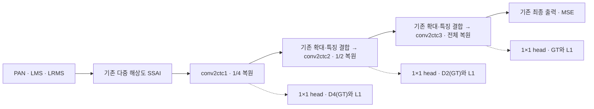
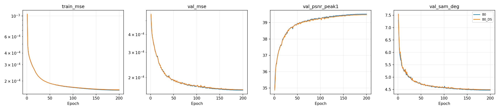
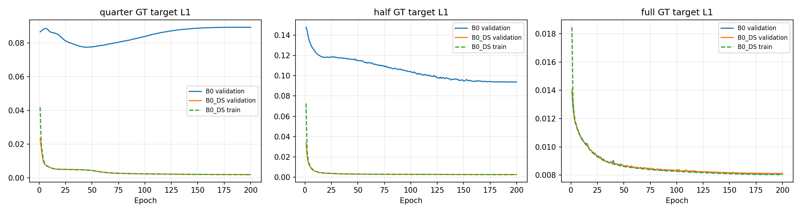
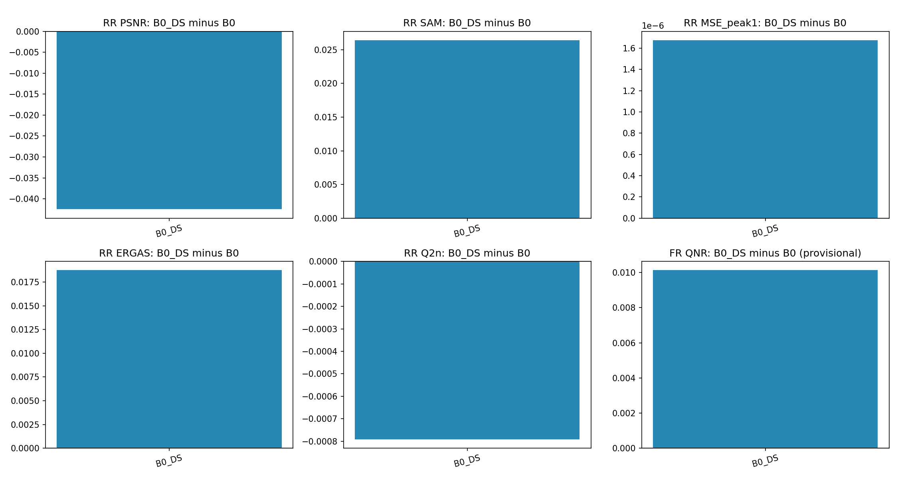
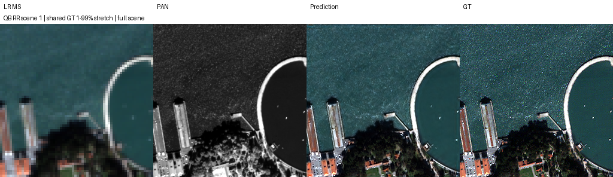
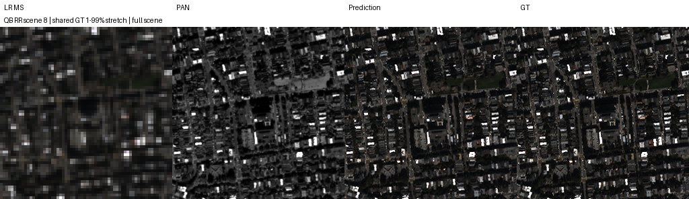
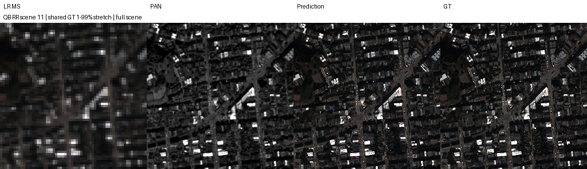
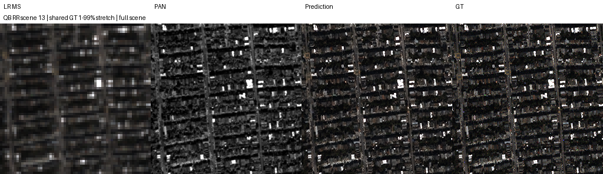
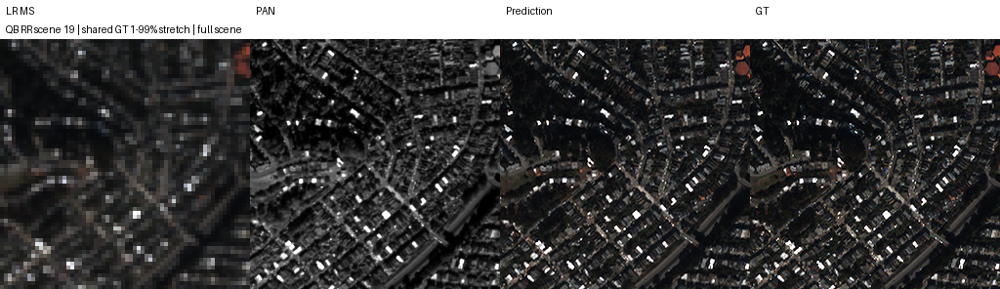

# 중간 해상도 복원 목표와 보조 손실

**변경 내용:** 원본 SSA-MRN의 1/4·1/2·전체 해상도 복원 지점에 학습용 1×1 출력 head를 붙이고, GT만으로 만든 해상도별 목표에 작은 L1 손실을 추가했습니다. 기존 복원 경로와 최종 출력은 유지했습니다.

| 확인된 결과 | 상태 | 개선 여부 |
|---|:---:|:---:|
| 후보−B0: RR PSNR −0.042514 dB, SAM +0.026407°, MSE +1.67355835e−6; 잠정 FR QNR +0.010130입니다. 중간 head의 GT 오차는 크게 줄었지만 최종 validation·RR은 악화했습니다. | 평가&nbsp;완료 | 부분&nbsp;개선 |

[실험 목록](../../../README.md#experiments) · [수치](#results) · [그래프](#graphs) · [이미지](#images) · [재현 자료](#evidence)

## 1. 목적과 상태

최종 출력에만 주어지던 복원 목표를 중간 해상도에도 부여하면 마지막 단계의 오류를 줄일 수 있는지 확인했습니다. 실험자는 **김윤지**입니다. **기준 B0와 보조 지도 후보 B0_DS를 각각 200에포크 학습했고, 각 모델의 validation best로 RR 20장·FR 20장 전체 평가를 완료했습니다.** 보관한 결과를 확인한 날짜는 **2026-10-13 KST**입니다. 제공된 결과에 Notebook Version ID와 정확한 학습·평가 종료 시각은 없습니다.

이 실험은 Haar 구조 교체나 B1/B2 반복 피드백을 추가하는 실험이 아닙니다. 원래 피라미드에서 복원 결과를 읽는 작은 head와 학습 신호만 추가했습니다. 목표가 너무 강하면 최종 디테일을 제한할 수 있어 보조 계수를 작게 시작했지만, 작은 계수가 실제 영향도 작다는 것을 보장하지는 않습니다.

제공된 원본 147개 파일의 크기·SHA-256, ZIP CRC, 실제 200개 에포크 기록, validation best 선택, 장면별 평균·차이를 대조했습니다. 원본 best/latest와 첫 100에포크 best를 합친 **6개 checkpoint의 strict load·CPU 유한값 추론**도 확인했습니다. 합성 64×64 입력에서 현행 import를 사용하는 모델과 학습 당시 원본 모델의 출력은 각 가중치에서 bitwise로 일치했습니다. 이 검사는 제공된 증거의 정합성 확인이며, 원본 H5의 전체 지표를 다시 계산한 검사는 아닙니다. [검증 기록](results/verification.json)에 범위를 구분했습니다.

## 2. 변경한 구조와 비교 조건

### 기존 복원 경로와 변경 위치

기준은 PAN·LMS·원래 LRMS를 입력받는 원본 SSA-MRN의 **단일 forward**입니다. 전체·1/2·1/4 해상도의 SSAI 특징을 만든 뒤 작은 크기부터 `conv2ctc1` → `conv2ctc2` → `conv2ctc3`으로 MS를 복원합니다. 세 복원 지점은 이미 4밴드 출력이므로 각각 `Conv2d(4,4,1)`로 읽었습니다. 세 head를 합친 추가 parameter는 **60개**입니다.



점선은 학습용 보조 readout입니다. head 출력을 다음 단계로 되돌리지 않으며, 기본 inference에서는 보조 head를 실행하지 않습니다. 최종 예측은 원래 `conv2ctc3` 출력입니다. 원래 bilinear 확대·축소의 `align_corners=True`, 입력, SSAI, 잔차·특징 결합을 그대로 유지했습니다. error encoder·α·공유 3회 반복·관측 feedback은 추가하지 않았습니다.

| 모델 | 같은 구조에서 바꾼 학습 신호 | 보조 head |
|---|---|---|
| B0 | 최종 출력 MSE만 사용했습니다. | 동일한 identity 초기값을 두고 학습하지 않았습니다. |
| B0_DS | 최종 MSE에 1/4·1/2·전체 readout의 GT L1을 추가했습니다. | 같은 초기값에서 보조 손실로 학습했습니다. |

\[
L=\operatorname{MSE}(X_{final},Y)
+0.005\operatorname{mean}|H_{1/4}(X_{1/4})-D_4(Y)|
+0.005\operatorname{mean}|H_{1/2}(X_{1/2})-D_2(Y)|
+0.001\operatorname{mean}|H_1(X_{final})-Y|.
\]

각 항은 batch·밴드·공간의 mean입니다. 최종 MSE와 L1의 단위·크기는 다르므로 계수만 비교하지 않습니다. 후보 best epoch의 실제 train MSE는 0.000160773621, 전체 objective는 0.000190846106으로, weighted auxiliary 항의 합은 final MSE의 약 **18.70%**였습니다. 이는 손실값의 비율이며 gradient 크기의 비율은 아닙니다.

### GT 축소의 필터와 좌표

**입력 LRMS를 GT의 wavelet LL로 취급하지 않았습니다.** 보조 목표는 정규화된 full GT에서 직접 만들었습니다.

| 목표 | 고정 필터 | 샘플링·경계 |
|---|---|---|
| 1/2, D2(Y) | 양 축의 `[1,4,6,4,1]/16` separable FIR | M=N/2, 좌표 `j*(N−1)/(M−1)`; replicate |
| 1/4, D4(Y) | 양 축의 `comb(16,i)/65536`, i=0…16 separable FIR | M=N/4, 같은 endpoint 좌표; replicate |
| 전체, D1(Y) | identity | 원래 GT 픽셀 |

필터는 대칭·양수·unit sum이고, FP32 필터링 뒤 bilinear `align_corners=True`로 sampling했습니다. quarter target은 full GT에서 직접 만들며 half target을 다시 축소하지 않았습니다. 이 필터는 명시한 합성 지도 목표입니다. 데이터셋 제작 연산이나 실측 QB MTF와 같다고 가정하지 않았습니다. [GT target 설정](provenance/gt_target_spec.json)에 계수·좌표를 보존했습니다.

### 공통 조건

| 항목 | 실제 조건 |
|---|---|
| 데이터 | QB, PAN 1·MS 4밴드, DN/2047; train 17,139 / validation 1,905 패치; RR 20·FR 20장 |
| 크기 | train/val HR 64×64·MS 16×16; RR HR 256×256·MS 64×64; FR HR 512×512·MS 128×128 |
| 구조·학습량 | K=4, 단일 원본 복원, seed=42, 각 200에포크 |
| 배치·optimizer | effective=micro=32, 마지막 불완전 batch 포함; Adam fused=True, betas=(0.9,0.999), eps=1e−8, weight_decay=0 |
| 학습률 | 첫 100에포크 lr=1e−4 고정, 이후 100에포크 cosine→1e−6 |
| 장치·환경 | T4×2, GPU0=B0 / GPU1=B0_DS; PyTorch 2.11.0+cu128, CUDA 12.8, Python 3.13.15 |
| 수치 | AMP FP16+GradScaler·channels-last 학습; validation/test FP32; deterministic=True, TF32=False, cuDNN benchmark=False |
| 공급·저장 | train/val 전체 FP32 GPU 상주, GPU randperm·index_select; 약 60초 batch 경계 및 epoch checkpoint |
| 선택 | 최종 FP32 validation MSE의 엄격한 감소만으로 best를 선택했습니다. 보조 L1·test로 선택하지 않았습니다. |
| 입력·평가 | H5 PAN/LMS/MS 그대로 사용, full-scene 평가, crop·재정합·예측 clipping을 추가하지 않았습니다. |

공통 core와 세 head를 포함한 초기 state 해시가 일치했고, 두 모델의 **200개 epoch sample-order 해시가 모두 일치**했습니다. 같은 seed의 GPU generator로 실제 순서를 만들었습니다. 최종 평가에는 각 모델의 epoch 199 best를 사용했으며 epoch 200 latest로 바꾸지 않았습니다.

<a id="results"></a>

## 3. 정량 결과

validation은 1,905개 패치의 최종 출력입니다. 각 모델의 validation 최저 epoch에서 비교했습니다. PSNR은 peak1의 패치별 밴드 평균, SAM은 유효 픽셀의 도 단위 평균입니다.

| 모델 | Best epoch | Validation MSE ↓ | Validation PSNR dB ↑ | Validation SAM ° ↓ |
|---|---:|---:|---:|---:|
| B0 | 199 | 0.000163158678 | 39.520714 | 4.473192 |
| B0_DS | 199 | 0.000164612633 | 39.478661 | 4.496062 |
| 후보−B0 | — | **+1.45395461e−6** | **−0.042053** | **+0.022871** |

다음은 validation에서 실제 측정한 **보조 head 출력의** GT L1입니다. B0 head는 identity로 학습하지 않았고, 후보 head는 학습했습니다.

| 해상도별 readout | B0 | B0_DS | 상대 변화 |
|---|---:|---:|---:|
| 1/4 GT L1 ↓ | 0.089314558 | 0.001900679 | **−97.87%** |
| 1/2 GT L1 ↓ | 0.093843706 | 0.002556520 | **−97.28%** |
| 전체 GT L1 ↓ | 0.008086769 | 0.008113921 | **+0.34%** |

RR·FR는 각 split의 **20장 산술평균**입니다. RR PSNR은 peak2047의 밴드 평균, MSE는 peak1 정규화 원소 MSE, SAM은 도 단위입니다. FR에는 HR GT가 없습니다. FR Dλ·Ds·QNR은 MATLAB 대응이 미검증인 잠정 지표입니다.

| 모델 | RR PSNR dB ↑ | RR SAM ° ↓ | RR MSE peak1 ↓ | RR ERGAS ↓ | RR SCC ↑ | RR Q2n ↑ |
|---|---:|---:|---:|---:|---:|---:|
| B0 | 37.629230 | 4.834539 | 0.000205115101 | 4.024698 | 0.978145 | 0.925898 |
| B0_DS | 37.586716 | 4.860947 | 0.000206788659 | 4.043441 | 0.977964 | 0.925107 |
| 후보−B0 | **−0.042514** | **+0.026407** | **+1.67355835e−6** | +0.018743 | −0.000182 | −0.000791 |

| 잠정 FR 지표 | B0 | B0_DS | 후보−B0 |
|---|---:|---:|---:|
| Dλ ↓ | 0.053576532 | 0.045695758 | **−0.007880774** |
| Ds ↓ | 0.045632963 | 0.043079500 | **−0.002553463** |
| QNR ↑ | 0.903297335 | 0.913427339 | **+0.010130004** |

후보의 validation MSE는 **0.891%**, RR MSE는 **0.816%** 증가했습니다. RR PSNR·MSE는 각각 2장 개선·18장 악화, SAM은 1장 개선·19장 악화했습니다. FR QNR은 18장 개선·2장 악화, Dλ는 20장 모두 개선, Ds는 14장 개선·6장 악화했습니다. 평균 이득과 모든 장면의 이득을 구분했습니다.

[원본 전체 결과](provenance/results.json) · [동일 seed 평균 차이](provenance/paired_comparison.json) · [검증·장면별 개선 수](results/verification.json) · [B0 RR](results/B0/RR_per_scene.json) / [후보 RR](results/B0_DS/RR_per_scene.json) · [B0 FR](results/B0/FR_per_scene.json) / [후보 FR](results/B0_DS/FR_per_scene.json)

## 4. 기준선 대비 차이와 해석

주된 비교는 이번 실행의 **B0_DS−B0**입니다. 중간 readout의 GT 목표는 훨씬 잘 맞췄지만, 최종 validation·RR의 주요 지표는 모두 악화했습니다. 따라서 중간 지도가 최종 복원 오류를 줄인다는 초기 가설은 이번 조건에서 확인하지 못했습니다. 잠정 FR 왜곡은 감소했으므로 결과 판정은 부분 개선입니다.

특히 중간 L1 감소에는 **학습한 1×1 head의 변환 효과가 포함**됩니다. 이를 원래 `conv2ctc1/2` raw 출력 오차가 같은 폭으로 줄었다고 해석하지 않습니다. raw 중간 출력의 GT 오차는 별도로 기록되지 않았습니다. 중간 목표를 학습한 사실과 최종 복원 품질이 좋아진 사실을 구분해야 합니다.

[직전 보정 계수 제한 실험](../24_alpha_bounded_shared_reconstruction/README.md)은 공유 3단계 B1·100에포크·고정 학습률을 비교했습니다. 이번 실험은 단일 B0·200에포크·후반 cosine이며 바꾼 요소도 다릅니다. 직전 실험과의 직접 ΔPSNR/SAM/MSE는 **N/A**로 두고, 위 표의 같은 실행 B0 차이만 손실 효과의 대조군으로 사용했습니다. 과거 모델을 이번 baseline 대신 가져오거나 과거 조건을 200에포크 결과로 표시하지 않았습니다.

FR에는 GT가 없고 QNR 자체도 잠정 값입니다. FR 이득으로 실제 고해상도 디테일의 정답 정확도를 보증하지 않습니다. test를 본 뒤 계수·epoch·best를 다시 선택하지 않았습니다.

<a id="graphs"></a>

## 5. 학습·평가 그래프

실제 200개 epoch의 train MSE와 validation MSE·PSNR·SAM입니다. [B0 history](results/B0/history.json)와 [후보 history](results/B0_DS/history.json)를 checkpoint 내부 기록과 대조했습니다. 없는 epoch를 추정하지 않았습니다.



중간 readout L1은 크게 줄지만 전체 해상도 readout·최종 출력의 이득으로 이어지지 않았습니다. baseline의 train auxiliary term=0은 비활성이며 실제 오차=0이 아닙니다. 아래 baseline 곡선은 validation에서 실제 측정한 값입니다.



최종 test 변화는 RR 저하와 잠정 FR QNR 상승이 엇갈립니다.



학습 루프와 validation의 누적 시간은 B0 **89.32분**, 후보 **96.41분**으로 후보가 약 **7.94%** 길었습니다. 주기 recovery 저장은 포함하지만 epoch 끝 저장·bootstrap·test·포장은 제외한 범위입니다. session 기록의 cache·benchmark·학습·저장·test 시간은 각각 **90.62분·97.74분**입니다. 독립 GPU에서 병렬 실행했으므로 두 시간을 더해 전체 wall time으로 쓰지 않았습니다.

기본 inference는 보조 head를 건너뜁니다. 제공된 RR 평균 inference는 25.58→23.92 ms, FR은 84.04→83.27 ms였지만, 고정 GPU 배정의 한 실행이므로 이를 보조 손실의 속도 개선으로 판단하지 않습니다. GPU 교환 반복이나 별도 latency benchmark는 하지 않았습니다.

<a id="images"></a>

## 6. 결과 이미지

학습 전에 seed42로 고정한 zero-based H5 row **1, 8, 11, 13, 19**를 full-scene·오름차순으로 표시했습니다. [선택 기록](provenance/selection.json)에 seed·scene ID·tile·순서를 보존했습니다. 결과를 보고 장면을 바꾸지 않았습니다.

아래는 후보 B0_DS의 **LR MS · PAN 입력 · 예측 · 정답** 4패널입니다. RGB [2,1,0]을 표시 가정으로 사용하고, 같은 장면의 LR MS·예측·GT에 GT 1-99% 대비를 공통 적용했습니다. LR은 최근접 확대, PAN은 별도 회색조 대비를 사용했습니다. 두 모델 각각의 5장면 원본을 모두 보관했으며 본문에는 후보만 표시합니다. FR에는 GT를 생성하지 않았습니다.

### 고정 장면 1



<details>
<summary>나머지 고정 장면 8·11·13·19</summary>

### 고정 장면 8



### 고정 장면 11



### 고정 장면 13



### 고정 장면 19



</details>

<a id="evidence"></a>

## 7. 재현 자료

실제 학습한 원본 checkpoint를 내용 변경 없이 보존했습니다. best는 두 모델 모두 epoch 199이며, latest는 200입니다. 첫 100에포크 구간의 실제 validation winner인 epoch 99도 별도로 남겼습니다.

| 모델 | Best 원본 | Epoch | Latest 원본 | Epoch | 첫 구간 best |
|---|---|---:|---|---:|---|
| B0 | [best.pt](checkpoints/B0_QB_s42/best.pt) | 199 | [latest.pt](https://github.com/BIYONGHIYON/CtrS/releases/download/weights-research-performance-25/checkpoints__B0_QB_s42__latest.pt) | 200 | [epoch 99](checkpoints/B0_QB_s42/best_first100.pt) |
| B0_DS | [best.pt](checkpoints/B0_DS_QB_s42/best.pt) | 199 | [latest.pt](https://github.com/BIYONGHIYON/CtrS/releases/download/weights-research-performance-25/checkpoints__B0_DS_QB_s42__latest.pt) | 200 | [epoch 99](checkpoints/B0_DS_QB_s42/best_first100.pt) |

checkpoint 내부 config·optimizer·scaler·Python/NumPy/Torch CPU/CUDA RNG·batch generator·lr 진행·history를 수정하지 않았습니다. latest의 best recovery bytes는 별도 best 원본과 SHA-256이 일치했습니다. 원본 source·설정·데이터 manifest는 [provenance](provenance), 현재 파일의 크기·SHA-256은 [manifest](manifest.json), load·best·history·scene 검사와 ZIP 해시는 [verification](results/verification.json)에 보존했습니다.

[현재 모델](model.py)은 공통 기준 모델을 import하고, [학습 당시 모델·worker](provenance/code)는 원문을 보존합니다. 두 구현의 strict load·CPU 추론이 6개 checkpoint에서 bitwise로 일치했습니다. 원본 H5를 제공하지 않아 전체 RR/FR 재평가는 하지 않았습니다. 재생성 가능한 예측 배열은 Git 보관에서 제외했으며 다운로드 원본은 유지했습니다.

[run.py](run.py) 전체를 T4×2·Internet·QB dataset이 연결된 Kaggle 코드 셀 하나에 붙이면 같은 프로토콜을 실행할 수 있습니다. 실행용 셀은 학습 당시 고정 소스와 원래 model/worker를 포함합니다. 새 실행은 별도 runtime에서 시작합니다. 현재 화면에는 해당 epoch만 표시하고, 실측 진행률·메모리·KST ETA를 갱신합니다. 재개는 동일 소스·설정·데이터·환경의 suite와 RESUME_INPUT을 요구하며 무관한 checkpoint를 가져오지 않습니다.

Persistence의 파일 보존, Saved Output, 다운로드 복사본은 코드 저장과 별개입니다. Saved Output에 실제 checkpoint·manifest가 있는지 확인하고 새 세션의 Input에 연결해야 합니다. 삭제된 파일이 어느 보관본에도 없다면 코드로 복구할 수 없습니다. 이 보고서 작성 중에는 학습을 시작하거나 재개하지 않았습니다.

```bash
# 보존 파일 해시를 확인합니다.
python SSA-MRN/common/verify.py --experiment 25

# 공식 submodule과 환경 준비 후, 데이터 없이 strict load·CPU 추론을 확인합니다.
python SSA-MRN/common/checkpoint.py --experiment 25 --checkpoint checkpoints/B0_DS_QB_s42/best.pt

# 원본 H5를 다시 읽지 않고 보존 결과 정합성과 가중치 6개를 검사합니다.
python SSA-MRN/research/performance/25_multiscale_supervision/prepare.py --output /new/path/verification.json
```

해시 확인, 원본 가중치 load, 저장된 수치의 대조는 실제 H5 성능 재평가와 별개입니다. CPU 검사를 T4의 학습·AMP·중단 재개 일치 검사로 확대하지 않습니다.

원격 결과 commit의 **변경 파일 83개 Git blob ID·크기가 일치**했습니다. 원본 checkpoint 6개를 GitHub에서 다시 내려받아 SHA-256·ZIP CRC·strict load·합성 입력의 CPU 유한값 추론을 확인했습니다. 다운로드한 latest의 best recovery bytes도 원래 best와 일치했습니다. [원격 보관 검증](results/remote_verification.json)에 대상 결과 commit과 검증 범위를 기록했습니다. 후속 metadata commit은 이 기록을 추가하며, 실제 T4 학습 재개까지 확인했다고 주장하지 않습니다. 다운로드 원본과 다른 실험 폴더는 유지했습니다.

## 8. 개선 여부와 다음 단계

**부분 개선이며 기준 모델 대체는 보류합니다.** 중간 head의 목표 오차를 줄이는 데는 성공했지만, 최종 validation과 RR 지표는 낮아졌습니다. 잠정 FR 왜곡 개선만으로 원래 목표인 최종 복원 개선을 달성했다고 판단하지 않습니다.

중간 지도가 과도하게 디테일을 제한했는지, head가 목표 변환을 대신 학습했는지, 단일 seed 변동인지는 이번 기록만으로 구분할 수 없습니다. 다음 확인은 validation에서 raw 중간 출력과 head 출력의 오차를 분리하고 final/auxiliary gradient 규모를 측정하는 것입니다. 계수 축소·감쇠와 full 보조 항의 필요성은 별도 대조 실험으로 확인하며 현재 test 결과로 설정을 다시 고르지 않습니다.

QB 단일 seed, 고정 GPU 배정, 같은 test split의 반복 연구라는 한계가 있습니다. FR에 HR GT가 없으며 QNR·Q2n·SCC의 MATLAB 대응도 미검증입니다. 반복 seed·다른 센서 검증 전 보조 손실의 일반적인 효과를 확정하지 않습니다.
