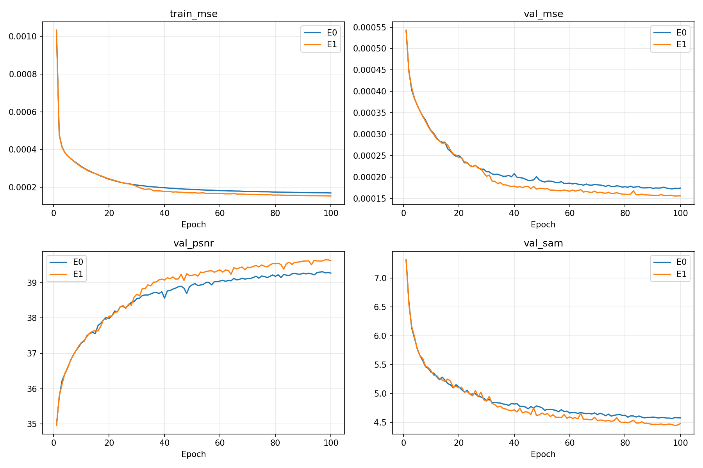
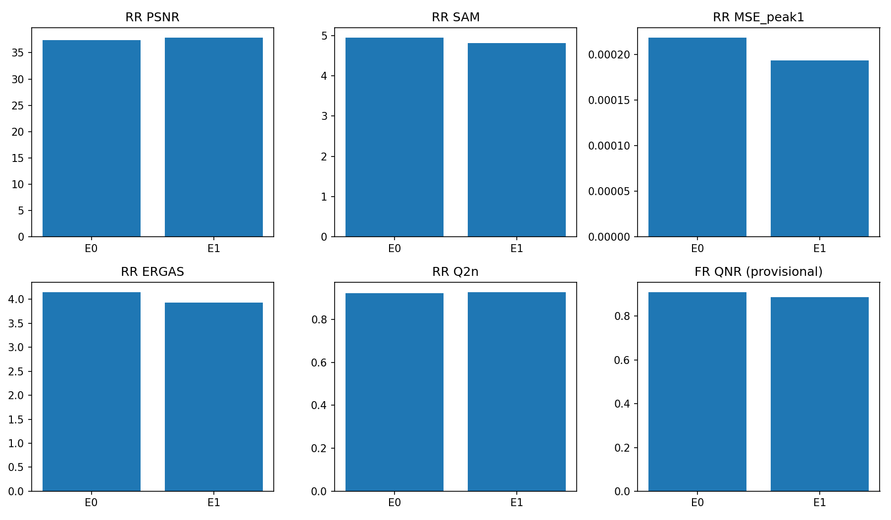
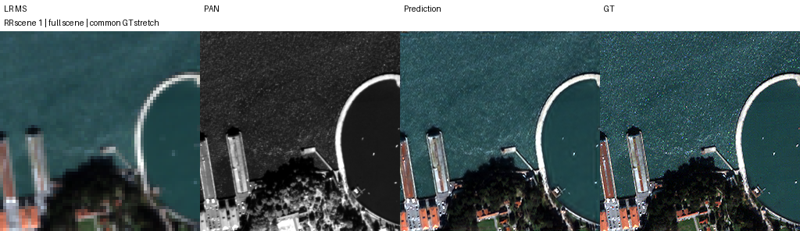
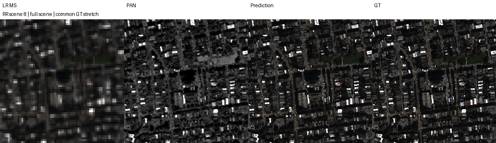
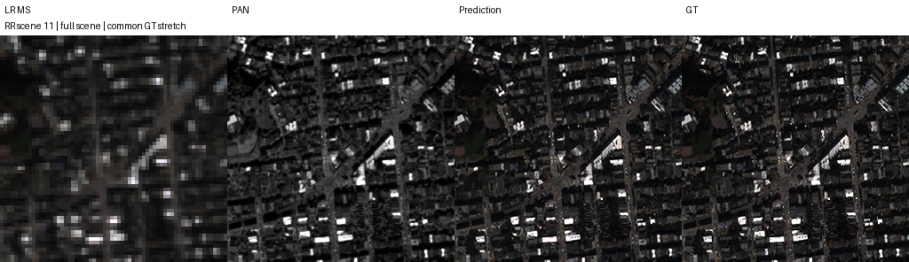
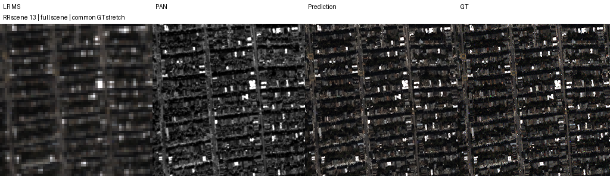
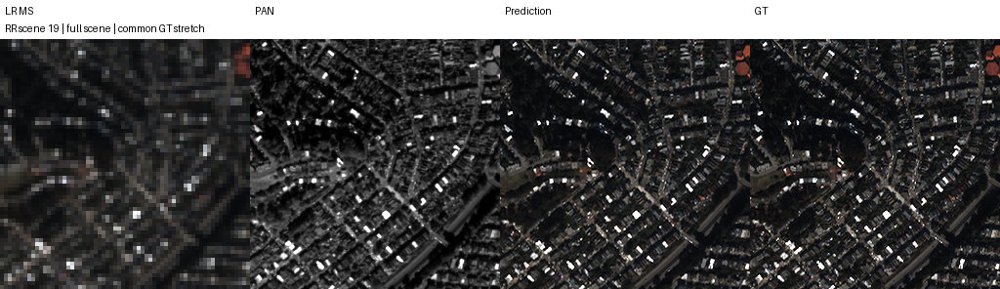

# Backbone 채널 어텐션 추가

**변경 내용:** 원본 SSA-MRN의 Backbone 잔차 블록 4개에 채널 어텐션을 추가했습니다. 초기 LRPAN과 기존 SSAI는 유지했습니다.

| 확인된 결과 | 상태 | 개선 여부 |
|---|:---:|:---:|
| 단일 시드에서 RR 지표가 개선됐으나 잠정 FR QNR은 하락했습니다. | 평가 완료 | 부분 개선 |

## 1. 목적과 상태

Backbone에서 채널별 중요도를 조절했을 때 복원 성능이 개선되는지 확인했습니다.
E0와 E1 모두 100 epoch 학습과 RR 20장면·FR 20장면 평가를 완료했습니다.
원격 보관 자료의 재다운로드 및 복구 검증은 아직 완료하지 않았습니다.

## 2. 변경한 구조와 비교 조건

E0는 원본 SSA-MRN이며, E1은 동일한 구조의 Backbone 잔차 분기에 채널 어텐션을 추가한 모델입니다.

어텐션은 GAP → 64 → 4 → 64 → 2×sigmoid로 구성했습니다.
블록 출력은 x + w ⊙ r이며, 마지막 투영을 0으로 초기화했습니다.
초기 LRPAN, 기존 SSAI, 보간, 손실 및 반복 복원 구조는 유지했습니다.

| 조건 | 설정 |
|---|---|
| 센서 | QuickBird |
| 내부 특징 차원 | K=4 |
| 시드 | 42 |
| 학습량·배치 | 100 epoch·microbatch 32 |
| 최적화 | fused Adam·고정 학습률 1e-4 |
| 손실 | 최종 출력 MSE |
| 정밀도 | AMP FP16·channels-last·TF32 비활성화 |
| 재현 설정 | strict deterministic |
| 가중치 선택 | FP32 validation MSE가 가장 낮은 epoch |

공통 계층의 초기 해시와 100 epoch의 데이터 순서 해시가 일치함을 확인했습니다.
Test 결과는 epoch나 설정 선택에 사용하지 않았습니다.
상세 조건은 [실험 설정](provenance/protocol.json)에 보존했습니다.

## 3. 정량 결과

| 모델 | Best epoch | Validation MSE | RR PSNR ↑ | RR SAM ↓ | RR MSE ↓ | 잠정 FR QNR ↑ |
|---|---:|---:|---:|---:|---:|---:|
| E0 | 97 | 0.000172096363 | 37.371084 | 4.946089 | 0.000218160682 | 0.909722 |
| E1 | 98 | 0.000155570917 | 37.851386 | 4.809228 | 0.000193513442 | 0.887091 |

E1 − E0의 RR PSNR은 +0.480302 dB, RR SAM은 −0.136862°, 잠정 FR QNR은 −0.022632였습니다.
차이는 반올림 전 결과를 기준으로 기록했습니다. RR MSE의 peak는 1입니다.

전체 지표와 장면별 결과는 [결과](results/results.json)와
[쌍별 비교](results/paired_comparison.json)에 보존했습니다.

## 4. 기준선 대비 차이와 해석

동일 조건에서 채널 어텐션 추가 효과를 비교했습니다.
E1에는 파라미터 2,320개가 추가됐으므로 파라미터 수 증가 효과를 별도로 분리한 실험은 아닙니다.
과거 보간·반복 복원·출력 디테일·보조 손실 실험은 학습 조건이 달라 직접적인 우열 비교에 한계가 있습니다.

## 5. 학습·평가 그래프

실제 학습 기록은 [E0](results/E0/history.json)와 [E1](results/E1/history.json)에 보존했습니다.

## 6. 결과 이미지

학습 전에 고정한 RR 장면 1·8·11·13·19를 표시합니다.
MS 패널에는 정답의 1-99% 대비 범위를 공통 적용했고, LR 영상은 최근접 보간으로 확대했습니다.
FR에는 고해상도 정답이 없습니다.
패널별 구성은 원본 이미지의 표기를 따릅니다.

| 장면 | E0 | E1 |
|---|---|---|
| 1 |  |  |
| 8 |  |  |
| 11 |  |  |
| 13 |  |  |
| 19 |  |  |

[장면 선택 기록](results/selection.json)

## 7. 재현 자료

- 가중치: [E0](checkpoints/E0_QB_seed42) · [E1](checkpoints/E1_QB_seed42)
- 장면별 지표: [E0](results/E0) · [E1](results/E1)
- 학습 당시 소스: [코드](provenance/code) · [실행 셀](provenance/executed_cell.py)
- 후보별 설정: [E0](provenance/E0_config.json) · [E1](provenance/E1_config.json)
- 초기화 비교: [기록](provenance/initialization_pair.json)
- 실제 업데이트 횟수: [기록](results/update_counts.json)
- 원본 보고서: [보고서](provenance/report.md)
- 원본 산출물 해시: [목록](provenance/artifact_manifest.json)

원본 산출물 해시 목록은 학습 당시 경로를 유지한 자료입니다.
현재 보관 경로·크기·SHA-256은 별도의 manifest.json으로 관리합니다.
파일 해시 확인과 성능 재평가는 별개입니다.

## 8. 개선 여부와 다음 단계

부분 개선으로 판정했습니다.
단일 시드에서 RR 개선을 확인했으나 잠정 FR 지표는 악화되어 종합 성능 우위나 최종 채택은 확정하지 않았습니다.

FR QNR과 D_s는 MATLAB과 완전히 일치하는 보간 구현이 아니며, Q2n과 SCC의 구현 일치성에도 한계가 있습니다.
Seed43은 결과 파일을 확보하지 못해 분석에 포함하지 않았습니다.
추가 시드 재현성과 FR 평가 구현의 일치성을 확인한 뒤 최종 채택 여부를 판단해야 합니다.
